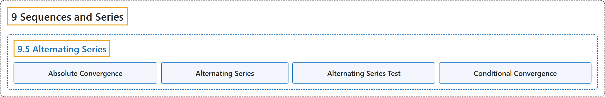

# 9.5 Alternating Series

## Classification

## Glossary

| Term | Definition | 中文翻译 | Source |
|---|---|---|---|
| **9 Sequences and Series** 数列与级数 | (No definition) | （无定义） | [Strang & Herman, 2016b, chapter 5](https://openstax.org/books/calculus-volume-2/pages/5-introduction) |
| **9.5 Alternating Series** 交错级数 | (No definition) | （无定义） | [Strang & Herman, 2016b, section 5.5](https://openstax.org/books/calculus-volume-2/pages/5-5-alternating-series) |
| **Absolute Convergence** 绝对收敛 | "if the series $\sum_{n=1}^{\infty }\vert a_{n}\vert$ converges, the series $\sum_{n=1}^{\infty }a_{n}$ is said to **converge absolutely**" | 若级数 $\sum_{n=1}^{\infty }\vert a_{n}\vert$ 收敛，就说级数 $\sum_{n=1}^{\infty }a_{n}$ **绝对收敛** | [Strang & Herman, 2016b, chapter 5 Key Terms](https://openstax.org/books/calculus-volume-2/pages/5-key-terms#fs-id1169738193975) |
| **Alternating Series** 交错级数 | "a series of the form $\sum_{n=1}^{\infty }(-1)^{n+1}b_{n}$ or $\sum_{n=1}^{\infty }(-1)^{n}b_{n},$ where $b_{n}\ge 0,$ **is called an alternating series**" | 形如 $\sum_{n=1}^{\infty }(-1)^{n+1}b_{n}$ 或 $\sum_{n=1}^{\infty }(-1)^{n}b_{n},$ 的级数，其中 $b_{n}\ge 0,$ **称为交错级数** | [Strang & Herman, 2016b, chapter 5 Key Terms](https://openstax.org/books/calculus-volume-2/pages/5-key-terms#fs-id1169738110013) |
| **Alternating Series Test** 交错级数检验 | "for an alternating series of either form, if $b_{n+1}\le b_{n}$ for all integers $n\ge 1$ and $b_{n}\to 0,$ then **an alternating series converges**" | 对两种形式之一的交错级数，若对所有整数 $n\ge 1$ 有 $b_{n+1}\le b_{n}$ 且 $b_{n}\to 0,$ 则**交错级数收敛** | [Strang & Herman, 2016b, chapter 5 Key Terms](https://openstax.org/books/calculus-volume-2/pages/5-key-terms#fs-id1169738110115) |
| **Conditional Convergence** 条件收敛 | "if the series $\sum_{n=1}^{\infty }a_{n}$ converges, but the series $\sum_{n=1}^{\infty }\vert a_{n}\vert$ diverges, the series $\sum_{n=1}^{\infty }a_{n}$ is said to **converge conditionally**" | 若级数 $\sum_{n=1}^{\infty }a_{n}$ 收敛，但级数 $\sum_{n=1}^{\infty }\vert a_{n}\vert$ 发散，就说级数 $\sum_{n=1}^{\infty }a_{n}$ **条件收敛** | [Strang & Herman, 2016b, chapter 5 Key Terms](https://openstax.org/books/calculus-volume-2/pages/5-key-terms#fs-id1169738040638) |

## References

Strang, G., & Herman, E. (2016b). *Calculus volume 2*. OpenStax. Retrieved October 29, 2026, from <https://openstax.org/details/books/calculus-volume-2>
