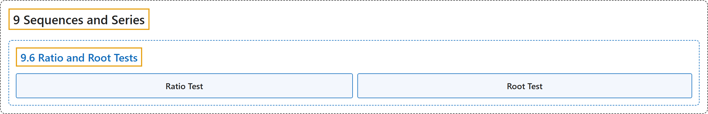

# 9.6 Ratio and Root Tests

## Classification

## Glossary

| Term | Definition | 中文翻译 | Source |
|---|---|---|---|
| **9 Sequences and Series** 数列与级数 | (No definition) | （无定义） | [Strang & Herman, 2016b, chapter 5](https://openstax.org/books/calculus-volume-2/pages/5-introduction) |
| **9.6 Ratio and Root Tests** 比值检验与根值检验 | (No definition) | （无定义） | [Strang & Herman, 2016b, section 5.6](https://openstax.org/books/calculus-volume-2/pages/5-6-ratio-and-root-tests) |
| **Ratio Test** 比值检验 | "for a series $\sum_{n=1}^{\infty }a_{n}$ with nonzero terms, let $\rho =\lim_{n\to \infty }\vert a_{n+1}/a_{n}\vert ;$ if $0\le \rho <1,$ **the series converges absolutely**; if $\rho >1,$ **the series diverges**; if $\rho =1,$ **the test is inconclusive**" | 对非零项的级数 $\sum_{n=1}^{\infty }a_{n}$，令 $\rho =\lim_{n\to \infty }\vert a_{n+1}/a_{n}\vert ;$ 若 $0\le \rho <1,$ **级数绝对收敛**；若 $\rho >1,$ **级数发散**；若 $\rho =1,$ **检验无法判定** | [Strang & Herman, 2016b, chapter 5 Key Terms](https://openstax.org/books/calculus-volume-2/pages/5-key-terms#fs-id1169736845011) |
| **Root Test** 根值检验 | "for a series $\sum_{n=1}^{\infty }a_{n},$ let $\rho =\lim_{n\to \infty }\sqrt[n]{\vert a_{n}\vert };$ if $0\le \rho <1,$ **the series converges absolutely**; if $\rho >1,$ **the series diverges**; if $\rho =1,$ **the test is inconclusive**" | 对级数 $\sum_{n=1}^{\infty }a_{n},$ 令 $\rho =\lim_{n\to \infty }\sqrt[n]{\vert a_{n}\vert };$ 若 $0\le \rho <1,$ **级数绝对收敛**；若 $\rho >1,$ **级数发散**；若 $\rho =1,$ **检验无法判定** | [Strang & Herman, 2016b, chapter 5 Key Terms](https://openstax.org/books/calculus-volume-2/pages/5-key-terms#fs-id1169736845132) |

## References

Strang, G., & Herman, E. (2016b). *Calculus volume 2*. OpenStax. Retrieved October 29, 2026, from <https://openstax.org/details/books/calculus-volume-2>
