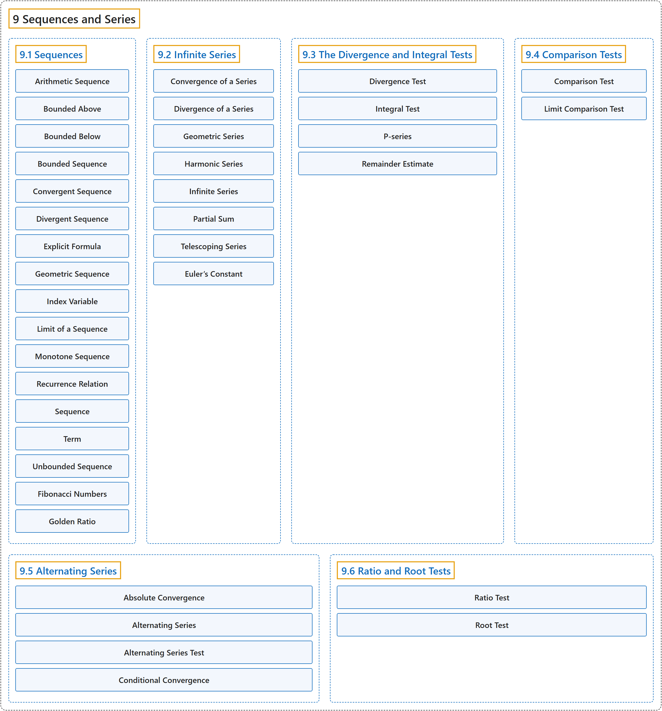

# 9 Sequences and Series

## Classification

## Glossary

| Term | Definition | 中文翻译 | Source |
|---|---|---|---|
| **9 Sequences and Series** 数列与级数 | (No definition) | （无定义） | [Strang & Herman, 2016b, chapter 5](https://openstax.org/books/calculus-volume-2/pages/5-introduction) |
| **[9.1 Sequences](9-1-sequences.md)** 数列 | (No definition) | （无定义） | [Strang & Herman, 2016b, section 5.1](https://openstax.org/books/calculus-volume-2/pages/5-1-sequences) |
| **[9.2 Infinite Series](9-2-infinite-series.md)** 无穷级数 | (No definition) | （无定义） | [Strang & Herman, 2016b, section 5.2](https://openstax.org/books/calculus-volume-2/pages/5-2-infinite-series) |
| **[9.3 The Divergence and Integral Tests](9-3-the-divergence-and-integral-tests.md)** 发散检验与积分检验 | (No definition) | （无定义） | [Strang & Herman, 2016b, section 5.3](https://openstax.org/books/calculus-volume-2/pages/5-3-the-divergence-and-integral-tests) |
| **[9.4 Comparison Tests](9-4-comparison-tests.md)** 比较检验 | (No definition) | （无定义） | [Strang & Herman, 2016b, section 5.4](https://openstax.org/books/calculus-volume-2/pages/5-4-comparison-tests) |
| **[9.5 Alternating Series](9-5-alternating-series.md)** 交错级数 | (No definition) | （无定义） | [Strang & Herman, 2016b, section 5.5](https://openstax.org/books/calculus-volume-2/pages/5-5-alternating-series) |
| **[9.6 Ratio and Root Tests](9-6-ratio-and-root-tests.md)** 比值检验与根值检验 | (No definition) | （无定义） | [Strang & Herman, 2016b, section 5.6](https://openstax.org/books/calculus-volume-2/pages/5-6-ratio-and-root-tests) |

## References

Strang, G., & Herman, E. (2016b). *Calculus volume 2*. OpenStax. Retrieved October 29, 2026, from <https://openstax.org/details/books/calculus-volume-2>
