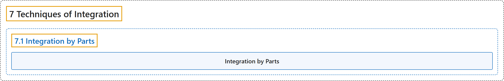

# 7.1 Integration by Parts

## Classification

## Glossary

| Term | Definition | 中文翻译 | Source |
|---|---|---|---|
| **7 Techniques of Integration** 积分技巧 | (No definition) | （无定义） | [Strang & Herman, 2016b, chapter 3](https://openstax.org/books/calculus-volume-2/pages/3-introduction) |
| **7.1 Integration by Parts** 分部积分 | (No definition) | （无定义） | [Strang & Herman, 2016b, section 3.1](https://openstax.org/books/calculus-volume-2/pages/3-1-integration-by-parts) |
| **Integration by Parts** 分部积分 | "a technique of integration that allows **the exchange of one integral for another** using the formula $\int u\,dv=uv-\int v\,du$" | 一种积分方法，用公式 $\int u\,dv=uv-\int v\,du$ **把一个积分换成另一个积分** | [Strang & Herman, 2016b, chapter 3 Key Terms](https://openstax.org/books/calculus-volume-2/pages/3-key-terms#fs-id1165040639374) |

## References

Strang, G., & Herman, E. (2016b). *Calculus volume 2*. OpenStax. Retrieved October 29, 2026, from <https://openstax.org/details/books/calculus-volume-2>
