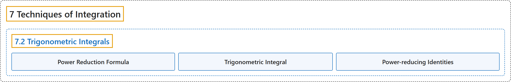

# 7.2 Trigonometric Integrals

## Classification

## Glossary

| Term | Definition | 中文翻译 | Source |
|---|---|---|---|
| **7 Techniques of Integration** 积分技巧 | (No definition) | （无定义） | [Strang & Herman, 2016b, chapter 3](https://openstax.org/books/calculus-volume-2/pages/3-introduction) |
| **7.2 Trigonometric Integrals** 三角积分 | (No definition) | （无定义） | [Strang & Herman, 2016b, section 3.2](https://openstax.org/books/calculus-volume-2/pages/3-2-trigonometric-integrals) |
| **Power Reduction Formula** 降幂公式 | "a rule that allows an integral of a power of a trigonometric function to be exchanged for **an integral involving a lower power**" | 一条法则，可以把三角函数某次幂的积分换成**含更低次幂的积分** | [Strang & Herman, 2016b, chapter 3 Key Terms](https://openstax.org/books/calculus-volume-2/pages/3-key-terms#fs-id1165042832379) |
| **Trigonometric Integral** 三角积分 | "an integral involving **powers and products of trigonometric functions**" | 含**三角函数的幂与乘积**的积分 | [Strang & Herman, 2016b, chapter 3 Key Terms](https://openstax.org/books/calculus-volume-2/pages/3-key-terms#fs-id1165042832387) |
| **Power-reducing Identities** 降幂恒等式 | "These identities are sometimes known as **power-reducing identities** and they may be derived from the double-angle identity $\cos(2x)=\cos^{2}x-\sin^{2}x$ and the Pythagorean identity $\cos^{2}x+\sin^{2}x=1.$" | 这些恒等式有时称为**降幂恒等式**，可以由二倍角恒等式 $\cos(2x)=\cos^{2}x-\sin^{2}x$ 和勾股恒等式 $\cos^{2}x+\sin^{2}x=1.$ 推出 | [Strang & Herman, 2016b, section 3.2](https://openstax.org/books/calculus-volume-2/pages/3-2-trigonometric-integrals#term-00002) |

## References

Strang, G., & Herman, E. (2016b). *Calculus volume 2*. OpenStax. Retrieved October 29, 2026, from <https://openstax.org/details/books/calculus-volume-2>
