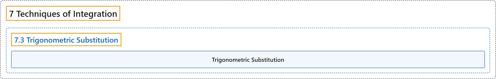

# 7.3 Trigonometric Substitution

## Classification

## Glossary

| Term | Definition | 中文翻译 | Source |
|---|---|---|---|
| **7 Techniques of Integration** 积分技巧 | (No definition) | （无定义） | [Strang & Herman, 2016b, chapter 3](https://openstax.org/books/calculus-volume-2/pages/3-introduction) |
| **7.3 Trigonometric Substitution** 三角换元 | (No definition) | （无定义） | [Strang & Herman, 2016b, section 3.3](https://openstax.org/books/calculus-volume-2/pages/3-3-trigonometric-substitution) |
| **Trigonometric Substitution** 三角换元 | "an integration technique that converts an algebraic integral containing expressions of the form $\sqrt{a^{2}-x^{2}},$ $\sqrt{a^{2}+x^{2}},$ or $\sqrt{x^{2}-a^{2}}$ **into a trigonometric integral**" | 一种积分方法，把含形如 $\sqrt{a^{2}-x^{2}},$ $\sqrt{a^{2}+x^{2}},$ 或 $\sqrt{x^{2}-a^{2}}$ 的表达式的代数积分**转化为三角积分** | [Strang & Herman, 2016b, chapter 3 Key Terms](https://openstax.org/books/calculus-volume-2/pages/3-key-terms#fs-id1165041956786) |

## References

Strang, G., & Herman, E. (2016b). *Calculus volume 2*. OpenStax. Retrieved October 29, 2026, from <https://openstax.org/details/books/calculus-volume-2>
