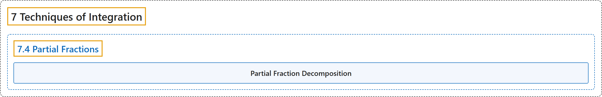

# 7.4 Partial Fractions

## Classification

## Glossary

| Term | Definition | 中文翻译 | Source |
|---|---|---|---|
| **7 Techniques of Integration** 积分技巧 | (No definition) | （无定义） | [Strang & Herman, 2016b, chapter 3](https://openstax.org/books/calculus-volume-2/pages/3-introduction) |
| **7.4 Partial Fractions** 部分分式 | (No definition) | （无定义） | [Strang & Herman, 2016b, section 3.4](https://openstax.org/books/calculus-volume-2/pages/3-4-partial-fractions) |
| **Partial Fraction Decomposition** 部分分式分解 | "a technique used to break down a rational function into **the sum of simple rational functions**" | 把有理函数分解成**简单有理函数之和**的方法 | [Strang & Herman, 2016b, chapter 3 Key Terms](https://openstax.org/books/calculus-volume-2/pages/3-key-terms#fs-id1165041981454) |

## References

Strang, G., & Herman, E. (2016b). *Calculus volume 2*. OpenStax. Retrieved October 29, 2026, from <https://openstax.org/details/books/calculus-volume-2>
