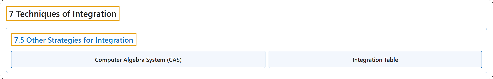

# 7.5 Other Strategies for Integration

## Classification

## Glossary

| Term | Definition | 中文翻译 | Source |
|---|---|---|---|
| **7 Techniques of Integration** 积分技巧 | (No definition) | （无定义） | [Strang & Herman, 2016b, chapter 3](https://openstax.org/books/calculus-volume-2/pages/3-introduction) |
| **7.5 Other Strategies for Integration** 其他积分策略 | (No definition) | （无定义） | [Strang & Herman, 2016b, section 3.5](https://openstax.org/books/calculus-volume-2/pages/3-5-other-strategies-for-integration) |
| **Computer Algebra System (CAS)** 计算机代数系统（CAS） | "technology used to **perform many mathematical tasks**, including integration" | 用来**完成许多数学任务**（包括积分）的技术 | [Strang & Herman, 2016b, chapter 3 Key Terms](https://openstax.org/books/calculus-volume-2/pages/3-key-terms#fs-id1165042047714) |
| **Integration Table** 积分表 | "a table that **lists integration formulas**" | **列出积分公式**的表 | [Strang & Herman, 2016b, chapter 3 Key Terms](https://openstax.org/books/calculus-volume-2/pages/3-key-terms#fs-id1165042047724) |

## References

Strang, G., & Herman, E. (2016b). *Calculus volume 2*. OpenStax. Retrieved October 29, 2026, from <https://openstax.org/details/books/calculus-volume-2>
