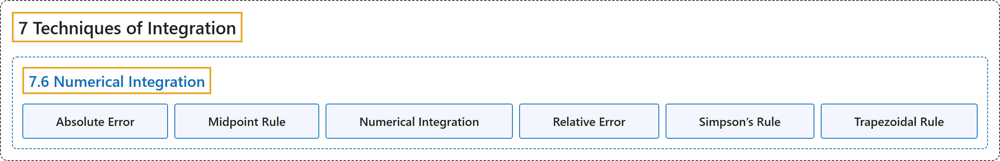

# 7.6 Numerical Integration

## Classification

## Glossary

| Term | Definition | 中文翻译 | Source |
|---|---|---|---|
| **7 Techniques of Integration** 积分技巧 | (No definition) | （无定义） | [Strang & Herman, 2016b, chapter 3](https://openstax.org/books/calculus-volume-2/pages/3-introduction) |
| **7.6 Numerical Integration** 数值积分 | (No definition) | （无定义） | [Strang & Herman, 2016b, section 3.6](https://openstax.org/books/calculus-volume-2/pages/3-6-numerical-integration) |
| **Absolute Error** 绝对误差 | "if $B$ is an estimate of some quantity having an actual value of $A,$ then **the absolute error** is given by $\vert A-B\vert$" | 若 $B$ 是某个实际值为 $A,$ 的量的估计，则**绝对误差**由 $\vert A-B\vert$ 给出 | [Strang & Herman, 2016b, chapter 3 Key Terms](https://openstax.org/books/calculus-volume-2/pages/3-key-terms#fs-id1165040778942) |
| **Midpoint Rule** 中点法则 | "a rule that uses a Riemann sum of the form $M_{n}=\sum_{i=1}^{n}f(m_{i})\Delta x,$ where $m_{i}$ **is the midpoint of the ith subinterval** to approximate ${\int }_{a}^{b}f(x)dx$" | 一条法则，用形如 $M_{n}=\sum_{i=1}^{n}f(m_{i})\Delta x,$ 的黎曼和来近似 ${\int }_{a}^{b}f(x)dx$，其中 $m_{i}$ **是第 i 个子区间的中点** | [Strang & Herman, 2016b, chapter 3 Key Terms](https://openstax.org/books/calculus-volume-2/pages/3-key-terms#fs-id1165042040454) |
| **Numerical Integration** 数值积分 | "the variety of numerical methods used to **estimate the value of a definite integral**, including the midpoint rule, trapezoidal rule, and Simpson’s rule" | 用来**估计定积分的值**的各种数值方法，包括中点法则、梯形法则和辛普森法则 | [Strang & Herman, 2016b, chapter 3 Key Terms](https://openstax.org/books/calculus-volume-2/pages/3-key-terms#fs-id1165040796205) |
| **Relative Error** 相对误差 | "**error as a percentage of the absolute value**, given by $\vert \frac{A-B}{A}\vert =\vert \frac{A-B}{A}\vert \cdot 100\%$" | **误差占绝对值的百分比**，由 $\vert \frac{A-B}{A}\vert =\vert \frac{A-B}{A}\vert \cdot 100\%$ 给出 | [Strang & Herman, 2016b, chapter 3 Key Terms](https://openstax.org/books/calculus-volume-2/pages/3-key-terms#fs-id1165040720635) |
| **Simpson’s Rule** 辛普森法则 | "a rule that approximates ${\int }_{a}^{b}f(x)dx$ using the integrals of **a piecewise quadratic function**. The approximation $S_{n}$ to ${\int }_{a}^{b}f(x)dx$ is given by $S_{n}=\frac{\Delta x}{3}\left(\begin{array}{l}f(x_{0})+4f(x_{1})+2f(x_{2})+4f(x_{3})+2f(x_{4})+4f(x_{5}) \\ +\cdots +2f(x_{n-2})+4f(x_{n-1})+f(x_{n})\end{array}\right)$" | 一条法则，用**分段二次函数**的积分近似 ${\int }_{a}^{b}f(x)dx$。对 ${\int }_{a}^{b}f(x)dx$ 的近似 $S_{n}$ 由 $S_{n}=\frac{\Delta x}{3}\left(\begin{array}{l}f(x_{0})+4f(x_{1})+2f(x_{2})+4f(x_{3})+2f(x_{4})+4f(x_{5}) \\ +\cdots +2f(x_{n-2})+4f(x_{n-1})+f(x_{n})\end{array}\right)$ 给出 | [Strang & Herman, 2016b, chapter 3 Key Terms](https://openstax.org/books/calculus-volume-2/pages/3-key-terms#fs-id1165040720689) |
| **Trapezoidal Rule** 梯形法则 | "The trapezoidal rule for estimating definite integrals **uses trapezoids rather than rectangles** to approximate the area under a curve." | 估计定积分的梯形法则**用梯形而不是矩形**来近似曲线下的面积。 | [Strang & Herman, 2016b, section 3.6](https://openstax.org/books/calculus-volume-2/pages/3-6-numerical-integration#term-00004) |

## References

Strang, G., & Herman, E. (2016b). *Calculus volume 2*. OpenStax. Retrieved October 29, 2026, from <https://openstax.org/details/books/calculus-volume-2>
