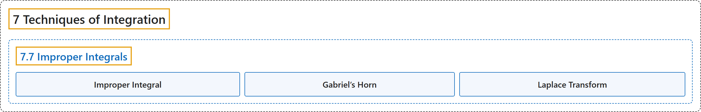

# 7.7 Improper Integrals

## Classification

## Glossary

| Term | Definition | 中文翻译 | Source |
|---|---|---|---|
| **7 Techniques of Integration** 积分技巧 | (No definition) | （无定义） | [Strang & Herman, 2016b, chapter 3](https://openstax.org/books/calculus-volume-2/pages/3-introduction) |
| **7.7 Improper Integrals** 反常积分 | (No definition) | （无定义） | [Strang & Herman, 2016b, section 3.7](https://openstax.org/books/calculus-volume-2/pages/3-7-improper-integrals) |
| **Improper Integral** 反常积分 | "**an integral over an infinite interval** or an integral of a function containing an infinite discontinuity on the interval; an improper integral is **defined in terms of a limit**. The improper integral converges if this limit is a finite real number; otherwise, the improper integral diverges" | **无穷区间上的积分**，或在区间上含无穷间断的函数的积分；反常积分**用极限来定义**。若这个极限是有限实数，反常积分收敛；否则反常积分发散 | [Strang & Herman, 2016b, chapter 3 Key Terms](https://openstax.org/books/calculus-volume-2/pages/3-key-terms#fs-id1165039564320) |
| **Gabriel’s Horn** 加百列号角 | "The solid generated is known as **Gabriel’s Horn**." | 生成的立体称为**加百列号角**。 | [Strang & Herman, 2016b, section 3.7](https://openstax.org/books/calculus-volume-2/pages/3-7-improper-integrals#term-00002) |
| **Laplace Transform** 拉普拉斯变换 | "Specifically, we describe **the Laplace transform** and some of its properties." | 具体来说，我们介绍**拉普拉斯变换**及其一些性质。 | [Strang & Herman, 2016b, section 3.7](https://openstax.org/books/calculus-volume-2/pages/3-7-improper-integrals#term-00005) |

## References

Strang, G., & Herman, E. (2016b). *Calculus volume 2*. OpenStax. Retrieved October 29, 2026, from <https://openstax.org/details/books/calculus-volume-2>
