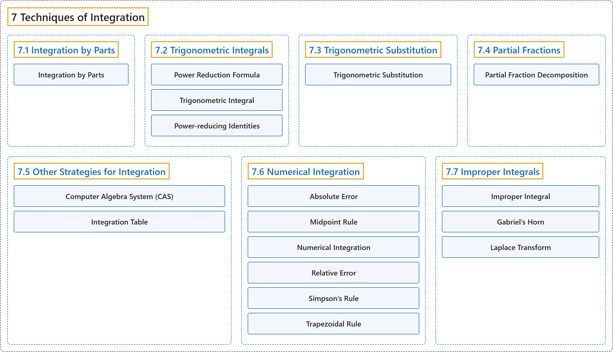

# 7 Techniques of Integration

## Classification

## Glossary

| Term | Definition | 中文翻译 | Source |
|---|---|---|---|
| **7 Techniques of Integration** 积分技巧 | (No definition) | （无定义） | [Strang & Herman, 2016b, chapter 3](https://openstax.org/books/calculus-volume-2/pages/3-introduction) |
| **[7.1 Integration by Parts](7-1-integration-by-parts.md)** 分部积分 | (No definition) | （无定义） | [Strang & Herman, 2016b, section 3.1](https://openstax.org/books/calculus-volume-2/pages/3-1-integration-by-parts) |
| **[7.2 Trigonometric Integrals](7-2-trigonometric-integrals.md)** 三角积分 | (No definition) | （无定义） | [Strang & Herman, 2016b, section 3.2](https://openstax.org/books/calculus-volume-2/pages/3-2-trigonometric-integrals) |
| **[7.3 Trigonometric Substitution](7-3-trigonometric-substitution.md)** 三角换元 | (No definition) | （无定义） | [Strang & Herman, 2016b, section 3.3](https://openstax.org/books/calculus-volume-2/pages/3-3-trigonometric-substitution) |
| **[7.4 Partial Fractions](7-4-partial-fractions.md)** 部分分式 | (No definition) | （无定义） | [Strang & Herman, 2016b, section 3.4](https://openstax.org/books/calculus-volume-2/pages/3-4-partial-fractions) |
| **[7.5 Other Strategies for Integration](7-5-other-strategies-for-integration.md)** 其他积分策略 | (No definition) | （无定义） | [Strang & Herman, 2016b, section 3.5](https://openstax.org/books/calculus-volume-2/pages/3-5-other-strategies-for-integration) |
| **[7.6 Numerical Integration](7-6-numerical-integration.md)** 数值积分 | (No definition) | （无定义） | [Strang & Herman, 2016b, section 3.6](https://openstax.org/books/calculus-volume-2/pages/3-6-numerical-integration) |
| **[7.7 Improper Integrals](7-7-improper-integrals.md)** 反常积分 | (No definition) | （无定义） | [Strang & Herman, 2016b, section 3.7](https://openstax.org/books/calculus-volume-2/pages/3-7-improper-integrals) |

## References

Strang, G., & Herman, E. (2016b). *Calculus volume 2*. OpenStax. Retrieved October 29, 2026, from <https://openstax.org/details/books/calculus-volume-2>
