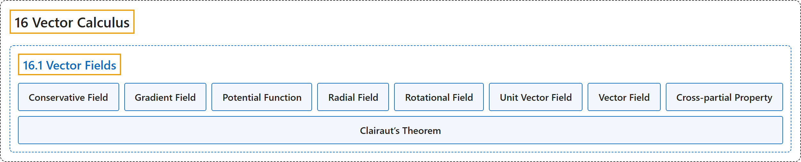

# 16.1 Vector Fields

## Classification

## Glossary

| Term | Definition | 中文翻译 | Source |
|---|---|---|---|
| **16 Vector Calculus** 向量微积分 | (No definition) | （无定义） | [Strang & Herman, 2016c, chapter 6](https://openstax.org/books/calculus-volume-3/pages/6-introduction) |
| **16.1 Vector Fields** 向量场 | (No definition) | （无定义） | [Strang & Herman, 2016c, section 6.1](https://openstax.org/books/calculus-volume-3/pages/6-1-vector-fields) |
| **Conservative Field** 保守场 | "a vector field for which **there exists a scalar function** $f$ such that $\nabla f=\text{F}$" | **存在标量函数** $f$ 使得 $\nabla f=\text{F}$ 的向量场 | [Strang & Herman, 2016c, chapter 6 Key Terms](https://openstax.org/books/calculus-volume-3/pages/6-key-terms#fs-id1167793559412) |
| **Gradient Field** 梯度场 | "a vector field $\text{F}$ for which there exists a scalar function $f$ such that $\nabla f=\text{F};$ in other words, a vector field that is **the gradient of a function**; such vector fields are also called conservative" | 存在标量函数 $f$ 使得 $\nabla f=\text{F};$ 的向量场 $\text{F}$；换句话说，是**某个函数的梯度**的向量场；这样的向量场也称为保守场 | [Strang & Herman, 2016c, chapter 6 Key Terms](https://openstax.org/books/calculus-volume-3/pages/6-key-terms#fs-id1167793735595) |
| **Potential Function** 势函数 | "**a scalar function** $f$ such that $\nabla f=\text{F}$" | 使得 $\nabla f=\text{F}$ 的**标量函数** $f$ | [Strang & Herman, 2016c, chapter 6 Key Terms](https://openstax.org/books/calculus-volume-3/pages/6-key-terms#fs-id1167793719942) |
| **Radial Field** 径向场 | "a vector field in which all vectors either **point directly toward or directly away from the origin**; the magnitude of any vector depends only on its distance from the origin" | 所有向量都**直接指向原点或直接背离原点**的向量场；任一向量的大小只取决于它到原点的距离 | [Strang & Herman, 2016c, chapter 6 Key Terms](https://openstax.org/books/calculus-volume-3/pages/6-key-terms#fs-id1167793719972) |
| **Rotational Field** 旋转场 | "a vector field in which the vector at point $(x,y)$ **is tangent to a circle** with radius $r=\sqrt{x^{2}+y^{2}};$ in a rotational field, all vectors flow either clockwise or counterclockwise, and the magnitude of a vector depends only on its distance from the origin" | 点 $(x,y)$ 处的向量**与半径为 $r=\sqrt{x^{2}+y^{2}};$ 的圆相切**的向量场；在旋转场中，所有向量都沿顺时针或逆时针流动，向量的大小只取决于它到原点的距离 | [Strang & Herman, 2016c, chapter 6 Key Terms](https://openstax.org/books/calculus-volume-3/pages/6-key-terms#fs-id1167793719984) |
| **Unit Vector Field** 单位向量场 | "a vector field in which **the magnitude of every vector is 1**" | **每个向量的大小都是 1** 的向量场 | [Strang & Herman, 2016c, chapter 6 Key Terms](https://openstax.org/books/calculus-volume-3/pages/6-key-terms#fs-id1167793776976) |
| **Vector Field** 向量场 | "measured in $\mathbb{R}^{2},$ **an assignment of a vector** $\text{F}(x,y)$ to each point $(x,y)$ of a subset $D$ of $\mathbb{R}^{2};$ in $\mathbb{R}^{3},$ an assignment of a vector $\text{F}(x,y,z)$ to each point $(x,y,z)$ of a subset $D$ of $\mathbb{R}^{3}$" | 在 $\mathbb{R}^{2},$ 中，对 $\mathbb{R}^{2};$ 的子集 $D$ 中每一点 $(x,y)$ **指定一个向量** $\text{F}(x,y)$；在 $\mathbb{R}^{3},$ 中，对 $\mathbb{R}^{3}$ 的子集 $D$ 中每一点 $(x,y,z)$ 指定一个向量 $\text{F}(x,y,z)$ | [Strang & Herman, 2016c, chapter 6 Key Terms](https://openstax.org/books/calculus-volume-3/pages/6-key-terms#fs-id1167793279228) |
| **Cross-partial Property** 交叉偏导性质 | "Conservative vector fields also have a special property called **the cross-partial property**." | 保守向量场还有一个特殊性质，称为**交叉偏导性质**。 | [Strang & Herman, 2016c, section 6.1](https://openstax.org/books/calculus-volume-3/pages/6-1-vector-fields#term-00010) |
| **Clairaut’s Theorem** 克莱罗定理 | "Clairaut’s theorem gives **a fast proof of the cross-partial property** of conservative vector fields in $\mathbb{R}^{3},$ just as it did for vector fields in $\mathbb{R}^{2}.$" | 克莱罗定理对 $\mathbb{R}^{3},$ 中的保守向量场给出了**交叉偏导性质的快速证明**，正如它对 $\mathbb{R}^{2}.$ 中的向量场所做的那样 | [Strang & Herman, 2016c, section 6.1](https://openstax.org/books/calculus-volume-3/pages/6-1-vector-fields#term-00011) |

## References

Strang, G., & Herman, E. (2016c). *Calculus volume 3*. OpenStax. Retrieved October 29, 2026, from <https://openstax.org/details/books/calculus-volume-3>
