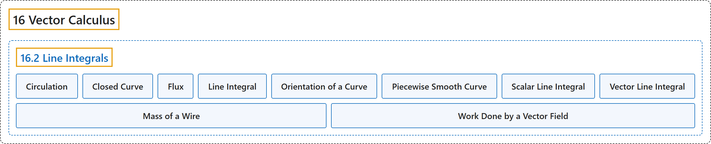

# 16.2 Line Integrals

## Classification

## Glossary

| Term | Definition | 中文翻译 | Source |
|---|---|---|---|
| **16 Vector Calculus** 向量微积分 | (No definition) | （无定义） | [Strang & Herman, 2016c, chapter 6](https://openstax.org/books/calculus-volume-3/pages/6-introduction) |
| **16.2 Line Integrals** 线积分 | (No definition) | （无定义） | [Strang & Herman, 2016c, section 6.2](https://openstax.org/books/calculus-volume-3/pages/6-2-line-integrals) |
| **Circulation** 环量 | "**the tendency of a fluid to move in the direction of curve C**. If C is a closed curve, then the circulation of F along C is line integral ${\int }_{C}\text{F}\cdot \text{T}ds,$ which we also denote ${\int }_{C}\text{F}\cdot \text{T}ds$" | **流体沿曲线 C 方向运动的趋势**。若 C 是闭曲线，则 F 沿 C 的环量是线积分 ${\int }_{C}\text{F}\cdot \text{T}ds,$ 我们也记作 ${\int }_{C}\text{F}\cdot \text{T}ds$ | [Strang & Herman, 2016c, chapter 6 Key Terms](https://openstax.org/books/calculus-volume-3/pages/6-key-terms#fs-id1167794226185) |
| **Closed Curve** 闭曲线 | "a curve for which there exists a parameterization $\text{r}(t),$ $a\le t\le b,$ such that $\text{r}(a)=\text{r}(b),$ and **the curve is traversed exactly once**" | 存在参数化 $\text{r}(t),$ $a\le t\le b,$ 使得 $\text{r}(a)=\text{r}(b),$ 并且**曲线恰好被走过一次**的曲线 | [Strang & Herman, 2016c, chapter 6 Key Terms](https://openstax.org/books/calculus-volume-3/pages/6-key-terms#fs-id1167793461072) |
| **Flux** 通量 | "**the rate of a fluid flowing across a curve** in a vector field; the flux of vector field F across plane curve C is line integral ${\int }_{C}\text{F}\cdot \frac{\text{n}(t)}{\Vert \text{n}(t)\Vert }\,ds$" | 向量场中**流体穿过曲线的流率**；向量场 F 穿过平面曲线 C 的通量是线积分 ${\int }_{C}\text{F}\cdot \frac{\text{n}(t)}{\Vert \text{n}(t)\Vert }\,ds$ | [Strang & Herman, 2016c, chapter 6 Key Terms](https://openstax.org/books/calculus-volume-3/pages/6-key-terms#fs-id1167793641802) |
| **Line Integral** 线积分 | "the integral of a function **along a curve in a plane or in space**" | 函数**沿平面或空间中曲线**的积分 | [Strang & Herman, 2016c, chapter 6 Key Terms](https://openstax.org/books/calculus-volume-3/pages/6-key-terms#fs-id1167793941044) |
| **Orientation of a Curve** 曲线的方向 | "the orientation of a curve C is **a specified direction** of C" | 曲线 C 的方向是 C 的**一个指定方向** | [Strang & Herman, 2016c, chapter 6 Key Terms](https://openstax.org/books/calculus-volume-3/pages/6-key-terms#fs-id1167793941054) |
| **Piecewise Smooth Curve** 分段光滑曲线 | "an oriented curve that is not smooth, but can be written as **the union of finitely many smooth curves**" | 不光滑、但可以写成**有限条光滑曲线之并**的有向曲线 | [Strang & Herman, 2016c, chapter 6 Key Terms](https://openstax.org/books/calculus-volume-3/pages/6-key-terms#fs-id1167793580146) |
| **Scalar Line Integral** 标量线积分 | "the scalar line integral of a function $f$ along a curve C **with respect to arc length** is the integral ${\int }_{C}fds,$ it is the integral of a scalar function $f$ along a curve in a plane or in space; such an integral is defined in terms of a Riemann sum, as is a single-variable integral" | 函数 $f$ 沿曲线 C **对弧长**的标量线积分是积分 ${\int }_{C}fds,$ 它是标量函数 $f$ 沿平面或空间中曲线的积分；这样的积分与一元积分一样，用黎曼和定义 | [Strang & Herman, 2016c, chapter 6 Key Terms](https://openstax.org/books/calculus-volume-3/pages/6-key-terms#fs-id1167793580157) |
| **Vector Line Integral** 向量线积分 | "the vector line integral of vector field F along curve C is the integral of **the dot product of F with unit tangent vector T** of C with respect to arc length, ${\int }_{C}\text{F}\cdot \text{T}ds;$ such an integral is defined in terms of a Riemann sum, similar to a single-variable integral" | 向量场 F 沿曲线 C 的向量线积分是 **F 与 C 的单位切向量 T 的点积**对弧长的积分，${\int }_{C}\text{F}\cdot \text{T}ds;$ 这样的积分与一元积分类似，用黎曼和定义 | [Strang & Herman, 2016c, chapter 6 Key Terms](https://openstax.org/books/calculus-volume-3/pages/6-key-terms#fs-id1167793580206) |
| **Mass of a Wire** 导线的质量 | "They can be used to calculate **the length or mass of a wire**, the surface area of a sheet of a given height, or the electric potential of a charged wire given a linear charge density." | 它们可以用来计算**导线的长度或质量**、给定高度的薄片的表面积，或给定线电荷密度时带电导线的电势。 | [Strang & Herman, 2016c, section 6.2](https://openstax.org/books/calculus-volume-3/pages/6-2-line-integrals#term-00007) |
| **Work Done by a Vector Field** 向量场所做的功 | "Therefore, it is not surprising that calculating **the work done by a vector field** representing a force is a standard use of vector line integrals." | 因此，计算表示力的**向量场所做的功**是向量线积分的标准用法，这并不奇怪。 | [Strang & Herman, 2016c, section 6.2](https://openstax.org/books/calculus-volume-3/pages/6-2-line-integrals#term-00008) |

## References

Strang, G., & Herman, E. (2016c). *Calculus volume 3*. OpenStax. Retrieved October 29, 2026, from <https://openstax.org/details/books/calculus-volume-3>
