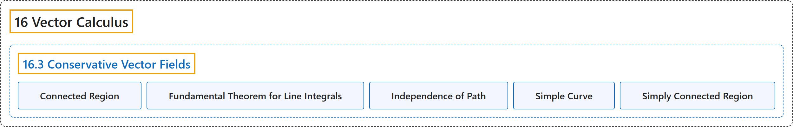

# 16.3 Conservative Vector Fields

## Classification

## Glossary

| Term | Definition | 中文翻译 | Source |
|---|---|---|---|
| **16 Vector Calculus** 向量微积分 | (No definition) | （无定义） | [Strang & Herman, 2016c, chapter 6](https://openstax.org/books/calculus-volume-3/pages/6-introduction) |
| **16.3 Conservative Vector Fields** 保守向量场 | (No definition) | （无定义） | [Strang & Herman, 2016c, section 6.3](https://openstax.org/books/calculus-volume-3/pages/6-3-conservative-vector-fields) |
| **Connected Region** 连通区域 | "a region in which **any two points can be connected by a path** with a trace contained entirely inside the region" | **任意两点都能用一条路径连接**、且路径的轨迹完全含于区域内的区域 | [Strang & Herman, 2016c, chapter 6 Key Terms](https://openstax.org/books/calculus-volume-3/pages/6-key-terms#fs-id1167793499403) |
| **Fundamental Theorem for Line Integrals** 线积分基本定理 | "the value of line integral ${\int }_{C}\nabla f\cdot d\text{r}$ **depends only on the value of** $f$ at the endpoints of C: ${\int }_{C}\nabla f\cdot d\text{r}=f(\text{r}(b))-f(\text{r}(a))$" | 线积分 ${\int }_{C}\nabla f\cdot d\text{r}$ 的值**只取决于 $f$ 在 C 端点处的值**：${\int }_{C}\nabla f\cdot d\text{r}=f(\text{r}(b))-f(\text{r}(a))$ | [Strang & Herman, 2016c, chapter 6 Key Terms](https://openstax.org/books/calculus-volume-3/pages/6-key-terms#fs-id1167794200222) |
| **Independence of Path** 路径无关性 | "a vector field F has path independence if ${\int }_{C_{1}}\text{F}\cdot d\text{r}={\int }_{C_{2}}\text{F}\cdot d\text{r}$ for any curves $C_{1}$ and $C_{2}$ in the domain of F **with the same initial points and terminal points**" | 向量场 F 具有路径无关性，如果对 F 定义域中**起点和终点都相同**的任意曲线 $C_{1}$ 和 $C_{2}$ 有 ${\int }_{C_{1}}\text{F}\cdot d\text{r}={\int }_{C_{2}}\text{F}\cdot d\text{r}$ | [Strang & Herman, 2016c, chapter 6 Key Terms](https://openstax.org/books/calculus-volume-3/pages/6-key-terms#fs-id1167794095296) |
| **Simple Curve** 简单曲线 | "a curve that **does not cross itself**" | **不与自身相交**的曲线 | [Strang & Herman, 2016c, chapter 6 Key Terms](https://openstax.org/books/calculus-volume-3/pages/6-key-terms#fs-id1167793234360) |
| **Simply Connected Region** 单连通区域 | "a region that is connected and has the property that **any closed curve that lies entirely inside the region** encompasses points that are entirely inside the region" | 连通的区域，且具有以下性质：**完全位于区域内的任一闭曲线**所围的点也完全在区域内 | [Strang & Herman, 2016c, chapter 6 Key Terms](https://openstax.org/books/calculus-volume-3/pages/6-key-terms#fs-id1167793234370) |

## References

Strang, G., & Herman, E. (2016c). *Calculus volume 3*. OpenStax. Retrieved October 29, 2026, from <https://openstax.org/details/books/calculus-volume-3>
