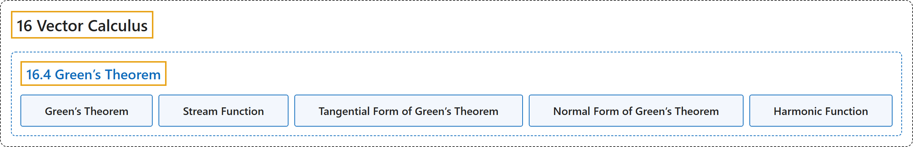

# 16.4 Green’s Theorem

## Classification

## Glossary

| Term | Definition | 中文翻译 | Source |
|---|---|---|---|
| **16 Vector Calculus** 向量微积分 | (No definition) | （无定义） | [Strang & Herman, 2016c, chapter 6](https://openstax.org/books/calculus-volume-3/pages/6-introduction) |
| **16.4 Green’s Theorem** 格林定理 | (No definition) | （无定义） | [Strang & Herman, 2016c, section 6.4](https://openstax.org/books/calculus-volume-3/pages/6-4-greens-theorem) |
| **Green’s Theorem** 格林定理 | "relates the integral over a connected region to **an integral over the boundary of the region**" | 把连通区域上的积分与**区域边界上的积分**联系起来 | [Strang & Herman, 2016c, chapter 6 Key Terms](https://openstax.org/books/calculus-volume-3/pages/6-key-terms#fs-id1167793776600) |
| **Stream Function** 流函数 | "if $\text{F}=\langle P,Q\rangle$ is **a source-free vector field**, then stream function g is a function such that $P=g_{y}$ and $Q=-g_{x}$" | 若 $\text{F}=\langle P,Q\rangle$ 是**无源向量场**，则流函数 g 是使得 $P=g_{y}$ 且 $Q=-g_{x}$ 的函数 | [Strang & Herman, 2016c, chapter 6 Key Terms](https://openstax.org/books/calculus-volume-3/pages/6-key-terms#fs-id1167793776611) |
| **Tangential Form of Green’s Theorem** 格林定理的切向形式 | "this version of Green’s theorem is sometimes referred to as **the tangential form of Green’s theorem**." | 这个版本的格林定理有时称为**格林定理的切向形式**。 | [Strang & Herman, 2016c, section 6.4](https://openstax.org/books/calculus-volume-3/pages/6-4-greens-theorem#term-00002) |
| **Normal Form of Green’s Theorem** 格林定理的法向形式 | "Because this form of Green’s theorem contains unit normal vector N, it is sometimes referred to as **the normal form of Green’s theorem**." | 由于这种形式的格林定理含单位法向量 N，它有时称为**格林定理的法向形式**。 | [Strang & Herman, 2016c, section 6.4](https://openstax.org/books/calculus-volume-3/pages/6-4-greens-theorem#term-00003) |
| **Harmonic Function** 调和函数 | "A function that satisfies Laplace’s equation is called **a harmonic function**." | 满足拉普拉斯方程的函数称为**调和函数**。 | [Strang & Herman, 2016c, section 6.4](https://openstax.org/books/calculus-volume-3/pages/6-4-greens-theorem#term-00006) |

## References

Strang, G., & Herman, E. (2016c). *Calculus volume 3*. OpenStax. Retrieved October 29, 2026, from <https://openstax.org/details/books/calculus-volume-3>
