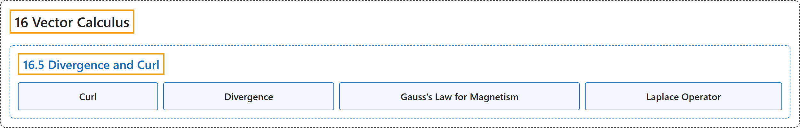

# 16.5 Divergence and Curl

## Classification

## Glossary

| Term | Definition | 中文翻译 | Source |
|---|---|---|---|
| **16 Vector Calculus** 向量微积分 | (No definition) | （无定义） | [Strang & Herman, 2016c, chapter 6](https://openstax.org/books/calculus-volume-3/pages/6-introduction) |
| **16.5 Divergence and Curl** 散度与旋度 | (No definition) | （无定义） | [Strang & Herman, 2016c, section 6.5](https://openstax.org/books/calculus-volume-3/pages/6-5-divergence-and-curl) |
| **Curl** 旋度 | "the curl of vector field $\text{F}=\langle P,Q,R\rangle ,$ denoted $\nabla \,\times \,\text{F},$ is the “determinant” of the matrix $\begin{vmatrix}\text{i} & \text{j} & \text{k} \\ \frac{\partial }{\partial x} & \frac{\partial }{\partial y} & \frac{\partial }{\partial z} \\ P & Q & R\end{vmatrix}$ and is given by the expression $(R_{y}-Q_{z})\text{i}+(P_{z}-R_{x})\text{j}+(Q_{x}-P_{y})\text{k};$ it measures **the tendency of particles at a point to rotate** about the axis that points in the direction of the curl at the point" | 向量场 $\text{F}=\langle P,Q,R\rangle ,$ 的旋度记作 $\nabla \,\times \,\text{F},$ 是矩阵 $\begin{vmatrix}\text{i} & \text{j} & \text{k} \\ \frac{\partial }{\partial x} & \frac{\partial }{\partial y} & \frac{\partial }{\partial z} \\ P & Q & R\end{vmatrix}$ 的“行列式”，由表达式 $(R_{y}-Q_{z})\text{i}+(P_{z}-R_{x})\text{j}+(Q_{x}-P_{y})\text{k};$ 给出；它度量**一点处粒子绕该点旋度方向的轴旋转的趋势** | [Strang & Herman, 2016c, chapter 6 Key Terms](https://openstax.org/books/calculus-volume-3/pages/6-key-terms#fs-id1167793432335) |
| **Divergence** 散度 | "the divergence of a vector field $\text{F}=\langle P,Q,R\rangle ,$ denoted $\nabla \,\cdot \,\text{F},$ is $P_{x}+Q_{y}+R_{z};$ it measures **the “outflowing-ness” of a vector field**" | 向量场 $\text{F}=\langle P,Q,R\rangle ,$ 的散度记作 $\nabla \,\cdot \,\text{F},$ 等于 $P_{x}+Q_{y}+R_{z};$ 它度量**向量场的“外流程度”** | [Strang & Herman, 2016c, chapter 6 Key Terms](https://openstax.org/books/calculus-volume-3/pages/6-key-terms#fs-id1167794267590) |
| **Gauss’s Law for Magnetism** 磁场的高斯定律 | "Physicists use divergence in Gauss’s law for magnetism, which states that if B is a magnetic field, then $\nabla \cdot \text{B}=0;$ in other words, **the divergence of a magnetic field is zero**." | 物理学家在磁场的高斯定律中使用散度，该定律指出：若 B 是磁场，则 $\nabla \cdot \text{B}=0;$ 换句话说，**磁场的散度为零**。 | [Strang & Herman, 2016c, section 6.5](https://openstax.org/books/calculus-volume-3/pages/6-5-divergence-and-curl#term-00002) |
| **Laplace Operator** 拉普拉斯算子 | "This operator is called **the Laplace operator**, and in this notation Laplace’s equation becomes ${\nabla }^{2}f=0.$" | 这个算子称为**拉普拉斯算子**，用这个记号，拉普拉斯方程成为 ${\nabla }^{2}f=0.$ | [Strang & Herman, 2016c, section 6.5](https://openstax.org/books/calculus-volume-3/pages/6-5-divergence-and-curl#term-00004) |

## References

Strang, G., & Herman, E. (2016c). *Calculus volume 3*. OpenStax. Retrieved October 29, 2026, from <https://openstax.org/details/books/calculus-volume-3>
