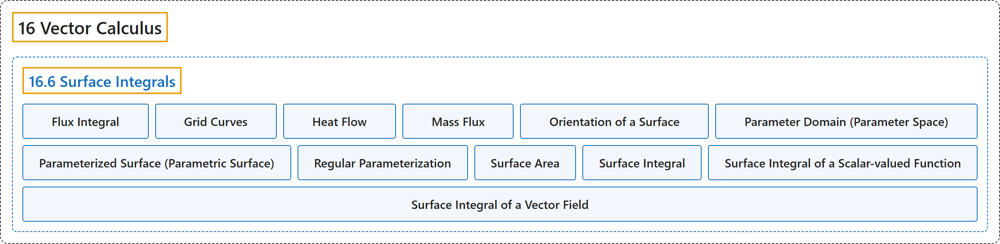

# 16.6 Surface Integrals

## Classification

## Glossary

| Term | Definition | 中文翻译 | Source |
|---|---|---|---|
| **16 Vector Calculus** 向量微积分 | (No definition) | （无定义） | [Strang & Herman, 2016c, chapter 6](https://openstax.org/books/calculus-volume-3/pages/6-introduction) |
| **16.6 Surface Integrals** 曲面积分 | (No definition) | （无定义） | [Strang & Herman, 2016c, section 6.6](https://openstax.org/books/calculus-volume-3/pages/6-6-surface-integrals) |
| **Flux Integral** 通量积分 | "**another name for a surface integral of a vector field**; the preferred term in physics and engineering" | **向量场曲面积分的另一个名称**；物理和工程中的首选术语 | [Strang & Herman, 2016c, chapter 6 Key Terms](https://openstax.org/books/calculus-volume-3/pages/6-key-terms#fs-id1167793570264) |
| **Grid Curves** 网格曲线 | "curves on a surface that are **parallel to grid lines in a coordinate plane**" | 曲面上**平行于坐标平面中网格线**的曲线 | [Strang & Herman, 2016c, chapter 6 Key Terms](https://openstax.org/books/calculus-volume-3/pages/6-key-terms#fs-id1167793570275) |
| **Heat Flow** 热流 | "a vector field **proportional to the negative temperature gradient** in an object" | 物体中**与负温度梯度成正比**的向量场 | [Strang & Herman, 2016c, chapter 6 Key Terms](https://openstax.org/books/calculus-volume-3/pages/6-key-terms#fs-id1167793570284) |
| **Mass Flux** 质量通量 | "**the rate of mass flow of a fluid per unit area**, measured in mass per unit time per unit area" | **单位面积上流体的质量流率**，以单位时间单位面积的质量度量 | [Strang & Herman, 2016c, chapter 6 Key Terms](https://openstax.org/books/calculus-volume-3/pages/6-key-terms#fs-id1167793570294) |
| **Orientation of a Surface** 曲面的方向 | "if a surface has an “inner” side and an “outer” side, then an orientation is **a choice of the inner or the outer side**; the surface could also have “upward” and “downward” orientations" | 若曲面有“内”侧和“外”侧，则方向是**对内侧或外侧的一种选择**；曲面也可以有“向上”和“向下”的方向 | [Strang & Herman, 2016c, chapter 6 Key Terms](https://openstax.org/books/calculus-volume-3/pages/6-key-terms#fs-id1167793570305) |
| **Parameter Domain (Parameter Space)** 参数域（参数空间） | "**the region of the uv plane** over which the parameters u and v vary for parameterization $\text{r}(u,v)=\langle x(u,v),y(u,v),z(u,v)\rangle$" | 参数化 $\text{r}(u,v)=\langle x(u,v),y(u,v),z(u,v)\rangle$ 中参数 u 和 v 在其上变化的 **uv 平面区域** | [Strang & Herman, 2016c, chapter 6 Key Terms](https://openstax.org/books/calculus-volume-3/pages/6-key-terms#fs-id1167793553790) |
| **Parameterized Surface (Parametric Surface)** 参数化曲面（参数曲面） | "a surface given by a description of the form $\text{r}(u,v)=\langle x(u,v),y(u,v),z(u,v)\rangle ,$ where the parameters u and v **vary over a parameter domain in the uv-plane**" | 由形如 $\text{r}(u,v)=\langle x(u,v),y(u,v),z(u,v)\rangle ,$ 的描述给出的曲面，其中参数 u 和 v **在 uv 平面的参数域上变化** | [Strang & Herman, 2016c, chapter 6 Key Terms](https://openstax.org/books/calculus-volume-3/pages/6-key-terms#fs-id1167793362873) |
| **Regular Parameterization** 正则参数化 | "parameterization $\text{r}(u,v)=\langle x(u,v),y(u,v),z(u,v)\rangle$ such that ${\text{r}}_{u}\,\times \,{\text{r}}_{v}$ **is not zero for any point** $(u,v)$ in the parameter domain" | 参数化 $\text{r}(u,v)=\langle x(u,v),y(u,v),z(u,v)\rangle$，使得 ${\text{r}}_{u}\,\times \,{\text{r}}_{v}$ 在参数域中**任一点 $(u,v)$ 处都不为零** | [Strang & Herman, 2016c, chapter 6 Key Terms](https://openstax.org/books/calculus-volume-3/pages/6-key-terms#fs-id1167793571388) |
| **Surface Area** 曲面面积 | "the area of surface S **given by the surface integral** $\int {\int }_{S}dS$" | 曲面 S 的面积，**由曲面积分 $\int {\int }_{S}dS$ 给出** | [Strang & Herman, 2016c, chapter 6 Key Terms](https://openstax.org/books/calculus-volume-3/pages/6-key-terms#fs-id1167793293936) |
| **Surface Integral** 曲面积分 | "an integral of a function **over a surface**" | 函数**在曲面上**的积分 | [Strang & Herman, 2016c, chapter 6 Key Terms](https://openstax.org/books/calculus-volume-3/pages/6-key-terms#fs-id1167793293975) |
| **Surface Integral of a Scalar-valued Function** 标量值函数的曲面积分 | "a surface integral in which **the integrand is a scalar function**" | **被积函数是标量函数**的曲面积分 | [Strang & Herman, 2016c, chapter 6 Key Terms](https://openstax.org/books/calculus-volume-3/pages/6-key-terms#fs-id1167793293985) |
| **Surface Integral of a Vector Field** 向量场的曲面积分 | "a surface integral in which **the integrand is a vector field**" | **被积函数是向量场**的曲面积分 | [Strang & Herman, 2016c, chapter 6 Key Terms](https://openstax.org/books/calculus-volume-3/pages/6-key-terms#fs-id1167793293994) |

## References

Strang, G., & Herman, E. (2016c). *Calculus volume 3*. OpenStax. Retrieved October 29, 2026, from <https://openstax.org/details/books/calculus-volume-3>
