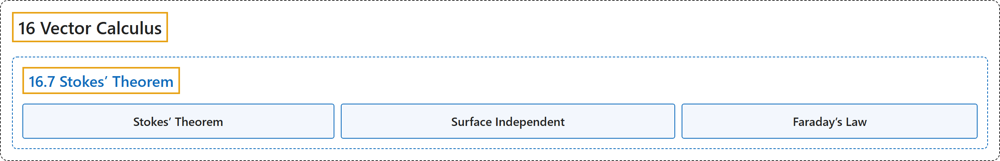

# 16.7 Stokes’ Theorem

## Classification

## Glossary

| Term | Definition | 中文翻译 | Source |
|---|---|---|---|
| **16 Vector Calculus** 向量微积分 | (No definition) | （无定义） | [Strang & Herman, 2016c, chapter 6](https://openstax.org/books/calculus-volume-3/pages/6-introduction) |
| **16.7 Stokes’ Theorem** 斯托克斯定理 | (No definition) | （无定义） | [Strang & Herman, 2016c, section 6.7](https://openstax.org/books/calculus-volume-3/pages/6-7-stokes-theorem) |
| **Stokes’ Theorem** 斯托克斯定理 | "relates the flux integral over a surface S to **a line integral around the boundary C of the surface S**" | 把曲面 S 上的通量积分与**绕曲面 S 边界 C 的线积分**联系起来 | [Strang & Herman, 2016c, chapter 6 Key Terms](https://openstax.org/books/calculus-volume-3/pages/6-key-terms#fs-id1167794097572) |
| **Surface Independent** 与曲面无关 | "flux integrals of curl vector fields are surface independent if their evaluation does not depend on the surface but **only on the boundary of the surface**" | 旋度向量场的通量积分与曲面无关，如果其计算结果不取决于曲面，而**只取决于曲面的边界** | [Strang & Herman, 2016c, chapter 6 Key Terms](https://openstax.org/books/calculus-volume-3/pages/6-key-terms#fs-id1167793244418) |
| **Faraday’s Law** 法拉第定律 | "In particular, we examine how we can use Stokes’ theorem to translate between **two equivalent forms of Faraday’s law**." | 特别地，我们考察如何用斯托克斯定理在**法拉第定律的两种等价形式**之间转换。 | [Strang & Herman, 2016c, section 6.7](https://openstax.org/books/calculus-volume-3/pages/6-7-stokes-theorem#term-00003) |

## References

Strang, G., & Herman, E. (2016c). *Calculus volume 3*. OpenStax. Retrieved October 29, 2026, from <https://openstax.org/details/books/calculus-volume-3>
