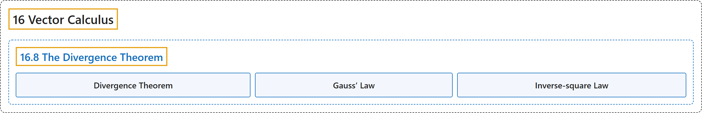

# 16.8 The Divergence Theorem

## Classification

## Glossary

| Term | Definition | 中文翻译 | Source |
|---|---|---|---|
| **16 Vector Calculus** 向量微积分 | (No definition) | （无定义） | [Strang & Herman, 2016c, chapter 6](https://openstax.org/books/calculus-volume-3/pages/6-introduction) |
| **16.8 The Divergence Theorem** 散度定理 | (No definition) | （无定义） | [Strang & Herman, 2016c, section 6.8](https://openstax.org/books/calculus-volume-3/pages/6-8-the-divergence-theorem) |
| **Divergence Theorem** 散度定理 | "a theorem used to transform a difficult flux integral **into an easier triple integral** and vice versa" | 用来把困难的通量积分**转化为较容易的三重积分**（反之亦然）的定理 | [Strang & Herman, 2016c, chapter 6 Key Terms](https://openstax.org/books/calculus-volume-3/pages/6-key-terms#fs-id1167793828731) |
| **Gauss’ Law** 高斯定律 | "if S is a piecewise, smooth closed surface in a vacuum and Q is the total stationary charge inside of S, then **the flux of electrostatic field E across S** is $Q/{\varepsilon }_{0}$" | 若 S 是真空中分段光滑的闭曲面，Q 是 S 内的总静电荷，则**静电场 E 穿过 S 的通量**是 $Q/{\varepsilon }_{0}$ | [Strang & Herman, 2016c, chapter 6 Key Terms](https://openstax.org/books/calculus-volume-3/pages/6-key-terms#fs-id1167793828742) |
| **Inverse-square Law** 平方反比定律 | "the electrostatic force at a given point is **inversely proportional to the square of the distance** from the source of the charge" | 给定点处的静电力**与到电荷源距离的平方成反比** | [Strang & Herman, 2016c, chapter 6 Key Terms](https://openstax.org/books/calculus-volume-3/pages/6-key-terms#fs-id1167794222295) |

## References

Strang, G., & Herman, E. (2016c). *Calculus volume 3*. OpenStax. Retrieved October 29, 2026, from <https://openstax.org/details/books/calculus-volume-3>
