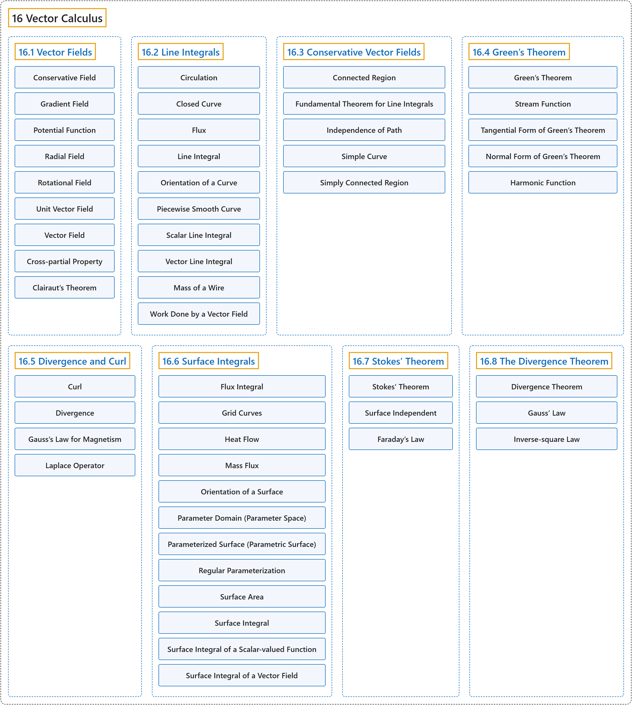

# 16 Vector Calculus

## Classification

## Glossary

| Term | Definition | 中文翻译 | Source |
|---|---|---|---|
| **16 Vector Calculus** 向量微积分 | (No definition) | （无定义） | [Strang & Herman, 2016c, chapter 6](https://openstax.org/books/calculus-volume-3/pages/6-introduction) |
| **[16.1 Vector Fields](16-1-vector-fields.md)** 向量场 | (No definition) | （无定义） | [Strang & Herman, 2016c, section 6.1](https://openstax.org/books/calculus-volume-3/pages/6-1-vector-fields) |
| **[16.2 Line Integrals](16-2-line-integrals.md)** 线积分 | (No definition) | （无定义） | [Strang & Herman, 2016c, section 6.2](https://openstax.org/books/calculus-volume-3/pages/6-2-line-integrals) |
| **[16.3 Conservative Vector Fields](16-3-conservative-vector-fields.md)** 保守向量场 | (No definition) | （无定义） | [Strang & Herman, 2016c, section 6.3](https://openstax.org/books/calculus-volume-3/pages/6-3-conservative-vector-fields) |
| **[16.4 Green’s Theorem](16-4-greens-theorem.md)** 格林定理 | (No definition) | （无定义） | [Strang & Herman, 2016c, section 6.4](https://openstax.org/books/calculus-volume-3/pages/6-4-greens-theorem) |
| **[16.5 Divergence and Curl](16-5-divergence-and-curl.md)** 散度与旋度 | (No definition) | （无定义） | [Strang & Herman, 2016c, section 6.5](https://openstax.org/books/calculus-volume-3/pages/6-5-divergence-and-curl) |
| **[16.6 Surface Integrals](16-6-surface-integrals.md)** 曲面积分 | (No definition) | （无定义） | [Strang & Herman, 2016c, section 6.6](https://openstax.org/books/calculus-volume-3/pages/6-6-surface-integrals) |
| **[16.7 Stokes’ Theorem](16-7-stokes-theorem.md)** 斯托克斯定理 | (No definition) | （无定义） | [Strang & Herman, 2016c, section 6.7](https://openstax.org/books/calculus-volume-3/pages/6-7-stokes-theorem) |
| **[16.8 The Divergence Theorem](16-8-the-divergence-theorem.md)** 散度定理 | (No definition) | （无定义） | [Strang & Herman, 2016c, section 6.8](https://openstax.org/books/calculus-volume-3/pages/6-8-the-divergence-theorem) |

## References

Strang, G., & Herman, E. (2016c). *Calculus volume 3*. OpenStax. Retrieved October 29, 2026, from <https://openstax.org/details/books/calculus-volume-3>
