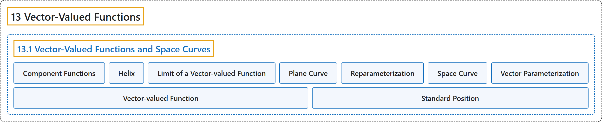

# 13.1 Vector-Valued Functions and Space Curves

## Classification

## Glossary

| Term | Definition | 中文翻译 | Source |
|---|---|---|---|
| **13 Vector-Valued Functions** 向量值函数 | (No definition) | （无定义） | [Strang & Herman, 2016c, chapter 3](https://openstax.org/books/calculus-volume-3/pages/3-introduction) |
| **13.1 Vector-Valued Functions and Space Curves** 向量值函数与空间曲线 | (No definition) | （无定义） | [Strang & Herman, 2016c, section 3.1](https://openstax.org/books/calculus-volume-3/pages/3-1-vector-valued-functions-and-space-curves) |
| **Component Functions** 分量函数 | "**the component functions of the vector-valued function** $\text{r}(t)=f(t)\,\text{i}+g(t)\,\text{j}$ are $f(t)$ and $g(t),$ and the component functions of the vector-valued function $\text{r}(t)=f(t)\,\text{i}+g(t)\,\text{j}+h(t)\,\text{k}$ are $f(t),$ $g(t)$ and $h(t)$" | **向量值函数 $\text{r}(t)=f(t)\,\text{i}+g(t)\,\text{j}$ 的分量函数**是 $f(t)$ 和 $g(t),$ 向量值函数 $\text{r}(t)=f(t)\,\text{i}+g(t)\,\text{j}+h(t)\,\text{k}$ 的分量函数是 $f(t),$ $g(t)$ 和 $h(t)$ | [Strang & Herman, 2016c, chapter 3 Key Terms](https://openstax.org/books/calculus-volume-3/pages/3-key-terms#fs-id1169737486700) |
| **Helix** 螺旋线 | "a three-dimensional curve **in the shape of a spiral**" | **螺旋形状的**三维曲线 | [Strang & Herman, 2016c, chapter 3 Key Terms](https://openstax.org/books/calculus-volume-3/pages/3-key-terms#fs-id1169738084072) |
| **Limit of a Vector-valued Function** 向量值函数的极限 | "a vector-valued function $\text{r}(t)$ **has a limit L as t approaches a** if $\lim_{t\to a}\vert \,\text{r}(t)-\text{L}\vert =0$" | 向量值函数 $\text{r}(t)$ **在 t 趋近 a 时有极限 L**，如果 $\lim_{t\to a}\vert \,\text{r}(t)-\text{L}\vert =0$ | [Strang & Herman, 2016c, chapter 3 Key Terms](https://openstax.org/books/calculus-volume-3/pages/3-key-terms#fs-id1169738084079) |
| **Plane Curve** 平面曲线 | "**the set of ordered pairs** $(f(t),g(t))$ together with their defining parametric equations $x=f(t)$ and $y=g(t)$" | **有序对 $(f(t),g(t))$ 的集合**，连同定义它们的参数方程 $x=f(t)$ 和 $y=g(t)$ | [Strang & Herman, 2016c, chapter 3 Key Terms](https://openstax.org/books/calculus-volume-3/pages/3-key-terms#fs-id1169737192224) |
| **Reparameterization** 重新参数化 | "**an alternative parameterization** of a given vector-valued function" | 给定向量值函数的**另一种参数化** | [Strang & Herman, 2016c, chapter 3 Key Terms](https://openstax.org/books/calculus-volume-3/pages/3-key-terms#fs-id1169737432405) |
| **Space Curve** 空间曲线 | "**the set of ordered triples** $(f(t),g(t),h(t))$ together with their defining parametric equations $x=f(t),$ $y=g(t)$ and $z=h(t)$" | **有序三元组 $(f(t),g(t),h(t))$ 的集合**，连同定义它们的参数方程 $x=f(t),$ $y=g(t)$ 和 $z=h(t)$ | [Strang & Herman, 2016c, chapter 3 Key Terms](https://openstax.org/books/calculus-volume-3/pages/3-key-terms#fs-id1169737432413) |
| **Vector Parameterization** 向量参数化 | "any representation of a plane or space curve **using a vector-valued function**" | **用向量值函数**对平面曲线或空间曲线的任一表示 | [Strang & Herman, 2016c, chapter 3 Key Terms](https://openstax.org/books/calculus-volume-3/pages/3-key-terms#fs-id1169737490855) |
| **Vector-valued Function** 向量值函数 | "a function of the form $\text{r}(t)=f(t)\,\text{i}+g(t)\,\text{j}$ or $\text{r}(t)=f(t)\,\text{i}+g(t)\,\text{j}+h(t)\,\text{k},$ where the component functions f, g, and h **are real-valued functions of the parameter t**" | 形如 $\text{r}(t)=f(t)\,\text{i}+g(t)\,\text{j}$ 或 $\text{r}(t)=f(t)\,\text{i}+g(t)\,\text{j}+h(t)\,\text{k},$ 的函数，其中分量函数 f、g 和 h **是参数 t 的实值函数** | [Strang & Herman, 2016c, chapter 3 Key Terms](https://openstax.org/books/calculus-volume-3/pages/3-key-terms#fs-id1169737490863) |
| **Standard Position** 标准位置 | "A vector is considered to be in **standard position** if the initial point is located at the origin." | 若向量的起点位于原点，就认为它处于**标准位置**。 | [Strang & Herman, 2016c, section 3.1](https://openstax.org/books/calculus-volume-3/pages/3-1-vector-valued-functions-and-space-curves#term-00005) |

## References

Strang, G., & Herman, E. (2016c). *Calculus volume 3*. OpenStax. Retrieved October 29, 2026, from <https://openstax.org/details/books/calculus-volume-3>
