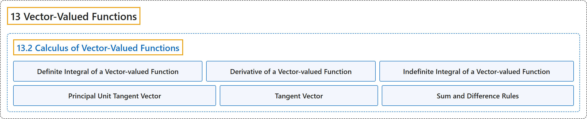

# 13.2 Calculus of Vector-Valued Functions

## Classification

## Glossary

| Term | Definition | 中文翻译 | Source |
|---|---|---|---|
| **13 Vector-Valued Functions** 向量值函数 | (No definition) | （无定义） | [Strang & Herman, 2016c, chapter 3](https://openstax.org/books/calculus-volume-3/pages/3-introduction) |
| **13.2 Calculus of Vector-Valued Functions** 向量值函数的微积分 | (No definition) | （无定义） | [Strang & Herman, 2016c, section 3.2](https://openstax.org/books/calculus-volume-3/pages/3-2-calculus-of-vector-valued-functions) |
| **Definite Integral of a Vector-valued Function** 向量值函数的定积分 | "the vector obtained by calculating **the definite integral of each of the component functions** of a given vector-valued function, then using the results as the components of the resulting function" | 这样得到的向量：计算给定向量值函数**每个分量函数的定积分**，再把结果用作所得函数的分量 | [Strang & Herman, 2016c, chapter 3 Key Terms](https://openstax.org/books/calculus-volume-3/pages/3-key-terms#fs-id1169736957692) |
| **Derivative of a Vector-valued Function** 向量值函数的导数 | "the derivative of a vector-valued function $\text{r}(t)$ is $r^{'}(t)=\lim_{\Delta t\to 0}\frac{\text{r}(t+\Delta t)-\text{r}(t)}{\Delta t},$ **provided the limit exists**" | 向量值函数 $\text{r}(t)$ 的导数是 $r^{'}(t)=\lim_{\Delta t\to 0}\frac{\text{r}(t+\Delta t)-\text{r}(t)}{\Delta t},$ **前提是极限存在** | [Strang & Herman, 2016c, chapter 3 Key Terms](https://openstax.org/books/calculus-volume-3/pages/3-key-terms#fs-id1169736929603) |
| **Indefinite Integral of a Vector-valued Function** 向量值函数的不定积分 | "a vector-valued function with **a derivative that is equal to a given vector-valued function**" | 一个向量值函数，其**导数等于给定的向量值函数** | [Strang & Herman, 2016c, chapter 3 Key Terms](https://openstax.org/books/calculus-volume-3/pages/3-key-terms#fs-id1169736929714) |
| **Principal Unit Tangent Vector** 主单位切向量 | "**a unit vector tangent to a curve** C" | **与曲线 C 相切的单位向量** | [Strang & Herman, 2016c, chapter 3 Key Terms](https://openstax.org/books/calculus-volume-3/pages/3-key-terms#fs-id1169736929723) |
| **Tangent Vector** 切向量 | "to $\text{r}(t)$ at $t=t_{0}$ any vector v such that, when the tail of the vector is placed at point $\text{r}(t_{0})$ on the graph, vector v **is tangent to curve C**" | $\text{r}(t)$ 在 $t=t_{0}$ 处的切向量，是任一向量 v，使得把该向量的尾部放在图像上的点 $\text{r}(t_{0})$ 时，向量 v **与曲线 C 相切** | [Strang & Herman, 2016c, chapter 3 Key Terms](https://openstax.org/books/calculus-volume-3/pages/3-key-terms#fs-id1169737014776) |
| **Sum and Difference Rules** 和差法则 | "In particular, the constant multiple rule, **the sum and difference rules**, the product rule, and the chain rule all extend to vector-valued functions." | 特别地，常数倍法则、**和差法则**、乘积法则和链式法则都可以推广到向量值函数。 | [Strang & Herman, 2016c, section 3.2](https://openstax.org/books/calculus-volume-3/pages/3-2-calculus-of-vector-valued-functions#term-00004) |

## References

Strang, G., & Herman, E. (2016c). *Calculus volume 3*. OpenStax. Retrieved October 29, 2026, from <https://openstax.org/details/books/calculus-volume-3>
