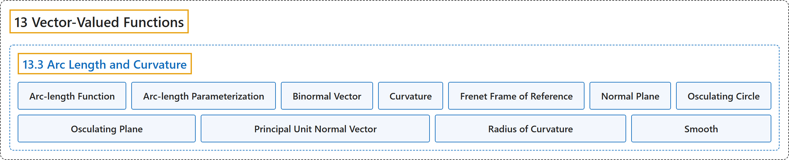

# 13.3 Arc Length and Curvature

## Classification

## Glossary

| Term | Definition | 中文翻译 | Source |
|---|---|---|---|
| **13 Vector-Valued Functions** 向量值函数 | (No definition) | （无定义） | [Strang & Herman, 2016c, chapter 3](https://openstax.org/books/calculus-volume-3/pages/3-introduction) |
| **13.3 Arc Length and Curvature** 弧长与曲率 | (No definition) | （无定义） | [Strang & Herman, 2016c, section 3.3](https://openstax.org/books/calculus-volume-3/pages/3-3-arc-length-and-curvature) |
| **Arc-length Function** 弧长函数 | "a function $s(t)$ that describes **the arc length of curve C as a function of t**" | 把**曲线 C 的弧长描述为 t 的函数**的函数 $s(t)$ | [Strang & Herman, 2016c, chapter 3 Key Terms](https://openstax.org/books/calculus-volume-3/pages/3-key-terms#fs-id1169738133209) |
| **Arc-length Parameterization** 弧长参数化 | "a reparameterization of a vector-valued function in which **the parameter is equal to the arc length**" | 向量值函数的一种重新参数化，其中**参数等于弧长** | [Strang & Herman, 2016c, chapter 3 Key Terms](https://openstax.org/books/calculus-volume-3/pages/3-key-terms#fs-id1169738133238) |
| **Binormal Vector** 副法向量 | "a unit vector **orthogonal to the unit tangent vector and the unit normal vector**" | **与单位切向量和单位法向量都正交**的单位向量 | [Strang & Herman, 2016c, chapter 3 Key Terms](https://openstax.org/books/calculus-volume-3/pages/3-key-terms#fs-id1169737140373) |
| **Curvature** 曲率 | "**the derivative of the unit tangent vector with respect to the arc-length parameter**" | **单位切向量对弧长参数的导数** | [Strang & Herman, 2016c, chapter 3 Key Terms](https://openstax.org/books/calculus-volume-3/pages/3-key-terms#fs-id1169737140380) |
| **Frenet Frame of Reference** 弗勒内标架 | "(TNB frame) a frame of reference in three-dimensional space formed by **the unit tangent vector, the unit normal vector, and the binormal vector**" | （TNB 标架）由**单位切向量、单位法向量和副法向量**构成的三维空间参考系 | [Strang & Herman, 2016c, chapter 3 Key Terms](https://openstax.org/books/calculus-volume-3/pages/3-key-terms#fs-id1169737140388) |
| **Normal Plane** 法平面 | "a plane that is **perpendicular to a curve** at any point on the curve" | 在曲线上任一点处**垂直于曲线**的平面 | [Strang & Herman, 2016c, chapter 3 Key Terms](https://openstax.org/books/calculus-volume-3/pages/3-key-terms#fs-id1169737140396) |
| **Osculating Circle** 密切圆 | "a circle that is tangent to a curve C at a point P and that **shares the same curvature**" | 在点 P 处与曲线 C 相切并**具有相同曲率**的圆 | [Strang & Herman, 2016c, chapter 3 Key Terms](https://openstax.org/books/calculus-volume-3/pages/3-key-terms#fs-id1169737140404) |
| **Osculating Plane** 密切平面 | "the plane determined by **the unit tangent and the unit normal vector**" | 由**单位切向量和单位法向量**确定的平面 | [Strang & Herman, 2016c, chapter 3 Key Terms](https://openstax.org/books/calculus-volume-3/pages/3-key-terms#fs-id1169737140422) |
| **Principal Unit Normal Vector** 主单位法向量 | "a vector **orthogonal to the unit tangent vector**, given by the formula $\frac{T^{'}(t)}{\Vert T^{'}(t)\Vert }$" | **与单位切向量正交**的向量，由公式 $\frac{T^{'}(t)}{\Vert T^{'}(t)\Vert }$ 给出 | [Strang & Herman, 2016c, chapter 3 Key Terms](https://openstax.org/books/calculus-volume-3/pages/3-key-terms#fs-id1169737140429) |
| **Radius of Curvature** 曲率半径 | "**the reciprocal of the curvature**" | **曲率的倒数** | [Strang & Herman, 2016c, chapter 3 Key Terms](https://openstax.org/books/calculus-volume-3/pages/3-key-terms#fs-id1169737140484) |
| **Smooth** 光滑 | "curves where the vector-valued function $\text{r}(t)$ is **differentiable with a non-zero derivative**" | 向量值函数 $\text{r}(t)$ **可导且导数非零**的曲线 | [Strang & Herman, 2016c, chapter 3 Key Terms](https://openstax.org/books/calculus-volume-3/pages/3-key-terms#fs-id1169737140492) |

## References

Strang, G., & Herman, E. (2016c). *Calculus volume 3*. OpenStax. Retrieved October 29, 2026, from <https://openstax.org/details/books/calculus-volume-3>
