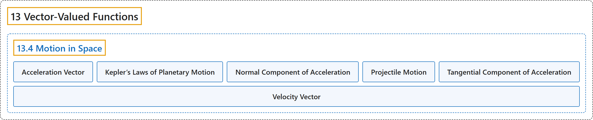

# 13.4 Motion in Space

## Classification

## Glossary

| Term | Definition | 中文翻译 | Source |
|---|---|---|---|
| **13 Vector-Valued Functions** 向量值函数 | (No definition) | （无定义） | [Strang & Herman, 2016c, chapter 3](https://openstax.org/books/calculus-volume-3/pages/3-introduction) |
| **13.4 Motion in Space** 空间运动 | (No definition) | （无定义） | [Strang & Herman, 2016c, section 3.4](https://openstax.org/books/calculus-volume-3/pages/3-4-motion-in-space) |
| **Acceleration Vector** 加速度向量 | "**the second derivative of the position vector**" | **位置向量的二阶导数** | [Strang & Herman, 2016c, chapter 3 Key Terms](https://openstax.org/books/calculus-volume-3/pages/3-key-terms#fs-id1169738243333) |
| **Kepler’s Laws of Planetary Motion** 开普勒行星运动定律 | "three laws governing the motion of planets, asteroids, and comets **in orbit around the Sun**" | 支配行星、小行星和彗星**绕太阳轨道**运动的三条定律 | [Strang & Herman, 2016c, chapter 3 Key Terms](https://openstax.org/books/calculus-volume-3/pages/3-key-terms#fs-id1169738243343) |
| **Normal Component of Acceleration** 加速度的法向分量 | "**the coefficient of the unit normal vector N** when the acceleration vector is written as a linear combination of $\text{T}$ and $\text{N}$" | 加速度向量写成 $\text{T}$ 与 $\text{N}$ 的线性组合时**单位法向量 N 的系数** | [Strang & Herman, 2016c, chapter 3 Key Terms](https://openstax.org/books/calculus-volume-3/pages/3-key-terms#fs-id1169738243354) |
| **Projectile Motion** 抛体运动 | "motion of an object with an initial velocity but **no force acting on it other than gravity**" | 有初速度、但**除重力外没有其他力作用**的物体的运动 | [Strang & Herman, 2016c, chapter 3 Key Terms](https://openstax.org/books/calculus-volume-3/pages/3-key-terms#fs-id1169738154851) |
| **Tangential Component of Acceleration** 加速度的切向分量 | "**the coefficient of the unit tangent vector T** when the acceleration vector is written as a linear combination of $\text{T}$ and $\text{N}$" | 加速度向量写成 $\text{T}$ 与 $\text{N}$ 的线性组合时**单位切向量 T 的系数** | [Strang & Herman, 2016c, chapter 3 Key Terms](https://openstax.org/books/calculus-volume-3/pages/3-key-terms#fs-id1169738154862) |
| **Velocity Vector** 速度向量 | "**the derivative of the position vector**" | **位置向量的导数** | [Strang & Herman, 2016c, chapter 3 Key Terms](https://openstax.org/books/calculus-volume-3/pages/3-key-terms#fs-id1169738154894) |

## References

Strang, G., & Herman, E. (2016c). *Calculus volume 3*. OpenStax. Retrieved October 29, 2026, from <https://openstax.org/details/books/calculus-volume-3>
