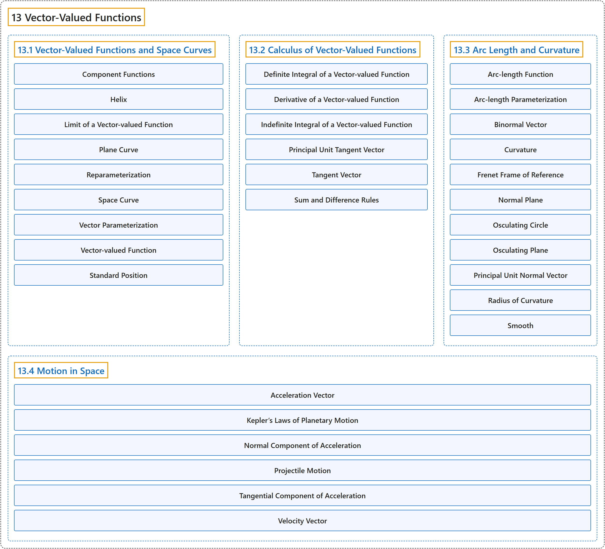

# 13 Vector-Valued Functions

## Classification

## Glossary

| Term | Definition | 中文翻译 | Source |
|---|---|---|---|
| **13 Vector-Valued Functions** 向量值函数 | (No definition) | （无定义） | [Strang & Herman, 2016c, chapter 3](https://openstax.org/books/calculus-volume-3/pages/3-introduction) |
| **[13.1 Vector-Valued Functions and Space Curves](13-1-vector-valued-functions-and-space-curves.md)** 向量值函数与空间曲线 | (No definition) | （无定义） | [Strang & Herman, 2016c, section 3.1](https://openstax.org/books/calculus-volume-3/pages/3-1-vector-valued-functions-and-space-curves) |
| **[13.2 Calculus of Vector-Valued Functions](13-2-calculus-of-vector-valued-functions.md)** 向量值函数的微积分 | (No definition) | （无定义） | [Strang & Herman, 2016c, section 3.2](https://openstax.org/books/calculus-volume-3/pages/3-2-calculus-of-vector-valued-functions) |
| **[13.3 Arc Length and Curvature](13-3-arc-length-and-curvature.md)** 弧长与曲率 | (No definition) | （无定义） | [Strang & Herman, 2016c, section 3.3](https://openstax.org/books/calculus-volume-3/pages/3-3-arc-length-and-curvature) |
| **[13.4 Motion in Space](13-4-motion-in-space.md)** 空间运动 | (No definition) | （无定义） | [Strang & Herman, 2016c, section 3.4](https://openstax.org/books/calculus-volume-3/pages/3-4-motion-in-space) |

## References

Strang, G., & Herman, E. (2016c). *Calculus volume 3*. OpenStax. Retrieved October 29, 2026, from <https://openstax.org/details/books/calculus-volume-3>
