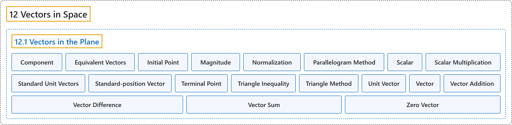

# 12.1 Vectors in the Plane

## Classification

## Glossary

| Term | Definition | 中文翻译 | Source |
|---|---|---|---|
| **12 Vectors in Space** 空间向量 | (No definition) | （无定义） | [Strang & Herman, 2016c, chapter 2](https://openstax.org/books/calculus-volume-3/pages/2-introduction) |
| **12.1 Vectors in the Plane** 平面向量 | (No definition) | （无定义） | [Strang & Herman, 2016c, section 2.1](https://openstax.org/books/calculus-volume-3/pages/2-1-vectors-in-the-plane) |
| **Component** 分量 | "**a scalar** that describes either the vertical or horizontal direction of a vector" | 描述向量竖直方向或水平方向的**标量** | [Strang & Herman, 2016c, chapter 2 Key Terms](https://openstax.org/books/calculus-volume-3/pages/2-key-terms#fs-id1167793541423) |
| **Equivalent Vectors** 相等向量 | "vectors that have **the same magnitude and the same direction**" | 具有**相同大小和相同方向**的向量 | [Strang & Herman, 2016c, chapter 2 Key Terms](https://openstax.org/books/calculus-volume-3/pages/2-key-terms#fs-id1167793541432) |
| **Initial Point** 起点 | "**the starting point** of a vector" | 向量的**起始点** | [Strang & Herman, 2016c, chapter 2 Key Terms](https://openstax.org/books/calculus-volume-3/pages/2-key-terms#fs-id1167793541440) |
| **Magnitude** 模 | "**the length** of a vector" | 向量的**长度** | [Strang & Herman, 2016c, chapter 2 Key Terms](https://openstax.org/books/calculus-volume-3/pages/2-key-terms#fs-id1167793299540) |
| **Normalization** 单位化 | "using scalar multiplication to **find a unit vector with a given direction**" | 用数乘**求给定方向的单位向量** | [Strang & Herman, 2016c, chapter 2 Key Terms](https://openstax.org/books/calculus-volume-3/pages/2-key-terms#fs-id1167793299548) |
| **Parallelogram Method** 平行四边形法 | "a method for finding the sum of two vectors; position the vectors so they share the same initial point; the vectors then form two adjacent sides of a parallelogram; the sum of the vectors is **the diagonal of that parallelogram**" | 求两个向量之和的方法；把两个向量放成共起点；这两个向量构成平行四边形的两条邻边；向量之和是**该平行四边形的对角线** | [Strang & Herman, 2016c, chapter 2 Key Terms](https://openstax.org/books/calculus-volume-3/pages/2-key-terms#fs-id1167793299557) |
| **Scalar** 标量 | "**a real number**" | **一个实数** | [Strang & Herman, 2016c, chapter 2 Key Terms](https://openstax.org/books/calculus-volume-3/pages/2-key-terms#fs-id1167793944666) |
| **Scalar Multiplication** 数乘 | "a vector operation that defines **the product of a scalar and a vector**" | 定义**标量与向量之积**的向量运算 | [Strang & Herman, 2016c, chapter 2 Key Terms](https://openstax.org/books/calculus-volume-3/pages/2-key-terms#fs-id1167793944675) |
| **Standard Unit Vectors** 标准单位向量 | "**unit vectors along the coordinate axes**: $\text{i}=\langle 1,0\rangle ,\text{j}=\langle 0,1\rangle$" | **沿坐标轴的单位向量**：$\text{i}=\langle 1,0\rangle ,\text{j}=\langle 0,1\rangle$ | [Strang & Herman, 2016c, chapter 2 Key Terms](https://openstax.org/books/calculus-volume-3/pages/2-key-terms#fs-id1167793542248) |
| **Standard-position Vector** 标准位置向量 | "**a vector with initial point** $(0,0)$" | **起点为 $(0,0)$ 的向量** | [Strang & Herman, 2016c, chapter 2 Key Terms](https://openstax.org/books/calculus-volume-3/pages/2-key-terms#fs-id1167793944683) |
| **Terminal Point** 终点 | "**the endpoint** of a vector" | 向量的**终点** | [Strang & Herman, 2016c, chapter 2 Key Terms](https://openstax.org/books/calculus-volume-3/pages/2-key-terms#fs-id1167793936699) |
| **Triangle Inequality** 三角不等式 | "the length of any side of a triangle is **less than the sum of the lengths of the other two sides**" | 三角形任一边的长度**小于另外两边长度之和** | [Strang & Herman, 2016c, chapter 2 Key Terms](https://openstax.org/books/calculus-volume-3/pages/2-key-terms#fs-id1167793936708) |
| **Triangle Method** 三角形法 | "a method for finding the sum of two vectors; position the vectors so the terminal point of one vector is the initial point of the other; these vectors then form two sides of a triangle; the sum of the vectors is **the vector that forms the third side**; the initial point of the sum is the initial point of the first vector; the terminal point of the sum is the terminal point of the second vector" | 求两个向量之和的方法；把向量放成一个向量的终点是另一个向量的起点；这两个向量构成三角形的两边；向量之和是**构成第三边的向量**；和的起点是第一个向量的起点；和的终点是第二个向量的终点 | [Strang & Herman, 2016c, chapter 2 Key Terms](https://openstax.org/books/calculus-volume-3/pages/2-key-terms#fs-id1167793936717) |
| **Unit Vector** 单位向量 | "**a vector with margnitude** $1$" | **大小为 $1$ 的向量** | [Strang & Herman, 2016c, chapter 2 Key Terms](https://openstax.org/books/calculus-volume-3/pages/2-key-terms#fs-id1167793234033) |
| **Vector** 向量 | "a mathematical object that has **both magnitude and direction**" | **既有大小又有方向**的数学对象 | [Strang & Herman, 2016c, chapter 2 Key Terms](https://openstax.org/books/calculus-volume-3/pages/2-key-terms#fs-id1167793234045) |
| **Vector Addition** 向量加法 | "a vector operation that defines **the sum of two vectors**" | 定义**两个向量之和**的向量运算 | [Strang & Herman, 2016c, chapter 2 Key Terms](https://openstax.org/books/calculus-volume-3/pages/2-key-terms#fs-id1167793960037) |
| **Vector Difference** 向量差 | "the vector difference $\text{v}-\text{w}$ **is defined as** $v+(-\text{w})=v+(-1)\text{w}$" | 向量差 $\text{v}-\text{w}$ **定义为** $v+(-\text{w})=v+(-1)\text{w}$ | [Strang & Herman, 2016c, chapter 2 Key Terms](https://openstax.org/books/calculus-volume-3/pages/2-key-terms#fs-id1167793960045) |
| **Vector Sum** 向量和 | "the sum of two vectors, $\text{v}$ and $\text{w},$ can be constructed graphically by **placing the initial point of** $\text{w}$ at the terminal point of $\text{v};$ then the vector sum $v+w$ is the vector with an initial point that coincides with the initial point of $\text{v},$ and with a terminal point that coincides with the terminal point of $\text{w}$" | 两个向量 $\text{v}$ 和 $\text{w},$ 之和可以用作图构造：把 $\text{w}$ **的起点放在** $\text{v};$ 的终点；于是向量和 $v+w$ 是起点与 $\text{v},$ 的起点重合、终点与 $\text{w}$ 的终点重合的向量 | [Strang & Herman, 2016c, chapter 2 Key Terms](https://openstax.org/books/calculus-volume-3/pages/2-key-terms#fs-id1167793294036) |
| **Zero Vector** 零向量 | "the vector with **both initial point and terminal point** $(0,0)$" | **起点和终点都**是 $(0,0)$ 的向量 | [Strang & Herman, 2016c, chapter 2 Key Terms](https://openstax.org/books/calculus-volume-3/pages/2-key-terms#fs-id1167793564161) |

## References

Strang, G., & Herman, E. (2016c). *Calculus volume 3*. OpenStax. Retrieved October 29, 2026, from <https://openstax.org/details/books/calculus-volume-3>
