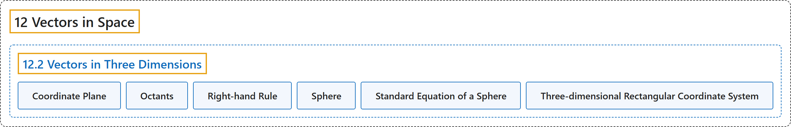

# 12.2 Vectors in Three Dimensions

## Classification

## Glossary

| Term | Definition | 中文翻译 | Source |
|---|---|---|---|
| **12 Vectors in Space** 空间向量 | (No definition) | （无定义） | [Strang & Herman, 2016c, chapter 2](https://openstax.org/books/calculus-volume-3/pages/2-introduction) |
| **12.2 Vectors in Three Dimensions** 三维向量 | (No definition) | （无定义） | [Strang & Herman, 2016c, section 2.2](https://openstax.org/books/calculus-volume-3/pages/2-2-vectors-in-three-dimensions) |
| **Coordinate Plane** 坐标平面 | "a plane containing **two of the three coordinate axes** in the three-dimensional coordinate system, named by the axes it contains: the xy-plane, xz-plane, or the yz-plane" | 三维坐标系中包含**三条坐标轴中两条**的平面，按其包含的轴命名：xy 平面、xz 平面或 yz 平面 | [Strang & Herman, 2016c, chapter 2 Key Terms](https://openstax.org/books/calculus-volume-3/pages/2-key-terms#fs-id1163723210185) |
| **Octants** 卦限 | "**the eight regions of space** created by the coordinate planes" | 坐标平面划分出的**空间的八个区域** | [Strang & Herman, 2016c, chapter 2 Key Terms](https://openstax.org/books/calculus-volume-3/pages/2-key-terms#fs-id1163723094490) |
| **Right-hand Rule** 右手法则 | "a common way to **define the orientation of the three-dimensional coordinate system**; when the right hand is curved around the z-axis in such a way that the fingers curl from the positive x-axis to the positive y-axis, the thumb points in the direction of the positive z-axis" | **规定三维坐标系方向**的常用方法；右手绕 z 轴弯曲，使手指从正 x 轴弯向正 y 轴时，拇指指向正 z 轴方向 | [Strang & Herman, 2016c, chapter 2 Key Terms](https://openstax.org/books/calculus-volume-3/pages/2-key-terms#fs-id1163723094449) |
| **Sphere** 球面 | "the set of all points **equidistant from a given point** known as the center" | **与给定点等距**的所有点的集合，这个给定点称为球心 | [Strang & Herman, 2016c, chapter 2 Key Terms](https://openstax.org/books/calculus-volume-3/pages/2-key-terms#fs-id1163723094500) |
| **Standard Equation of a Sphere** 球面的标准方程 | "$(x-a)^{2}+(y-b)^{2}+(z-c)^{2}=r^{2}$ **describes a sphere** with center $(a,b,c)$ and radius $r$" | $(x-a)^{2}+(y-b)^{2}+(z-c)^{2}=r^{2}$ **描述一个球面**，球心为 $(a,b,c)$，半径为 $r$ | [Strang & Herman, 2016c, chapter 2 Key Terms](https://openstax.org/books/calculus-volume-3/pages/2-key-terms#fs-id1163723094513) |
| **Three-dimensional Rectangular Coordinate System** 三维直角坐标系 | "a coordinate system defined by **three lines that intersect at right angles**; every point in space is described by an ordered triple $(x,y,z)$ that plots its location relative to the defining axes" | 由**三条两两成直角相交的直线**定义的坐标系；空间中每一点都由一个有序三元组 $(x,y,z)$ 描述，它标出该点相对于定义轴的位置 | [Strang & Herman, 2016c, chapter 2 Key Terms](https://openstax.org/books/calculus-volume-3/pages/2-key-terms#fs-id1163723094612) |

## References

Strang, G., & Herman, E. (2016c). *Calculus volume 3*. OpenStax. Retrieved October 29, 2026, from <https://openstax.org/details/books/calculus-volume-3>
