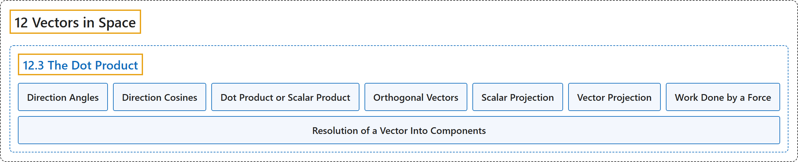

# 12.3 The Dot Product

## Classification

## Glossary

| Term | Definition | 中文翻译 | Source |
|---|---|---|---|
| **12 Vectors in Space** 空间向量 | (No definition) | （无定义） | [Strang & Herman, 2016c, chapter 2](https://openstax.org/books/calculus-volume-3/pages/2-introduction) |
| **12.3 The Dot Product** 点积 | (No definition) | （无定义） | [Strang & Herman, 2016c, section 2.3](https://openstax.org/books/calculus-volume-3/pages/2-3-the-dot-product) |
| **Direction Angles** 方向角 | "**the angles formed by a nonzero vector and the coordinate axes**" | **非零向量与坐标轴所成的角** | [Strang & Herman, 2016c, chapter 2 Key Terms](https://openstax.org/books/calculus-volume-3/pages/2-key-terms#fs-id1163724066368) |
| **Direction Cosines** 方向余弦 | "**the cosines of the angles** formed by a nonzero vector and the coordinate axes" | 非零向量与坐标轴所成**角的余弦** | [Strang & Herman, 2016c, chapter 2 Key Terms](https://openstax.org/books/calculus-volume-3/pages/2-key-terms#fs-id1163724066377) |
| **Dot Product or Scalar Product** 点积或数量积 | "$\text{u}\cdot \text{v}=u_{1}v_{1}+u_{2}v_{2}+u_{3}v_{3}$ **where** $\text{u}=\langle u_{1},u_{2},u_{3}\rangle$ and $\text{v}=\langle v_{1},v_{2},v_{3}\rangle$" | $\text{u}\cdot \text{v}=u_{1}v_{1}+u_{2}v_{2}+u_{3}v_{3}$ **其中** $\text{u}=\langle u_{1},u_{2},u_{3}\rangle$ 且 $\text{v}=\langle v_{1},v_{2},v_{3}\rangle$ | [Strang & Herman, 2016c, chapter 2 Key Terms](https://openstax.org/books/calculus-volume-3/pages/2-key-terms#fs-id1163724066387) |
| **Orthogonal Vectors** 正交向量 | "vectors that **form a right angle** when placed in standard position" | 放在标准位置时**成直角**的向量 | [Strang & Herman, 2016c, chapter 2 Key Terms](https://openstax.org/books/calculus-volume-3/pages/2-key-terms#fs-id1163724022871) |
| **Scalar Projection** 标量投影 | "**the magnitude of the vector projection** of a vector" | 一个向量的**向量投影的大小** | [Strang & Herman, 2016c, chapter 2 Key Terms](https://openstax.org/books/calculus-volume-3/pages/2-key-terms#fs-id1163724022862) |
| **Vector Projection** 向量投影 | "the component of a vector that **follows a given direction**" | 向量中**沿给定方向**的分量 | [Strang & Herman, 2016c, chapter 2 Key Terms](https://openstax.org/books/calculus-volume-3/pages/2-key-terms#fs-id1163724022881) |
| **Work Done by a Force** 力所做的功 | "work is generally thought of as the amount of energy it takes to move an object; if we represent an applied force by a vector F and the displacement of an object by a vector s, then the work done by the force is **the dot product of F and s**." | 功一般被看作移动物体所需的能量；若用向量 F 表示施加的力、用向量 s 表示物体的位移，则力所做的功是 **F 与 s 的点积**。 | [Strang & Herman, 2016c, chapter 2 Key Terms](https://openstax.org/books/calculus-volume-3/pages/2-key-terms#fs-id1163724022890) |
| **Resolution of a Vector Into Components** 向量分解为分量 | "This process is called **the resolution of a vector into components**." | 这个过程称为**把向量分解为分量**。 | [Strang & Herman, 2016c, section 2.3](https://openstax.org/books/calculus-volume-3/pages/2-3-the-dot-product#term-00010) |

## References

Strang, G., & Herman, E. (2016c). *Calculus volume 3*. OpenStax. Retrieved October 29, 2026, from <https://openstax.org/details/books/calculus-volume-3>
