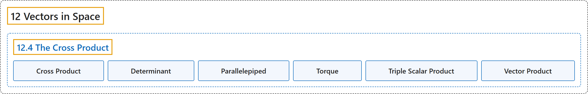

# 12.4 The Cross Product

## Classification

## Glossary

| Term | Definition | 中文翻译 | Source |
|---|---|---|---|
| **12 Vectors in Space** 空间向量 | (No definition) | （无定义） | [Strang & Herman, 2016c, chapter 2](https://openstax.org/books/calculus-volume-3/pages/2-introduction) |
| **12.4 The Cross Product** 叉积 | (No definition) | （无定义） | [Strang & Herman, 2016c, section 2.4](https://openstax.org/books/calculus-volume-3/pages/2-4-the-cross-product) |
| **Cross Product** 叉积 | "$\text{u}\,\times \,\text{v}=(u_{2}v_{3}-u_{3}v_{2})\text{i}-(u_{1}v_{3}-u_{3}v_{1})\text{j}+(u_{1}v_{2}-u_{2}v_{1})\text{k},$ **where** $\text{u}=\langle u_{1},u_{2},u_{3}\rangle$ and $\text{v}=\langle v_{1},v_{2},v_{3}\rangle$" | $\text{u}\,\times \,\text{v}=(u_{2}v_{3}-u_{3}v_{2})\text{i}-(u_{1}v_{3}-u_{3}v_{1})\text{j}+(u_{1}v_{2}-u_{2}v_{1})\text{k},$ **其中** $\text{u}=\langle u_{1},u_{2},u_{3}\rangle$ 且 $\text{v}=\langle v_{1},v_{2},v_{3}\rangle$ | [Strang & Herman, 2016c, chapter 2 Key Terms](https://openstax.org/books/calculus-volume-3/pages/2-key-terms#fs-id1163723198295) |
| **Determinant** 行列式 | "a real number **associated with a square matrix**" | **与方阵相联系的**实数 | [Strang & Herman, 2016c, chapter 2 Key Terms](https://openstax.org/books/calculus-volume-3/pages/2-key-terms#fs-id1163723289188) |
| **Parallelepiped** 平行六面体 | "a three-dimensional prism with **six faces that are parallelograms**" | **六个面都是平行四边形**的三维棱柱 | [Strang & Herman, 2016c, chapter 2 Key Terms](https://openstax.org/books/calculus-volume-3/pages/2-key-terms#fs-id1163723289197) |
| **Torque** 力矩 | "the effect of a force that **causes an object to rotate**" | 力**使物体转动**的效应 | [Strang & Herman, 2016c, chapter 2 Key Terms](https://openstax.org/books/calculus-volume-3/pages/2-key-terms#fs-id1163723289207) |
| **Triple Scalar Product** 三重数量积 | "the dot product of a vector with **the cross product of two other vectors**: $\text{u}\cdot (\text{v}\,\times \,\text{w})$" | 一个向量与**另外两个向量的叉积**的点积：$\text{u}\cdot (\text{v}\,\times \,\text{w})$ | [Strang & Herman, 2016c, chapter 2 Key Terms](https://openstax.org/books/calculus-volume-3/pages/2-key-terms#fs-id1163723289216) |
| **Vector Product** 向量积 | "**the cross product** of two vectors" | 两个向量的**叉积** | [Strang & Herman, 2016c, chapter 2 Key Terms](https://openstax.org/books/calculus-volume-3/pages/2-key-terms#fs-id1163723289267) |

## References

Strang, G., & Herman, E. (2016c). *Calculus volume 3*. OpenStax. Retrieved October 29, 2026, from <https://openstax.org/details/books/calculus-volume-3>
