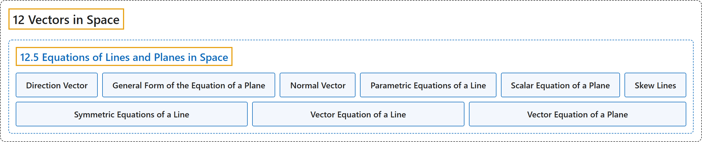

# 12.5 Equations of Lines and Planes in Space

## Classification

## Glossary

| Term | Definition | 中文翻译 | Source |
|---|---|---|---|
| **12 Vectors in Space** 空间向量 | (No definition) | （无定义） | [Strang & Herman, 2016c, chapter 2](https://openstax.org/books/calculus-volume-3/pages/2-introduction) |
| **12.5 Equations of Lines and Planes in Space** 空间直线与平面的方程 | (No definition) | （无定义） | [Strang & Herman, 2016c, section 2.5](https://openstax.org/books/calculus-volume-3/pages/2-5-equations-of-lines-and-planes-in-space) |
| **Direction Vector** 方向向量 | "**a vector parallel to a line** that is used to describe the direction, or orientation, of the line in space" | **平行于直线的向量**，用来描述直线在空间中的方向或取向 | [Strang & Herman, 2016c, chapter 2 Key Terms](https://openstax.org/books/calculus-volume-3/pages/2-key-terms#fs-id1163723342542) |
| **General Form of the Equation of a Plane** 平面方程的一般式 | "an equation in the form $ax+by+cz+d=0,$ where $\text{n}=\langle a,b,c\rangle$ **is a normal vector of the plane**, $P=(x_{0},y_{0},z_{0})$ is a point on the plane, and $d=-ax_{0}-by_{0}-cz_{0}$" | 形如 $ax+by+cz+d=0,$ 的方程，其中 $\text{n}=\langle a,b,c\rangle$ **是平面的法向量**，$P=(x_{0},y_{0},z_{0})$ 是平面上一点，且 $d=-ax_{0}-by_{0}-cz_{0}$ | [Strang & Herman, 2016c, chapter 2 Key Terms](https://openstax.org/books/calculus-volume-3/pages/2-key-terms#fs-id1163723342553) |
| **Normal Vector** 法向量 | "a vector **perpendicular to a plane**" | **垂直于平面**的向量 | [Strang & Herman, 2016c, chapter 2 Key Terms](https://openstax.org/books/calculus-volume-3/pages/2-key-terms#fs-id1163724121681) |
| **Parametric Equations of a Line** 直线的参数方程 | "the set of equations $x=x_{0}+ta,$ $y=y_{0}+tb,$ and $z=z_{0}+tc$ **describing the line with direction vector** $\text{v}=\langle a,b,c\rangle$ passing through point $(x_{0},y_{0},z_{0})$" | 方程组 $x=x_{0}+ta,$ $y=y_{0}+tb,$ 和 $z=z_{0}+tc$，**描述方向向量为** $\text{v}=\langle a,b,c\rangle$、经过点 $(x_{0},y_{0},z_{0})$ 的直线 | [Strang & Herman, 2016c, chapter 2 Key Terms](https://openstax.org/books/calculus-volume-3/pages/2-key-terms#fs-id1163724121691) |
| **Scalar Equation of a Plane** 平面的数量方程 | "the equation $a(x-x_{0})+b(y-y_{0})+c(z-z_{0})=0$ **used to describe a plane containing point** $P=(x_{0},y_{0},z_{0})$ with normal vector $\text{n}=\langle a,b,c\rangle$ or its alternate form $ax+by+cz+d=0,$ where $d=-ax_{0}-by_{0}-cz_{0}$" | 方程 $a(x-x_{0})+b(y-y_{0})+c(z-z_{0})=0$，**用来描述含点** $P=(x_{0},y_{0},z_{0})$、法向量为 $\text{n}=\langle a,b,c\rangle$ 的平面，或其另一种形式 $ax+by+cz+d=0,$ 其中 $d=-ax_{0}-by_{0}-cz_{0}$ | [Strang & Herman, 2016c, chapter 2 Key Terms](https://openstax.org/books/calculus-volume-3/pages/2-key-terms#fs-id1163724121822) |
| **Skew Lines** 异面直线 | "two lines that are **not parallel but do not intersect**" | **不平行但也不相交**的两条直线 | [Strang & Herman, 2016c, chapter 2 Key Terms](https://openstax.org/books/calculus-volume-3/pages/2-key-terms#fs-id1163723361734) |
| **Symmetric Equations of a Line** 直线的对称式方程 | "the equations $\frac{x-x_{0}}{a}=\frac{y-y_{0}}{b}=\frac{z-z_{0}}{c}$ **describing the line with direction vector** $\text{v}=\langle a,b,c\rangle$ passing through point $(x_{0},y_{0},z_{0})$" | 方程 $\frac{x-x_{0}}{a}=\frac{y-y_{0}}{b}=\frac{z-z_{0}}{c}$，**描述方向向量为** $\text{v}=\langle a,b,c\rangle$、经过点 $(x_{0},y_{0},z_{0})$ 的直线 | [Strang & Herman, 2016c, chapter 2 Key Terms](https://openstax.org/books/calculus-volume-3/pages/2-key-terms#fs-id1163723361744) |
| **Vector Equation of a Line** 直线的向量方程 | "the equation $\text{r}={\text{r}}_{0}+t\text{v}$ used to describe a line with direction vector $\text{v}=\langle a,b,c\rangle$ passing through point $P=(x_{0},y_{0},z_{0}),$ where ${\text{r}}_{0}=\langle x_{0},y_{0},z_{0}\rangle ,$ **is the position vector of point** $P$" | 方程 $\text{r}={\text{r}}_{0}+t\text{v}$，用来描述方向向量为 $\text{v}=\langle a,b,c\rangle$、经过点 $P=(x_{0},y_{0},z_{0}),$ 的直线，其中 ${\text{r}}_{0}=\langle x_{0},y_{0},z_{0}\rangle ,$ **是点 $P$ 的位置向量** | [Strang & Herman, 2016c, chapter 2 Key Terms](https://openstax.org/books/calculus-volume-3/pages/2-key-terms#fs-id1163723361871) |
| **Vector Equation of a Plane** 平面的向量方程 | "the equation $\text{n}\cdot \vec{PQ}=0,$ where $P$ is a given point in the plane, $Q$ is any point in the plane, and $\text{n}$ **is a normal vector of the plane**" | 方程 $\text{n}\cdot \vec{PQ}=0,$ 其中 $P$ 是平面上给定的一点，$Q$ 是平面上任一点，$\text{n}$ **是平面的法向量** | [Strang & Herman, 2016c, chapter 2 Key Terms](https://openstax.org/books/calculus-volume-3/pages/2-key-terms#fs-id1163724148191) |

## References

Strang, G., & Herman, E. (2016c). *Calculus volume 3*. OpenStax. Retrieved October 29, 2026, from <https://openstax.org/details/books/calculus-volume-3>
