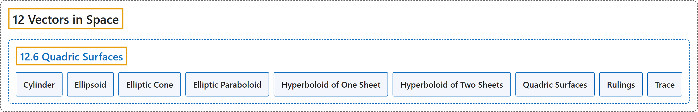

# 12.6 Quadric Surfaces

## Classification

## Glossary

| Term | Definition | 中文翻译 | Source |
|---|---|---|---|
| **12 Vectors in Space** 空间向量 | (No definition) | （无定义） | [Strang & Herman, 2016c, chapter 2](https://openstax.org/books/calculus-volume-3/pages/2-introduction) |
| **12.6 Quadric Surfaces** 二次曲面 | (No definition) | （无定义） | [Strang & Herman, 2016c, section 2.6](https://openstax.org/books/calculus-volume-3/pages/2-6-quadric-surfaces) |
| **Cylinder** 柱面 | "a set of lines **parallel to a given line passing through a given curve**" | **平行于给定直线并经过给定曲线**的一族直线 | [Strang & Herman, 2016c, chapter 2 Key Terms](https://openstax.org/books/calculus-volume-3/pages/2-key-terms#fs-id1163723474257) |
| **Ellipsoid** 椭球面 | "a three-dimensional surface described by an equation of the form $\frac{x^{2}}{a^{2}}+\frac{y^{2}}{b^{2}}+\frac{z^{2}}{c^{2}}=1;$ **all traces of this surface are ellipses**" | 由形如 $\frac{x^{2}}{a^{2}}+\frac{y^{2}}{b^{2}}+\frac{z^{2}}{c^{2}}=1;$ 的方程描述的三维曲面；**这个曲面的所有截痕都是椭圆** | [Strang & Herman, 2016c, chapter 2 Key Terms](https://openstax.org/books/calculus-volume-3/pages/2-key-terms#fs-id1163723474266) |
| **Elliptic Cone** 椭圆锥面 | "a three-dimensional surface described by an equation of the form $\frac{x^{2}}{a^{2}}+\frac{y^{2}}{b^{2}}-\frac{z^{2}}{c^{2}}=0;$ traces of this surface include **ellipses and intersecting lines**" | 由形如 $\frac{x^{2}}{a^{2}}+\frac{y^{2}}{b^{2}}-\frac{z^{2}}{c^{2}}=0;$ 的方程描述的三维曲面；这个曲面的截痕包括**椭圆和相交直线** | [Strang & Herman, 2016c, chapter 2 Key Terms](https://openstax.org/books/calculus-volume-3/pages/2-key-terms#fs-id1163723495793) |
| **Elliptic Paraboloid** 椭圆抛物面 | "a three-dimensional surface described by an equation of the form $z=\frac{x^{2}}{a^{2}}+\frac{y^{2}}{b^{2}};$ traces of this surface include **ellipses and parabolas**" | 由形如 $z=\frac{x^{2}}{a^{2}}+\frac{y^{2}}{b^{2}};$ 的方程描述的三维曲面；这个曲面的截痕包括**椭圆和抛物线** | [Strang & Herman, 2016c, chapter 2 Key Terms](https://openstax.org/books/calculus-volume-3/pages/2-key-terms#fs-id1163723497222) |
| **Hyperboloid of One Sheet** 单叶双曲面 | "a three-dimensional surface described by an equation of the form $\frac{x^{2}}{a^{2}}+\frac{y^{2}}{b^{2}}-\frac{z^{2}}{c^{2}}=1;$ traces of this surface include **ellipses and hyperbolas**" | 由形如 $\frac{x^{2}}{a^{2}}+\frac{y^{2}}{b^{2}}-\frac{z^{2}}{c^{2}}=1;$ 的方程描述的三维曲面；这个曲面的截痕包括**椭圆和双曲线** | [Strang & Herman, 2016c, chapter 2 Key Terms](https://openstax.org/books/calculus-volume-3/pages/2-key-terms#fs-id1163723494568) |
| **Hyperboloid of Two Sheets** 双叶双曲面 | "a three-dimensional surface described by an equation of the form $\frac{z^{2}}{c^{2}}-\frac{x^{2}}{a^{2}}-\frac{y^{2}}{b^{2}}=1;$ traces of this surface include **ellipses and hyperbolas**" | 由形如 $\frac{z^{2}}{c^{2}}-\frac{x^{2}}{a^{2}}-\frac{y^{2}}{b^{2}}=1;$ 的方程描述的三维曲面；这个曲面的截痕包括**椭圆和双曲线** | [Strang & Herman, 2016c, chapter 2 Key Terms](https://openstax.org/books/calculus-volume-3/pages/2-key-terms#fs-id1163724080720) |
| **Quadric Surfaces** 二次曲面 | "surfaces in three dimensions having the property that **the traces of the surface are conic sections** (ellipses, hyperbolas, and parabolas)" | 三维空间中的曲面，其性质是**曲面的截痕都是圆锥曲线**（椭圆、双曲线和抛物线） | [Strang & Herman, 2016c, chapter 2 Key Terms](https://openstax.org/books/calculus-volume-3/pages/2-key-terms#fs-id1163723500562) |
| **Rulings** 母线 | "**parallel lines that make up a cylindrical surface**" | **构成柱面的平行直线** | [Strang & Herman, 2016c, chapter 2 Key Terms](https://openstax.org/books/calculus-volume-3/pages/2-key-terms#fs-id1163723500573) |
| **Trace** 截痕 | "**the intersection of a three-dimensional surface with a coordinate plane**" | **三维曲面与坐标平面的交** | [Strang & Herman, 2016c, chapter 2 Key Terms](https://openstax.org/books/calculus-volume-3/pages/2-key-terms#fs-id1163723500583) |

## References

Strang, G., & Herman, E. (2016c). *Calculus volume 3*. OpenStax. Retrieved October 29, 2026, from <https://openstax.org/details/books/calculus-volume-3>
