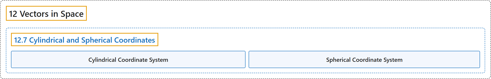

# 12.7 Cylindrical and Spherical Coordinates

## Classification

## Glossary

| Term | Definition | 中文翻译 | Source |
|---|---|---|---|
| **12 Vectors in Space** 空间向量 | (No definition) | （无定义） | [Strang & Herman, 2016c, chapter 2](https://openstax.org/books/calculus-volume-3/pages/2-introduction) |
| **12.7 Cylindrical and Spherical Coordinates** 柱坐标与球坐标 | (No definition) | （无定义） | [Strang & Herman, 2016c, section 2.7](https://openstax.org/books/calculus-volume-3/pages/2-7-cylindrical-and-spherical-coordinates) |
| **Cylindrical Coordinate System** 柱坐标系 | "a way to describe a location in space with an ordered triple $(r,\theta ,z),$ where $(r,\theta )$ represents **the polar coordinates of the point’s projection in the xy-plane**, and $z$ represents the point’s projection onto the z-axis" | 用有序三元组 $(r,\theta ,z),$ 描述空间位置的一种方式，其中 $(r,\theta )$ 表示**该点在 xy 平面上投影的极坐标**，$z$ 表示该点在 z 轴上的投影 | [Strang & Herman, 2016c, chapter 2 Key Terms](https://openstax.org/books/calculus-volume-3/pages/2-key-terms#fs-id1163724042242) |
| **Spherical Coordinate System** 球坐标系 | "a way to describe a location in space with an ordered triple $(\rho ,\theta ,\varphi ),$ where $\rho$ is the distance between $P$ and the origin $(\rho \ne 0),$ $\theta$ is the same angle used to describe the location in cylindrical coordinates, and $\varphi$ is **the angle formed by the positive z-axis and line segment** $\overline{OP},$ where $O$ is the origin and $0\le \varphi \le \pi$" | 用有序三元组 $(\rho ,\theta ,\varphi ),$ 描述空间位置的一种方式，其中 $\rho$ 是 $P$ 与原点之间的距离 $(\rho \ne 0),$ $\theta$ 是柱坐标中描述位置所用的同一个角，$\varphi$ 是**正 z 轴与线段 $\overline{OP},$ 所成的角**，其中 $O$ 是原点，且 $0\le \varphi \le \pi$ | [Strang & Herman, 2016c, chapter 2 Key Terms](https://openstax.org/books/calculus-volume-3/pages/2-key-terms#fs-id1163723290017) |

## References

Strang, G., & Herman, E. (2016c). *Calculus volume 3*. OpenStax. Retrieved October 29, 2026, from <https://openstax.org/details/books/calculus-volume-3>
