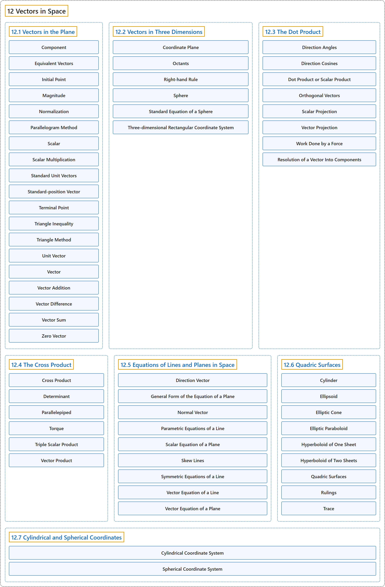

# 12 Vectors in Space

## Classification

## Glossary

| Term | Definition | 中文翻译 | Source |
|---|---|---|---|
| **12 Vectors in Space** 空间向量 | (No definition) | （无定义） | [Strang & Herman, 2016c, chapter 2](https://openstax.org/books/calculus-volume-3/pages/2-introduction) |
| **[12.1 Vectors in the Plane](12-1-vectors-in-the-plane.md)** 平面向量 | (No definition) | （无定义） | [Strang & Herman, 2016c, section 2.1](https://openstax.org/books/calculus-volume-3/pages/2-1-vectors-in-the-plane) |
| **[12.2 Vectors in Three Dimensions](12-2-vectors-in-three-dimensions.md)** 三维向量 | (No definition) | （无定义） | [Strang & Herman, 2016c, section 2.2](https://openstax.org/books/calculus-volume-3/pages/2-2-vectors-in-three-dimensions) |
| **[12.3 The Dot Product](12-3-the-dot-product.md)** 点积 | (No definition) | （无定义） | [Strang & Herman, 2016c, section 2.3](https://openstax.org/books/calculus-volume-3/pages/2-3-the-dot-product) |
| **[12.4 The Cross Product](12-4-the-cross-product.md)** 叉积 | (No definition) | （无定义） | [Strang & Herman, 2016c, section 2.4](https://openstax.org/books/calculus-volume-3/pages/2-4-the-cross-product) |
| **[12.5 Equations of Lines and Planes in Space](12-5-equations-of-lines-and-planes-in-space.md)** 空间直线与平面的方程 | (No definition) | （无定义） | [Strang & Herman, 2016c, section 2.5](https://openstax.org/books/calculus-volume-3/pages/2-5-equations-of-lines-and-planes-in-space) |
| **[12.6 Quadric Surfaces](12-6-quadric-surfaces.md)** 二次曲面 | (No definition) | （无定义） | [Strang & Herman, 2016c, section 2.6](https://openstax.org/books/calculus-volume-3/pages/2-6-quadric-surfaces) |
| **[12.7 Cylindrical and Spherical Coordinates](12-7-cylindrical-and-spherical-coordinates.md)** 柱坐标与球坐标 | (No definition) | （无定义） | [Strang & Herman, 2016c, section 2.7](https://openstax.org/books/calculus-volume-3/pages/2-7-cylindrical-and-spherical-coordinates) |

## References

Strang, G., & Herman, E. (2016c). *Calculus volume 3*. OpenStax. Retrieved October 29, 2026, from <https://openstax.org/details/books/calculus-volume-3>
