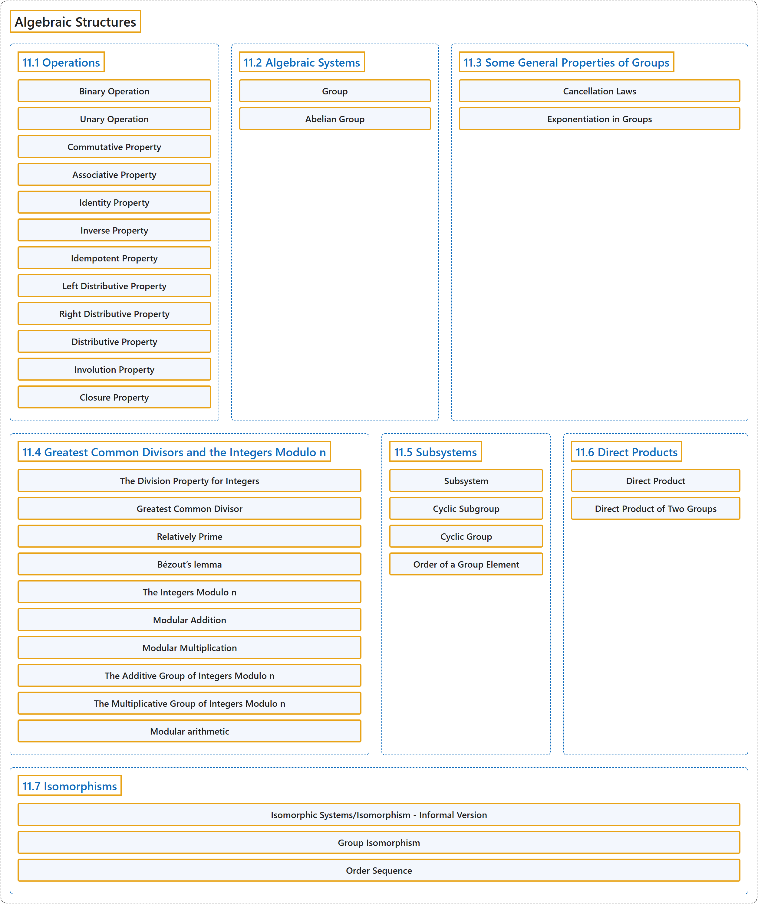

# 11 Algebraic Structures

## Classification

## Glossary

| Term | Definition | 中文翻译 | Source |
|---|---|---|---|
| **11 Algebraic Structures** 代数结构 | (No definition) | （无定义） | [Doerr & Levasseur, n.d., chapter 11](https://discretemath.org/ads/chapter_11.html) |
| **11.1 Operations** 运算 | (No definition) | （无定义） | [Doerr & Levasseur, n.d., section 11.1](https://discretemath.org/ads/s-Operations.html) |
| **Binary Operation** 二元运算 | "Let $S$ be a nonempty set. A **binary operation** on $S$ is **a rule that assigns to each ordered pair of elements of $S$ a unique element of $S\text{.}$** In other words, a binary operation is a **function from $S\times S$ into $S\text{.}$**" | 设 $S$ 为非空集合。$S$ 上的**二元运算**是**为 $S$ 的每个有序元素对指定 $S$ 中唯一一个元素的规则**。换言之，二元运算是**从 $S\times S$ 到 $S$ 的函数**。 | [Doerr & Levasseur, n.d., Definition 11.1.1](https://discretemath.org/ads/s-Operations.html#def-binary-operation) |
| **Unary Operation** 一元运算 | "Let $S$ be a nonempty set. A **unary operator** on $S$ is **a rule that assigns to each element of $S$ a unique element of $S\text{.}$** In other words, a unary operator is a **function from $S$ into $S\text{.}$**" | 设 $S$ 为非空集合。$S$ 上的**一元运算**是**为 $S$ 的每个元素指定 $S$ 中唯一一个元素的规则**。换言之，一元运算是**从 $S$ 到 $S$ 的函数**。 | [Doerr & Levasseur, n.d., Definition 11.1.4](https://discretemath.org/ads/s-Operations.html#def-unary-operation) |
| **Commutative Property** 交换律 | "Let $*$ be a binary operation on a set $S\text{.}$ We say that $*$ is **commutative** if and only if $a * b = b * a$ for all $a, b \in S\text{.}$" | 设 $*$ 为集合 $S$。 上的二元运算。我们说 $*$ 是**可交换的**，当且仅当对所有 $a, b \in S$。 都有 $a * b = b * a$。 | [Doerr & Levasseur, n.d., Definition 11.1.5](https://discretemath.org/ads/s-Operations.html#def-commutative-property) |
| **Associative Property** 结合律 | "Let $*$ be a binary operation on a set $S\text{.}$ We say that $*$ is **associative** if and only if $(a * b) * c = a * (b * c)$ for all $a, b, c \in S\text{.}$" | 设 $*$ 为集合 $S$。 上的二元运算。我们说 $*$ 是**可结合的**，当且仅当对所有 $a, b, c \in S$。 都有 $(a * b) * c = a * (b * c)$。 | [Doerr & Levasseur, n.d., Definition 11.1.6](https://discretemath.org/ads/s-Operations.html#def-associative-property) |
| **Identity Property** 单位元性质 | "Let $*$ be a binary operation on a set $S\text{.}$ We say that $*$ **has an identity** if and only if **there exists an element, $e\text{,}$ in $S$** such that $a * e = e * a = a$ for all $a \in S\text{.}$" | 设 $*$ 为集合 $S$ 上的二元运算。我们说 $*$ 有**单位元**，当且仅当 **$S$ 中存在元素 $e$，**，使得对所有 $a \in S$。 都有 $a * e = e * a = a$。 | [Doerr & Levasseur, n.d., Definition 11.1.7](https://discretemath.org/ads/s-Operations.html#def-identity-property) |
| **Inverse Property** 逆元性质 | "Let $*$ be a binary operation on a set $S\text{.}$ We say that $*$ **has the inverse property** if and only if for each $a \in S\text{,}$ there exists $b \in S$ such that $a*b = b*a = e\text{.}$ We call $b$ an **inverse of $a\text{.}$**" | 设 $*$ 为集合 $S$。 上的二元运算。我们说 $*$ 具有**逆元性质**，当且仅当对每个 $a \in S$，存在 $b \in S$ 使得 $a*b = b*a = e$。我们称 $b$ 为 $a$。 的**逆元**。 | [Doerr & Levasseur, n.d., Definition 11.1.8](https://discretemath.org/ads/s-Operations.html#def-inverse-property) |
| **Idempotent Property** 幂等律 | "Let $*$ be a binary operation on a set $S\text{.}$ We say that $*$ is **idempotent** if and only if $a * a = a$ for all $a \in S\text{.}$" | 设 $*$ 为集合 $S$。 上的二元运算。我们说 $*$ 是**幂等的**，当且仅当对所有 $a \in S$。 都有 $a * a = a$。 | [Doerr & Levasseur, n.d., Definition 11.1.9](https://discretemath.org/ads/s-Operations.html#def-idempotent-property) |
| **Left Distributive Property** 左分配律 | "Let $*$ and $\diamond$ be binary operations on a set $S\text{.}$ We say that $\diamond$ is **left distributive** over $*$ if and only if $a \diamond (b * c) = (a \diamond b) * (a \diamond c)$ for all $a,b,c\in S\text{.}$" | 设 $*$ 和 $\diamond$ 为集合 $S$。 上的二元运算。我们说 $\diamond$ 对 $*$ 是**左分配的**，当且仅当对所有 $a,b,c\in S$。 都有 $a \diamond (b * c) = (a \diamond b) * (a \diamond c)$。 | [Doerr & Levasseur, n.d., Definition 11.1.10](https://discretemath.org/ads/s-Operations.html#def-left-distributive-property) |
| **Right Distributive Property** 右分配律 | "Let $*$ and $\diamond$ be binary operations on a set $S\text{.}$ We say that $\diamond$ is **right distributive** over $*$ if and only if $(b * c)\diamond a = (b\diamond a) * (c \diamond a)$ for all $a,b,c\in S\text{.}$" | 设 $*$ 和 $\diamond$ 为集合 $S$。 上的二元运算。我们说 $\diamond$ 对 $*$ 是**右分配的**，当且仅当对所有 $a,b,c\in S$。 都有 $(b * c)\diamond a = (b\diamond a) * (c \diamond a)$。 | [Doerr & Levasseur, n.d., Definition 11.1.11](https://discretemath.org/ads/s-Operations.html#def-right-distributive-property) |
| **Distributive Property** 分配律 | "Let $*$ and $\diamond$ be binary operations on a set $S\text{.}$ We say that $\diamond$ is **distributive** over $*$ if and only if $\diamond$ is **both left and right distributive** over $*\text{.}$" | 设 $*$ 和 $\diamond$ 为集合 $S$。 上的二元运算。我们说 $\diamond$ 对 $*$ 是**可分配的**，当且仅当 $\diamond$ 对 $*$ **既是左分配的又是右分配的**。 | [Doerr & Levasseur, n.d., Definition 11.1.12](https://discretemath.org/ads/s-Operations.html#def-distributive-property) |
| **Involution Property** 对合律 | "Let $-$ be a unary operation on $S\text{.}$ We say that $-$ has the **involution property** if $-(-a) = a$ for all $a \in S\text{.}$" | 设 $-$ 为 $S$。 上的一元运算。我们说 $-$ 具有**对合性质**，如果对所有 $a \in S$。 都有 $-(-a) = a$。 | [Doerr & Levasseur, n.d., Definition 11.1.13](https://discretemath.org/ads/s-Operations.html#def-involution-property) |
| **Closure Property** 封闭性 | "Let $T$ be a subset of $S$ and let $*$ be a binary operation on $S\text{.}$ We say that $T$ is **closed under** $*$ if $a, b \in T$ implies that $a * b \in T\text{.}$" | 设 $T$ 为 $S$ 的子集，$*$ 为 $S$ 上的二元运算。我们说 $T$ 对 $*$ **封闭**，如果 $a, b \in T$ 蕴含 $a * b \in T$。 | [Doerr & Levasseur, n.d., Definition 11.1.14](https://discretemath.org/ads/s-Operations.html#def-closure-property) |
| **11.2 Algebraic Systems** 代数系统 | (No definition) | （无定义） | [Doerr & Levasseur, n.d., section 11.2](https://discretemath.org/ads/s-algebraic-systems.html) |
| **Group** 群 | "A **group** consists of a **nonempty set $G$** and a binary operation $*$ on $G$ satisfying the properties" | **群**由**非空集合 $G$** 和 $G$ 上的二元运算 $*$ 组成，并满足下列性质 | [Doerr & Levasseur, n.d., Definition 11.2.3](https://discretemath.org/ads/s-algebraic-systems.html#def-Group) |
| **Abelian Group** 阿贝尔群 | "A group is **abelian if its operation is commutative**." | 若群的运算是可交换的，则该群是**阿贝尔群**。 | [Doerr & Levasseur, n.d., Definition 11.2.6](https://discretemath.org/ads/s-algebraic-systems.html#def-abelian-group) |
| **11.3 Some General Properties of Groups** 群的一些一般性质 | (No definition) | （无定义） | [Doerr & Levasseur, n.d., section 11.3](https://discretemath.org/ads/s-general-properties-of-groups.html) |
| **Cancellation Laws** 消去律 | "If $a\text{,}$ $b\text{,}$ and $c$ are **elements of group $G\text{,}$** then" | 若 $a$、$b$， 和 $c$ 是**群 $G$， 的元素**，则 | [Doerr & Levasseur, n.d., Theorem 11.3.8](https://discretemath.org/ads/s-general-properties-of-groups.html#theorem-11-3-cancellation) |
| **Exponentiation in Groups** 群中的幂运算 | "For $n \geq 0\text{,}$ **define $a^n$ recursively** by $a ^0 = e$ and if $n > 0, a^n= a^{n-1} *a\text{.}$ Also, if $n >1\text{,}$ $a^{-n}= \left(a^n\right)^{-1}\text{.}$" | 对 $n \geq 0$，**递归地定义 $a^n$**：$a ^0 = e$，且若 $n > 0, a^n= a^{n-1} *a$。另外，若 $n >1$，则 $a^{-n}= \left(a^n\right)^{-1}$。 | [Doerr & Levasseur, n.d., Definition 11.3.11](https://discretemath.org/ads/s-general-properties-of-groups.html#def-exponents-in-groups) |
| **11.4 Greatest Common Divisors and the Integers Modulo n** 最大公约数与模 n 整数 | (No definition) | （无定义） | [Doerr & Levasseur, n.d., section 11.4](https://discretemath.org/ads/s-gcds-and-zsubn.html) |
| **The Division Property for Integers** 整数的带余除法性质 | "If $m, n\in \mathbb{Z}\text{,}$ $n>0\text{,}$ then **there exist two unique integers, $q$ (the quotient) and $r$ (the remainder)**, such that $m = n q + r$ and $0 \leq r < n\text{.}$" | 若 $m, n\in \mathbb{Z}$， 且 $n>0$，则**存在唯一的两个整数 $q$（商）和 $r$（余数）**，使得 $m = n q + r$ 且 $0 \leq r < n$。 | [Doerr & Levasseur, n.d., Theorem 11.4.1](https://discretemath.org/ads/s-gcds-and-zsubn.html#th-division-property) |
| **Greatest Common Divisor** 最大公约数 | "Given two integers, $a$ and $b\text{,}$ not both zero, the **greatest common divisor** of $a$ and $b$ is **the positive integer** $g=\gcd(a,b)$ such that $g \mid a\text{,}$ $g\mid b\text{,}$ and" | 给定两个不全为零的整数 $a$ 和 $b$，$a$ 与 $b$ 的**最大公约数**是**正整数** $g=\gcd(a,b)$，使得 $g \mid a$，$g\mid b$，并且 | [Doerr & Levasseur, n.d., Definition 11.4.5](https://discretemath.org/ads/s-gcds-and-zsubn.html#def-gcd) |
| **Relatively Prime** 互素 | "A pair of integers, $a$ and $b\text{,}$ are **relatively prime** if $\gcd(a, b)=1$" | 一对整数 $a$ 和 $b$， **互素**，如果 $\gcd(a, b)=1$ | [Doerr & Levasseur, n.d., Definition 11.4.6](https://discretemath.org/ads/s-gcds-and-zsubn.html#def-def-rel-prime) |
| **Bézout’s lemma** 裴蜀引理 | "If $a$ and $b$ are positive integers, the **smallest positive value of $a x + b y$ is the greatest common divisor** of $a$ and $b\text{,}$ $\gcd(a,b)\text{.}$" | 若 $a$ 和 $b$ 是正整数，则 **$a x + b y$ 的最小正值是最大公约数** $\gcd(a,b)$，即 $a$ 与 $b$ 的最大公约数。 | [Doerr & Levasseur, n.d., Theorem 11.4.10](https://discretemath.org/ads/s-gcds-and-zsubn.html#theorem-11-4-1) |
| **The Integers Modulo n** 模 n 整数 | "If $n$ is a positive integer greater than one, we define the **integers modulo $n$** to be the set $\{0, 1, 2,..., n-1\}\text{.}$" | 若 $n$ 是大于 1 的正整数，我们把**模 $n$ 整数**定义为集合 $\{0, 1, 2,..., n-1\}$。 | [Doerr & Levasseur, n.d., Definition 11.4.13](https://discretemath.org/ads/s-gcds-and-zsubn.html#def-integers-modulo-n) |
| **Modular Addition** 模加法 | "If $n$ is a positive integer, we define **addition modulo $n$** $\left(+_n\right.$) as follows. If $a, b \in \mathbb{Z}_n\text{,}$" | 若 $n$ 是正整数，我们如下定义**模 $n$ 加法** $\left(+_n\right.$)。若 $a, b \in \mathbb{Z}_n$， | [Doerr & Levasseur, n.d., Definition 11.4.14](https://discretemath.org/ads/s-gcds-and-zsubn.html#def-def-modular-addition) |
| **Modular Multiplication** 模乘法 | "If $n$ is a positive integer, we define **multiplication modulo $n$** $\left(\times_n\right.$) as follows. If $a, b \in \mathbb{Z}_n\text{,}$" | 若 $n$ 是正整数，我们如下定义**模 $n$ 乘法** $\left(\times_n\right.$)。若 $a, b \in \mathbb{Z}_n$， | [Doerr & Levasseur, n.d., Definition 11.4.15](https://discretemath.org/ads/s-gcds-and-zsubn.html#def-def-modular-multiplication) |
| **The Additive Group of Integers Modulo n** 模 n 整数加法群 | "**The Additive Group of Integers Modulo $n$** is the group with domain $\{0, 1, 2, \dots, n-1\}$ and with **the operation of mod $n$ addition**. It is denoted as $\mathbb{Z}_n\text{.}$" | **模 $n$ 整数加法群**是以 $\{0, 1, 2, \dots, n-1\}$ 为定义域、运算为**模 $n$ 加法**的群。记作 $\mathbb{Z}_n$。 | [Doerr & Levasseur, n.d., Definition 11.4.19](https://discretemath.org/ads/s-gcds-and-zsubn.html#ss-properties-modular-arithmetic-5) |
| **The Multiplicative Group of Integers Modulo n** 模 n 整数乘法群 | "**The Multiplicative Group of Integers Modulo $n$** is the group with domain $\{k\in \mathbb{Z} \vert 1 \leq k \leq n-1 \textrm{ and }\gcd(n,k)=1\}$ and with **the operation of mod $n$ multiplication**. It is denoted as $\mathbb{U}_n\text{.}$" | **模 $n$ 整数乘法群**是以 $\{k\in \mathbb{Z} \vert 1 \leq k \leq n-1 \textrm{ and }\gcd(n,k)=1\}$ 为定义域、运算为**模 $n$ 乘法**的群。记作 $\mathbb{U}_n$。 | [Doerr & Levasseur, n.d., Definition 11.4.20](https://discretemath.org/ads/s-gcds-and-zsubn.html#ss-properties-modular-arithmetic-9) |
| **Modular arithmetic** 模运算 | "Modular arithmetic is the **arithmetic of congruences**, sometimes known informally as '**clock arithmetic**.'" | 模运算是**同余的算术**，非正式地也称为“**时钟算术**”。 | [Weisstein, n.d., "Modular arithmetic" entry, para. 1](https://mathworld.wolfram.com/ModularArithmetic.html#:~:text=Modular%20arithmetic%20is%20the%20arithmetic%20of%20congruences) |
| **11.5 Subsystems** 子系统 | (No definition) | （无定义） | [Doerr & Levasseur, n.d., section 11.5](https://discretemath.org/ads/s-Subsystems.html) |
| **Subsystem** 子系统 | "If $\left[V; *_1, \ldots,*_n\right]$ is an algebraic system of a certain kind and $W$ is a subset of $V\text{,}$ then **$W$ is a subsystem of $V$** if $\left[W; *_1, \ldots,*_n\right]$ is **an algebraic system of the same kind as $V\text{.}$** The usual notation for “$W$ is a subsystem of $V$” is $W \leq V\text{.}$" | 若 $\left[V; *_1, \ldots,*_n\right]$ 是某一类代数系统，$W$ 是 $V$ 的子集，且 $\left[W; *_1, \ldots,*_n\right]$ 是与 $V$ **同类的代数系统**，则称 **$W$ 是 $V$ 的子系统**。“$W$ 是 $V$ 的子系统”的通常记法是 $W \leq V$。 | [Doerr & Levasseur, n.d., Definition 11.5.1](https://discretemath.org/ads/s-Subsystems.html#def-subsystem) |
| **Cyclic Subgroup** 循环子群 | "If $G$ is a group and $a \in G\text{,}$ **the cyclic subgroup generated by $a\text{,}$** $\langle a \rangle\text{,}$ is **the set of all powers of $a\text{:}$**" | 若 $G$ 是群且 $a \in G$， 则**由 $a$， 生成的循环子群** $\langle a \rangle$， 是 **$a$： 的所有幂的集合** | [Doerr & Levasseur, n.d., Definition 11.5.6](https://discretemath.org/ads/s-Subsystems.html#def-cyclic-subgroup) |
| **Cyclic Group** 循环群 | "**A group $G$ is cyclic** if there exists $\beta \in G$ such that $\langle \beta \rangle=G\text{.}$" | 若存在 $\beta \in G$ 使得 $\langle \beta \rangle=G$。 则群 $G$ 是**循环群**。 | [Doerr & Levasseur, n.d., Definition 11.5.7](https://discretemath.org/ads/s-Subsystems.html#def-cyclic-group) |
| **Order of a Group Element** 群元素的阶 | "**The order of an element $a$ of group $G$** is **the number of elements in the cyclic subgroup of $G$ generated by** $a\text{.}$ The order of $a$ is denoted $ord(a)\text{.}$" | **群 $G$ 的元素 $a$ 的阶**是 $G$ 中由 $a$ 生成的循环子群的**元素个数**。$a$ 的阶记作 $ord(a)$。 | [Doerr & Levasseur, n.d., Definition 11.5.9](https://discretemath.org/ads/s-Subsystems.html#def-order-of-element) |
| **11.6 Direct Products** 直积 | (No definition) | （无定义） | [Doerr & Levasseur, n.d., section 11.6](https://discretemath.org/ads/s-direct-products.html) |
| **Direct Product** 直积 | "If $\left[V_i;*_i, \diamond_i, \ldots \right]\text{,}$ $i = 1, 2, \ldots, n$ are algebraic systems of the same kind, then **the direct product of these systems** is $V =V_1\times V_2\times \cdots \times V_n$, with operations defined below. The elements of $V$ are $n$-tuples of the form $\left(a_1, a_2, \dots, a _n \right)\text{,}$ where $a_k \in V_k\text{,}$ $k = 1, \dots, n\text{.}$ The systems $V_1\text{,}$ $V_2, \dots, V_n$ are called **the factors of $V\text{.}$** There are as many operations on $V$ as there are in the factors. Each of these operations is defined **componentwise**:" | 若 $\left[V_i;*_i, \diamond_i, \ldots \right]$， $i = 1, 2, \ldots, n$ 是同类的代数系统，则这些系统的**直积**是 $V =V_1\times V_2\times \cdots \times V_n$，其运算定义如下。$V$ 的元素是形如 $\left(a_1, a_2, \dots, a _n \right)$， 的 $n$ 元组，其中 $a_k \in V_k$， $k = 1, \dots, n$。 系统 $V_1$， $V_2, \dots, V_n$ 称为 $V$ 的**因子**。$V$ 上的运算与各因子中的运算一样多。其中每个运算都**按分量**定义： | [Doerr & Levasseur, n.d., Definition 11.6.1](https://discretemath.org/ads/s-direct-products.html#def-direct-product) |
| **Direct Product of Two Groups** 两个群的直积 | "Let $[G_1;*_1]$ and $[G_2;*_2]$ be two groups. **Their direct product** is the system $[G_1 \times G_2; *]$ with domain equal to the Cartesian product of the domains of the two groups and with the **coordinatewise operation $*$** defined by" | 设 $[G_1;*_1]$ 和 $[G_2;*_2]$ 为两个群。它们的**直积**是系统 $[G_1 \times G_2; *]$，其定义域等于这两个群的定义域的笛卡尔积，其**按坐标运算** $*$ 定义为 | [Doerr & Levasseur, n.d., Definition 11.6.3](https://discretemath.org/ads/s-direct-products.html#def-direct-product-of-groups) |
| **11.7 Isomorphisms** 同构 | (No definition) | （无定义） | [Doerr & Levasseur, n.d., section 11.7](https://discretemath.org/ads/s-isomorphisms.html) |
| **Isomorphic Systems/Isomorphism - Informal Version** 同构系统／同构（非形式化版本） | "**Two algebraic systems are isomorphic** if there exists **a translation rule between them** so that any true statement in one system can be translated to a true statement in the other." | 若两个代数系统之间存在一种**翻译规则**，使得其中一个系统中的任何真命题都能翻译为另一个系统中的真命题，则这两个代数系统**同构**。 | [Doerr & Levasseur, n.d., Definition 11.7.1](https://discretemath.org/ads/s-isomorphisms.html#def-isomorphism-informal) |
| **Group Isomorphism** 群同构 | "If $\left[G_1; *_1\right]$ and $\left[G_2; *_2\right]$ are groups, $f: G_1 \to G_2$ is **an isomorphism** from $G_1$ into $G_2$ if and only if:" | 若 $\left[G_1; *_1\right]$ 和 $\left[G_2; *_2\right]$ 是群，则 $f: G_1 \to G_2$ 是从 $G_1$ 到 $G_2$ 的**同构**，当且仅当： | [Doerr & Levasseur, n.d., Definition 11.7.9](https://discretemath.org/ads/s-isomorphisms.html#def-group-isomorphism) |
| **Order Sequence** 阶序列 | "The **order sequence of a finite group** is the sequence whose terms are the respective orders of all the elements of the group, **arranged in increasing order**." | 有限群的**阶序列**是这样的序列：其各项分别是该群所有元素的阶，并**按递增顺序排列**。 | [Doerr & Levasseur, n.d., Definition 11.7.15](https://discretemath.org/ads/s-isomorphisms.html#s-isomorphisms-5-3) |

## References

Doerr, A., & Levasseur, K. (n.d.). *Applied discrete structures*. Retrieved October 28, 2026, from <https://discretemath.org/ads/index-ads.html>

Weisstein, E. W. (n.d.). *Modular arithmetic*. MathWorld: A Wolfram Resource. Retrieved October 27, 2026, from <https://mathworld.wolfram.com/ModularArithmetic.html>
