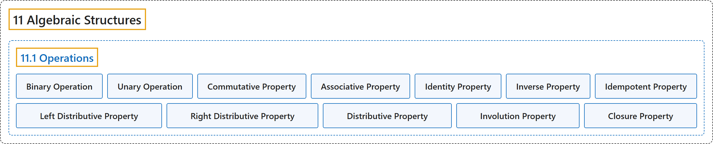

# 11.1 Operations

## Classification

## Glossary

| Term | Definition | 中文翻译 | Source |
|---|---|---|---|
| **11.1 Operations** 运算 | (No definition) | （无定义） | [Doerr & Levasseur, n.d., section 11.1](https://discretemath.org/ads/s-Operations.html) |
| **Binary Operation** 二元运算 | "Let $S$ be a nonempty set. A **binary operation** on $S$ is **a rule that assigns to each ordered pair of elements of $S$ a unique element of $S\text{.}$** In other words, a binary operation is a **function from $S\times S$ into $S\text{.}$**" | 设 $S$ 为非空集合。$S$ 上的**二元运算**是**为 $S$ 的每个有序元素对指定 $S$ 中唯一一个元素的规则**。换言之，二元运算是**从 $S\times S$ 到 $S$ 的函数**。 | [Doerr & Levasseur, n.d., Definition 11.1.1](https://discretemath.org/ads/s-Operations.html#def-binary-operation) |
| **Unary Operation** 一元运算 | "Let $S$ be a nonempty set. A **unary operator** on $S$ is **a rule that assigns to each element of $S$ a unique element of $S\text{.}$** In other words, a unary operator is a **function from $S$ into $S\text{.}$**" | 设 $S$ 为非空集合。$S$ 上的**一元运算**是**为 $S$ 的每个元素指定 $S$ 中唯一一个元素的规则**。换言之，一元运算是**从 $S$ 到 $S$ 的函数**。 | [Doerr & Levasseur, n.d., Definition 11.1.4](https://discretemath.org/ads/s-Operations.html#def-unary-operation) |
| **Commutative Property** 交换律 | "Let $*$ be a binary operation on a set $S\text{.}$ We say that $*$ is **commutative** if and only if $a * b = b * a$ for all $a, b \in S\text{.}$" | 设 $*$ 为集合 $S$。 上的二元运算。我们说 $*$ 是**可交换的**，当且仅当对所有 $a, b \in S$。 都有 $a * b = b * a$。 | [Doerr & Levasseur, n.d., Definition 11.1.5](https://discretemath.org/ads/s-Operations.html#def-commutative-property) |
| **Associative Property** 结合律 | "Let $*$ be a binary operation on a set $S\text{.}$ We say that $*$ is **associative** if and only if $(a * b) * c = a * (b * c)$ for all $a, b, c \in S\text{.}$" | 设 $*$ 为集合 $S$。 上的二元运算。我们说 $*$ 是**可结合的**，当且仅当对所有 $a, b, c \in S$。 都有 $(a * b) * c = a * (b * c)$。 | [Doerr & Levasseur, n.d., Definition 11.1.6](https://discretemath.org/ads/s-Operations.html#def-associative-property) |
| **Identity Property** 单位元性质 | "Let $*$ be a binary operation on a set $S\text{.}$ We say that $*$ **has an identity** if and only if **there exists an element, $e\text{,}$ in $S$** such that $a * e = e * a = a$ for all $a \in S\text{.}$" | 设 $*$ 为集合 $S$ 上的二元运算。我们说 $*$ 有**单位元**，当且仅当 **$S$ 中存在元素 $e$，**，使得对所有 $a \in S$。 都有 $a * e = e * a = a$。 | [Doerr & Levasseur, n.d., Definition 11.1.7](https://discretemath.org/ads/s-Operations.html#def-identity-property) |
| **Inverse Property** 逆元性质 | "Let $*$ be a binary operation on a set $S\text{.}$ We say that $*$ **has the inverse property** if and only if for each $a \in S\text{,}$ there exists $b \in S$ such that $a*b = b*a = e\text{.}$ We call $b$ an **inverse of $a\text{.}$**" | 设 $*$ 为集合 $S$。 上的二元运算。我们说 $*$ 具有**逆元性质**，当且仅当对每个 $a \in S$，存在 $b \in S$ 使得 $a*b = b*a = e$。我们称 $b$ 为 $a$。 的**逆元**。 | [Doerr & Levasseur, n.d., Definition 11.1.8](https://discretemath.org/ads/s-Operations.html#def-inverse-property) |
| **Idempotent Property** 幂等律 | "Let $*$ be a binary operation on a set $S\text{.}$ We say that $*$ is **idempotent** if and only if $a * a = a$ for all $a \in S\text{.}$" | 设 $*$ 为集合 $S$。 上的二元运算。我们说 $*$ 是**幂等的**，当且仅当对所有 $a \in S$。 都有 $a * a = a$。 | [Doerr & Levasseur, n.d., Definition 11.1.9](https://discretemath.org/ads/s-Operations.html#def-idempotent-property) |
| **Left Distributive Property** 左分配律 | "Let $*$ and $\diamond$ be binary operations on a set $S\text{.}$ We say that $\diamond$ is **left distributive** over $*$ if and only if $a \diamond (b * c) = (a \diamond b) * (a \diamond c)$ for all $a,b,c\in S\text{.}$" | 设 $*$ 和 $\diamond$ 为集合 $S$。 上的二元运算。我们说 $\diamond$ 对 $*$ 是**左分配的**，当且仅当对所有 $a,b,c\in S$。 都有 $a \diamond (b * c) = (a \diamond b) * (a \diamond c)$。 | [Doerr & Levasseur, n.d., Definition 11.1.10](https://discretemath.org/ads/s-Operations.html#def-left-distributive-property) |
| **Right Distributive Property** 右分配律 | "Let $*$ and $\diamond$ be binary operations on a set $S\text{.}$ We say that $\diamond$ is **right distributive** over $*$ if and only if $(b * c)\diamond a = (b\diamond a) * (c \diamond a)$ for all $a,b,c\in S\text{.}$" | 设 $*$ 和 $\diamond$ 为集合 $S$。 上的二元运算。我们说 $\diamond$ 对 $*$ 是**右分配的**，当且仅当对所有 $a,b,c\in S$。 都有 $(b * c)\diamond a = (b\diamond a) * (c \diamond a)$。 | [Doerr & Levasseur, n.d., Definition 11.1.11](https://discretemath.org/ads/s-Operations.html#def-right-distributive-property) |
| **Distributive Property** 分配律 | "Let $*$ and $\diamond$ be binary operations on a set $S\text{.}$ We say that $\diamond$ is **distributive** over $*$ if and only if $\diamond$ is **both left and right distributive** over $*\text{.}$" | 设 $*$ 和 $\diamond$ 为集合 $S$。 上的二元运算。我们说 $\diamond$ 对 $*$ 是**可分配的**，当且仅当 $\diamond$ 对 $*$ **既是左分配的又是右分配的**。 | [Doerr & Levasseur, n.d., Definition 11.1.12](https://discretemath.org/ads/s-Operations.html#def-distributive-property) |
| **Involution Property** 对合律 | "Let $-$ be a unary operation on $S\text{.}$ We say that $-$ has the **involution property** if $-(-a) = a$ for all $a \in S\text{.}$" | 设 $-$ 为 $S$。 上的一元运算。我们说 $-$ 具有**对合性质**，如果对所有 $a \in S$。 都有 $-(-a) = a$。 | [Doerr & Levasseur, n.d., Definition 11.1.13](https://discretemath.org/ads/s-Operations.html#def-involution-property) |
| **Closure Property** 封闭性 | "Let $T$ be a subset of $S$ and let $*$ be a binary operation on $S\text{.}$ We say that $T$ is **closed under** $*$ if $a, b \in T$ implies that $a * b \in T\text{.}$" | 设 $T$ 为 $S$ 的子集，$*$ 为 $S$ 上的二元运算。我们说 $T$ 对 $*$ **封闭**，如果 $a, b \in T$ 蕴含 $a * b \in T$。 | [Doerr & Levasseur, n.d., Definition 11.1.14](https://discretemath.org/ads/s-Operations.html#def-closure-property) |

## References

Doerr, A., & Levasseur, K. (n.d.). *Applied discrete structures*. Retrieved October 28, 2026, from <https://discretemath.org/ads/index-ads.html>
