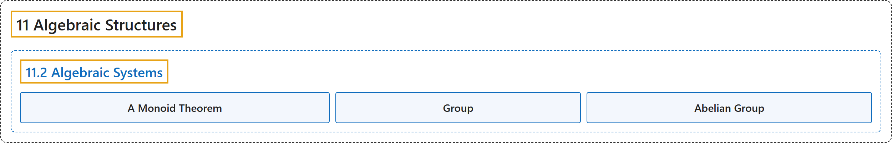

# 11.2 Algebraic Systems

## Classification

## Glossary

| Term | Definition | 中文翻译 | Source |
|---|---|---|---|
| **11.2 Algebraic Systems** 代数系统 | (No definition) | （无定义） | [Doerr & Levasseur, n.d., section 11.2](https://discretemath.org/ads/s-algebraic-systems.html) |
| **A Monoid Theorem** 一个幺半群定理 | "If $a$, $b$ are elements of $M$ and $a * b = b * a$, then **$(a * b) * (a * b) = (a * a) * (b * b)$**." | 若 $a$、$b$ 是 $M$ 的元素且 $a * b = b * a$，则 **$(a * b) * (a * b) = (a * a) * (b * b)$**。 | [Doerr & Levasseur, n.d., Theorem 11.2.1](https://discretemath.org/ads/s-algebraic-systems.html#theorem-first-monoid) |
| **Group** 群 | "A **group** consists of a **nonempty set $G$** and a binary operation $*$ on $G$ satisfying the properties" | **群**由**非空集合 $G$** 和 $G$ 上的二元运算 $*$ 组成，并满足下列性质 | [Doerr & Levasseur, n.d., Definition 11.2.3](https://discretemath.org/ads/s-algebraic-systems.html#def-Group) |
| **Abelian Group** 阿贝尔群 | "A group is **abelian if its operation is commutative**." | 若群的运算是可交换的，则该群是**阿贝尔群**。 | [Doerr & Levasseur, n.d., Definition 11.2.6](https://discretemath.org/ads/s-algebraic-systems.html#def-abelian-group) |

## References

Doerr, A., & Levasseur, K. (n.d.). *Applied discrete structures*. Retrieved October 28, 2026, from <https://discretemath.org/ads/index-ads.html>
