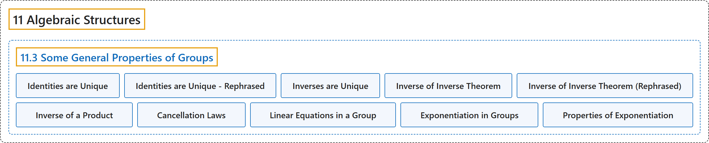

# 11.3 Some General Properties of Groups

## Classification

## Glossary

| Term | Definition | 中文翻译 | Source |
|---|---|---|---|
| **11.3 Some General Properties of Groups** 群的一些一般性质 | (No definition) | （无定义） | [Doerr & Levasseur, n.d., section 11.3](https://discretemath.org/ads/s-general-properties-of-groups.html) |
| **Identities are Unique** 单位元是唯一的 | "The identity of a group **is unique**." | 群的单位元**是唯一的**。 | [Doerr & Levasseur, n.d., Theorem 11.3.1](https://discretemath.org/ads/s-general-properties-of-groups.html#theorem-11-3-1) |
| **Identities are Unique - Rephrased** 单位元是唯一的（另一种表述） | "If $G= [G; *]$ is a group and $e$ is an identity of $G$, then **no other element of $G$ is an identity of $G$**." | 若 $G= [G; *]$ 是群且 $e$ 是 $G$ 的单位元，则 **$G$ 中没有其他元素是 $G$ 的单位元**。 | [Doerr & Levasseur, n.d., Theorem 11.3.2](https://discretemath.org/ads/s-general-properties-of-groups.html#theorem-11-3-1-a) |
| **Inverses are Unique** 逆元是唯一的 | "The inverse of any element of a group **is unique**." | 群中任一元素的逆元**是唯一的**。 | [Doerr & Levasseur, n.d., Theorem 11.3.3](https://discretemath.org/ads/s-general-properties-of-groups.html#theorem-11-3-2) |
| **Inverse of Inverse Theorem** 逆元的逆元定理 | "If a is an element of group $G$, then **$\left(a^{-1}\right)^{-1}=a$**." | 若 a 是群 $G$ 的元素，则 **$\left(a^{-1}\right)^{-1}=a$**。 | [Doerr & Levasseur, n.d., Theorem 11.3.5](https://discretemath.org/ads/s-general-properties-of-groups.html#theorem-11-3-3) |
| **Inverse of Inverse Theorem (Rephrased)** 逆元的逆元定理（另一种表述） | "If $a$ has inverse $b$ and $b$ has inverse $c$, then **$a = c$**." | 若 $a$ 有逆元 $b$，且 $b$ 有逆元 $c$，则 **$a = c$**。 | [Doerr & Levasseur, n.d., Theorem 11.3.6](https://discretemath.org/ads/s-general-properties-of-groups.html#theorem-11-3-3-rephrased) |
| **Inverse of a Product** 乘积的逆元 | "If $a$ and $b$ are elements of group $G$, then **$(a*b)^{-1}= b^{-1}*a^{-1}$**." | 若 $a$ 和 $b$ 是群 $G$ 的元素，则 **$(a*b)^{-1}= b^{-1}*a^{-1}$**。 | [Doerr & Levasseur, n.d., Theorem 11.3.7](https://discretemath.org/ads/s-general-properties-of-groups.html#theorem-11-3-4) |
| **Cancellation Laws** 消去律 | "If $a\text{,}$ $b\text{,}$ and $c$ are **elements of group $G\text{,}$** then" | 若 $a$、$b$， 和 $c$ 是**群 $G$， 的元素**，则 | [Doerr & Levasseur, n.d., Theorem 11.3.8](https://discretemath.org/ads/s-general-properties-of-groups.html#theorem-11-3-cancellation) |
| **Linear Equations in a Group** 群中的线性方程 | "If $G$ is a group and $a, b \in G$, the equation $a * x = b$ **has a unique solution, $x = a^{-1} * b$**. In addition, the equation $x * a = b$ **has a unique solution, $x = b * a^{-1}$**." | 若 $G$ 是群且 $a, b \in G$，则方程 $a * x = b$ **有唯一解 $x = a^{-1} * b$**。此外，方程 $x * a = b$ **有唯一解 $x = b * a^{-1}$**。 | [Doerr & Levasseur, n.d., Theorem 11.3.9](https://discretemath.org/ads/s-general-properties-of-groups.html#theorem-11-3-linear-in-groups) |
| **Exponentiation in Groups** 群中的幂运算 | "For $n \geq 0\text{,}$ **define $a^n$ recursively** by $a ^0 = e$ and if $n > 0, a^n= a^{n-1} *a\text{.}$ Also, if $n >1\text{,}$ $a^{-n}= \left(a^n\right)^{-1}\text{.}$" | 对 $n \geq 0$，**递归地定义 $a^n$**：$a ^0 = e$，且若 $n > 0, a^n= a^{n-1} *a$。另外，若 $n >1$，则 $a^{-n}= \left(a^n\right)^{-1}$。 | [Doerr & Levasseur, n.d., Definition 11.3.11](https://discretemath.org/ads/s-general-properties-of-groups.html#def-exponents-in-groups) |
| **Properties of Exponentiation** 幂的性质 | "If a is an element of a group $G$, and $m$ and $n$ are integers, $a^{-n}= \left(a^{-1}\right)^n$ and hence $\left(a^n\right)^{-1}= \left(a^{-1}\right)^n$ $\displaystyle a^{n+m}= a^n*a^m$ $\displaystyle \left(a^n\right)^m= a^{n m}$" | 若 a 是群 $G$ 的元素，$m$ 和 $n$ 是整数，则 $a^{-n}= \left(a^{-1}\right)^n$，从而 $\left(a^n\right)^{-1}= \left(a^{-1}\right)^n$ $\displaystyle a^{n+m}= a^n*a^m$ $\displaystyle \left(a^n\right)^m= a^{n m}$ | [Doerr & Levasseur, n.d., Theorem 11.3.14](https://discretemath.org/ads/s-general-properties-of-groups.html#theorem-11-3-expo-properties) |

## References

Doerr, A., & Levasseur, K. (n.d.). *Applied discrete structures*. Retrieved October 28, 2026, from <https://discretemath.org/ads/index-ads.html>
