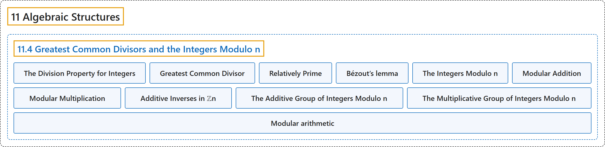

# 11.4 Greatest Common Divisors and the Integers Modulo n

## Classification

## Glossary

| Term | Definition | 中文翻译 | Source |
|---|---|---|---|
| **11.4 Greatest Common Divisors and the Integers Modulo n** 最大公约数与模 n 整数 | (No definition) | （无定义） | [Doerr & Levasseur, n.d., section 11.4](https://discretemath.org/ads/s-gcds-and-zsubn.html) |
| **The Division Property for Integers** 整数的带余除法性质 | "If $m, n\in \mathbb{Z}\text{,}$ $n>0\text{,}$ then **there exist two unique integers, $q$ (the quotient) and $r$ (the remainder)**, such that $m = n q + r$ and $0 \leq r < n\text{.}$" | 若 $m, n\in \mathbb{Z}$， 且 $n>0$，则**存在唯一的两个整数 $q$（商）和 $r$**（余数），使得 $m = n q + r$ 且 $0 \leq r < n$。 | [Doerr & Levasseur, n.d., Theorem 11.4.1](https://discretemath.org/ads/s-gcds-and-zsubn.html#th-division-property) |
| **Greatest Common Divisor** 最大公约数 | "Given two integers, $a$ and $b\text{,}$ not both zero, the **greatest common divisor** of $a$ and $b$ is **the positive integer** $g=\gcd(a,b)$ such that $g \mid a\text{,}$ $g\mid b\text{,}$ and" | 给定两个不全为零的整数 $a$ 和 $b$，$a$ 与 $b$ 的**最大公约数**是**正整数** $g=\gcd(a,b)$，使得 $g \mid a$，$g\mid b$，并且 | [Doerr & Levasseur, n.d., Definition 11.4.5](https://discretemath.org/ads/s-gcds-and-zsubn.html#def-gcd) |
| **Relatively Prime** 互素 | "A pair of integers, $a$ and $b\text{,}$ are **relatively prime** if $\gcd(a, b)=1$" | 一对整数 $a$ 和 $b$， **互素**，如果 $\gcd(a, b)=1$ | [Doerr & Levasseur, n.d., Definition 11.4.6](https://discretemath.org/ads/s-gcds-and-zsubn.html#def-def-rel-prime) |
| **Bézout’s lemma** 裴蜀引理 | "If $a$ and $b$ are positive integers, the **smallest positive value of $a x + b y$ is the greatest common divisor** of $a$ and $b\text{,}$ $\gcd(a,b)\text{.}$" | 若 $a$ 和 $b$ 是正整数，则 **$a x + b y$ 的最小正值是最大公约数** $\gcd(a,b)$，即 $a$ 与 $b$ 的最大公约数。 | [Doerr & Levasseur, n.d., Theorem 11.4.10](https://discretemath.org/ads/s-gcds-and-zsubn.html#theorem-11-4-1) |
| **The Integers Modulo n** 模 n 整数 | "If $n$ is a positive integer greater than one, we define the **integers modulo $n$** to be the set $\{0, 1, 2,..., n-1\}\text{.}$" | 若 $n$ 是大于 1 的正整数，我们把**模 $n$ 整数**定义为集合 $\{0, 1, 2,..., n-1\}$。 | [Doerr & Levasseur, n.d., Definition 11.4.13](https://discretemath.org/ads/s-gcds-and-zsubn.html#def-integers-modulo-n) |
| **Modular Addition** 模加法 | "If $n$ is a positive integer, we define **addition modulo $n$** $\left(+_n\right.$) as follows. If $a, b \in \mathbb{Z}_n\text{,}$" | 若 $n$ 是正整数，我们如下定义**模 $n$ 加法** $\left(+_n\right.$)。若 $a, b \in \mathbb{Z}_n$， | [Doerr & Levasseur, n.d., Definition 11.4.14](https://discretemath.org/ads/s-gcds-and-zsubn.html#def-def-modular-addition) |
| **Modular Multiplication** 模乘法 | "If $n$ is a positive integer, we define **multiplication modulo $n$** $\left(\times_n\right.$) as follows. If $a, b \in \mathbb{Z}_n\text{,}$" | 若 $n$ 是正整数，我们如下定义**模 $n$ 乘法** $\left(\times_n\right.$)。若 $a, b \in \mathbb{Z}_n$， | [Doerr & Levasseur, n.d., Definition 11.4.15](https://discretemath.org/ads/s-gcds-and-zsubn.html#def-def-modular-multiplication) |
| **Additive Inverses in ℤn** ℤn 中的加法逆元 | "If $a \in \mathbb{Z}_n$, $a\neq 0$, then the additive inverse of a **is $n - a$**." | 若 $a \in \mathbb{Z}_n$，$a\neq 0$，则 a 的加法逆元**是 $n - a$**。 | [Doerr & Levasseur, n.d., Theorem 11.4.18](https://discretemath.org/ads/s-gcds-and-zsubn.html#theorem-modular-add-inverse) |
| **The Additive Group of Integers Modulo n** 模 n 整数加法群 | "**The Additive Group of Integers Modulo $n$** is the group with domain $\{0, 1, 2, \dots, n-1\}$ and with **the operation of mod $n$ addition**. It is denoted as $\mathbb{Z}_n\text{.}$" | **模 $n$ 整数加法群**是以 $\{0, 1, 2, \dots, n-1\}$ 为定义域、运算为**模 $n$ 加法**的群。记作 $\mathbb{Z}_n$。 | [Doerr & Levasseur, n.d., Definition 11.4.19](https://discretemath.org/ads/s-gcds-and-zsubn.html#ss-properties-modular-arithmetic-5) |
| **The Multiplicative Group of Integers Modulo n** 模 n 整数乘法群 | "**The Multiplicative Group of Integers Modulo $n$** is the group with domain $\{k\in \mathbb{Z} \vert 1 \leq k \leq n-1 \textrm{ and }\gcd(n,k)=1\}$ and with **the operation of mod $n$ multiplication**. It is denoted as $\mathbb{U}_n\text{.}$" | **模 $n$ 整数乘法群**是以 $\{k\in \mathbb{Z} \vert 1 \leq k \leq n-1 \textrm{ and }\gcd(n,k)=1\}$ 为定义域、运算为**模 $n$ 乘法**的群。记作 $\mathbb{U}_n$。 | [Doerr & Levasseur, n.d., Definition 11.4.20](https://discretemath.org/ads/s-gcds-and-zsubn.html#ss-properties-modular-arithmetic-9) |
| **Modular arithmetic** 模运算 | "Modular arithmetic is the **arithmetic of congruences**, sometimes known informally as '**clock arithmetic**.'" | 模运算是**同余的算术**，非正式地也称为“**时钟算术**”。 | [Weisstein, n.d., "Modular arithmetic" entry, para. 1](https://mathworld.wolfram.com/ModularArithmetic.html#:~:text=Modular%20arithmetic%20is%20the%20arithmetic%20of%20congruences) |

## References

Doerr, A., & Levasseur, K. (n.d.). *Applied discrete structures*. Retrieved October 28, 2026, from <https://discretemath.org/ads/index-ads.html>

Weisstein, E. W. (n.d.). *Modular arithmetic*. MathWorld: A Wolfram Resource. Retrieved October 27, 2026, from <https://mathworld.wolfram.com/ModularArithmetic.html>
