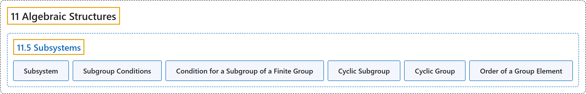

# 11.5 Subsystems

## Classification

## Glossary

| Term | Definition | 中文翻译 | Source |
|---|---|---|---|
| **11.5 Subsystems** 子系统 | (No definition) | （无定义） | [Doerr & Levasseur, n.d., section 11.5](https://discretemath.org/ads/s-Subsystems.html) |
| **Subsystem** 子系统 | "If $\left[V; *_1, \ldots,*_n\right]$ is an algebraic system of a certain kind and $W$ is a subset of $V\text{,}$ then **$W$ is a subsystem of $V$** if $\left[W; *_1, \ldots,*_n\right]$ is **an algebraic system of the same kind as $V\text{.}$** The usual notation for “$W$ is a subsystem of $V$” is $W \leq V\text{.}$" | 若 $\left[V; *_1, \ldots,*_n\right]$ 是某一类代数系统，$W$ 是 $V$ 的子集，且 $\left[W; *_1, \ldots,*_n\right]$ 是与 $V$ **同类的代数系统**，则称 **$W$ 是 $V$ 的子系统**。“$W$ 是 $V$ 的子系统”的通常记法是 $W \leq V$。 | [Doerr & Levasseur, n.d., Definition 11.5.1](https://discretemath.org/ads/s-Subsystems.html#def-subsystem) |
| **Subgroup Conditions** 子群的条件 | "To determine whether H, a subset of group $[G;*]$, is a subgroup, **it is sufficient to prove**: H is closed under $*$; that is, $a, b \in H \Rightarrow a * b \in H$; H contains the identity element for $*$; and H contains the inverse of each of its elements; that is, $a\in H \Rightarrow a^{-1}\in H$." | 要判断群 $[G;*]$ 的子集 H 是否为子群，**只需证明**：H 对 $*$ 封闭，即 $a, b \in H \Rightarrow a * b \in H$；H 包含 $*$ 的单位元；并且 H 包含其每个元素的逆元，即 $a\in H \Rightarrow a^{-1}\in H$。 | [Doerr & Levasseur, n.d., Theorem 11.5.3](https://discretemath.org/ads/s-Subsystems.html#th-subgroup-conditions) |
| **Condition for a Subgroup of a Finite Group** 有限群的子群条件 | "Given that $[G; * ]$ is a finite group and $H$ is a nonempty subset of $G$, if $H$ is closed under $*$ , then **$H$ is a subgroup of $G$**." | 已知 $[G; * ]$ 是有限群，$H$ 是 $G$ 的非空子集，若 $H$ 对 $*$ 封闭，则 **$H$ 是 $G$ 的子群**。 | [Doerr & Levasseur, n.d., Theorem 11.5.5](https://discretemath.org/ads/s-Subsystems.html#th-subgroup-of-finite-group) |
| **Cyclic Subgroup** 循环子群 | "If $G$ is a group and $a \in G\text{,}$ **the cyclic subgroup generated by $a\text{,}$** $\langle a \rangle\text{,}$ is **the set of all powers of $a\text{:}$**" | 若 $G$ 是群且 $a \in G$， 则**由 $a$， 生成的循环子群** $\langle a \rangle$， 是 **$a$： 的所有幂的集合** | [Doerr & Levasseur, n.d., Definition 11.5.6](https://discretemath.org/ads/s-Subsystems.html#def-cyclic-subgroup) |
| **Cyclic Group** 循环群 | "**A group $G$ is cyclic** if there exists $\beta \in G$ such that $\langle \beta \rangle=G\text{.}$" | 若存在 $\beta \in G$ 使得 $\langle \beta \rangle=G$。 则群 $G$ 是**循环群**。 | [Doerr & Levasseur, n.d., Definition 11.5.7](https://discretemath.org/ads/s-Subsystems.html#def-cyclic-group) |
| **Order of a Group Element** 群元素的阶 | "**The order of an element $a$ of group $G$** is **the number of elements in the cyclic subgroup of $G$ generated by** $a\text{.}$ The order of $a$ is denoted $ord(a)\text{.}$" | **群 $G$ 的元素 $a$ 的阶**是 $G$ 中由 $a$ 生成的循环子群的**元素个数**。$a$ 的阶记作 $ord(a)$。 | [Doerr & Levasseur, n.d., Definition 11.5.9](https://discretemath.org/ads/s-Subsystems.html#def-order-of-element) |

## References

Doerr, A., & Levasseur, K. (n.d.). *Applied discrete structures*. Retrieved October 28, 2026, from <https://discretemath.org/ads/index-ads.html>
