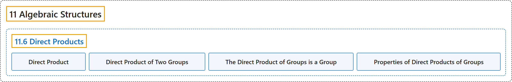

# 11.6 Direct Products

## Classification

## Glossary

| Term | Definition | 中文翻译 | Source |
|---|---|---|---|
| **11.6 Direct Products** 直积 | (No definition) | （无定义） | [Doerr & Levasseur, n.d., section 11.6](https://discretemath.org/ads/s-direct-products.html) |
| **Direct Product** 直积 | "If $\left[V_i;*_i, \diamond_i, \ldots \right]\text{,}$ $i = 1, 2, \ldots, n$ are algebraic systems of the same kind, then **the direct product of these systems** is $V =V_1\times V_2\times \cdots \times V_n$, with operations defined below. The elements of $V$ are $n$-tuples of the form $\left(a_1, a_2, \dots, a _n \right)\text{,}$ where $a_k \in V_k\text{,}$ $k = 1, \dots, n\text{.}$ The systems $V_1\text{,}$ $V_2, \dots, V_n$ are called **the factors of $V\text{.}$** There are as many operations on $V$ as there are in the factors. Each of these operations is defined **componentwise**:" | 若 $\left[V_i;*_i, \diamond_i, \ldots \right]$， $i = 1, 2, \ldots, n$ 是同类的代数系统，则这些系统的**直积**是 $V =V_1\times V_2\times \cdots \times V_n$，其运算定义如下。$V$ 的元素是形如 $\left(a_1, a_2, \dots, a _n \right)$， 的 $n$ 元组，其中 $a_k \in V_k$， $k = 1, \dots, n$。 系统 $V_1$， $V_2, \dots, V_n$ 称为 $V$ 的**因子**。$V$ 上的运算与各因子中的运算一样多。其中每个运算都**按分量**定义： | [Doerr & Levasseur, n.d., Definition 11.6.1](https://discretemath.org/ads/s-direct-products.html#def-direct-product) |
| **Direct Product of Two Groups** 两个群的直积 | "Let $[G_1;*_1]$ and $[G_2;*_2]$ be two groups. **Their direct product** is the system $[G_1 \times G_2; *]$ with domain equal to the Cartesian product of the domains of the two groups and with the **coordinatewise operation $*$** defined by" | 设 $[G_1;*_1]$ 和 $[G_2;*_2]$ 为两个群。它们的**直积**是系统 $[G_1 \times G_2; *]$，其定义域等于这两个群的定义域的笛卡尔积，其**按坐标运算** $*$ 定义为 | [Doerr & Levasseur, n.d., Definition 11.6.3](https://discretemath.org/ads/s-direct-products.html#def-direct-product-of-groups) |
| **The Direct Product of Groups is a Group** 群的直积是群 | "The direct product of two or more groups **is a group**; that is, the algebraic properties of a system obtained by taking the direct product of two or more groups includes the group axioms." | 两个或多个群的直积**是群**；即，取两个或多个群的直积所得到的系统，其代数性质包含群公理。 | [Doerr & Levasseur, n.d., Theorem 11.6.6](https://discretemath.org/ads/s-direct-products.html#theorem-product-of-groups) |
| **Properties of Direct Products of Groups** 群直积的性质 | "If $G = G_1\times G_2 \times \cdots \times G_n$ is a direct product of $n$ groups and $\left(a_1, a_2 , \dots , a_n\right) \in G$, then: The identity of $G$ is $\left(e_1, e_2 , . . . , e_n\right)$, where $e_k$ is the identity of $G_k$. $\left(a_1, a_2 , . . . , a_n\right) {}^{-1}= \left(a_1{}^{-1}, a_2{}^{-1} , . . . , a_n{}^{-1}\right)$. $\left(a_1, a_2 , . . . , a_n\right) {}^m= \left(a_1{}^m, a_2{}^m , . . . , a_n{}^m\right)$ for all $m\in \mathbb{Z}$. $G$ is abelian if and only if each of the factors $G_1, G_2, \ldots , G_n$ is abelian. lf $H_1, H_2, \ldots , H_n$ are subgroups of the corresponding factors, then $H_1\times H_2 \times \cdots \times H_n$ is a subgroup of $G$." | 若 $G = G_1\times G_2 \times \cdots \times G_n$ 是 $n$ 个群的直积，且 $\left(a_1, a_2 , \dots , a_n\right) \in G$，则：$G$ 的单位元是 $\left(e_1, e_2 , . . . , e_n\right)$，其中 $e_k$ 是 $G_k$ 的单位元。$\left(a_1, a_2 , . . . , a_n\right) {}^{-1}= \left(a_1{}^{-1}, a_2{}^{-1} , . . . , a_n{}^{-1}\right)$。对所有 $m\in \mathbb{Z}$，$\left(a_1, a_2 , . . . , a_n\right) {}^m= \left(a_1{}^m, a_2{}^m , . . . , a_n{}^m\right)$。$G$ 是阿贝尔群，当且仅当每个因子 $G_1, G_2, \ldots , G_n$ 都是阿贝尔群。若 $H_1, H_2, \ldots , H_n$ 是相应因子的子群，则 $H_1\times H_2 \times \cdots \times H_n$ 是 $G$ 的子群。 | [Doerr & Levasseur, n.d., Theorem 11.6.9](https://discretemath.org/ads/s-direct-products.html#theorem-direct-product-properties) |

## References

Doerr, A., & Levasseur, K. (n.d.). *Applied discrete structures*. Retrieved October 28, 2026, from <https://discretemath.org/ads/index-ads.html>
