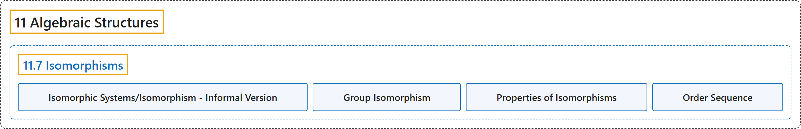

# 11.7 Isomorphisms

## Classification

## Glossary

| Term | Definition | 中文翻译 | Source |
|---|---|---|---|
| **11.7 Isomorphisms** 同构 | (No definition) | （无定义） | [Doerr & Levasseur, n.d., section 11.7](https://discretemath.org/ads/s-isomorphisms.html) |
| **Isomorphic Systems/Isomorphism - Informal Version** 同构系统／同构（非形式化版本） | "**Two algebraic systems are isomorphic** if there exists **a translation rule between them** so that any true statement in one system can be translated to a true statement in the other." | 若两个代数系统之间存在一种**翻译规则**，使得其中一个系统中的任何真命题都能翻译为另一个系统中的真命题，则这两个代数系统**同构**。 | [Doerr & Levasseur, n.d., Definition 11.7.1](https://discretemath.org/ads/s-isomorphisms.html#def-isomorphism-informal) |
| **Group Isomorphism** 群同构 | "If $\left[G_1; *_1\right]$ and $\left[G_2; *_2\right]$ are groups, $f: G_1 \to G_2$ is **an isomorphism** from $G_1$ into $G_2$ if and only if:" | 若 $\left[G_1; *_1\right]$ 和 $\left[G_2; *_2\right]$ 是群，则 $f: G_1 \to G_2$ 是从 $G_1$ 到 $G_2$ 的**同构**，当且仅当： | [Doerr & Levasseur, n.d., Definition 11.7.9](https://discretemath.org/ads/s-isomorphisms.html#def-group-isomorphism) |
| **Properties of Isomorphisms** 同构的性质 | "If $[G;*]$ and $[H;\diamond ]$ are groups with identities $e$ and $e'$, respectively, and $T:G \to H$ is an isomorphism from $G$ into $H$, then: $\displaystyle T(e) = e'$ $T(a)^{-1} = T\left(a^{-1}\right)$ for all $a \in G$, and If $K$ is a subgroup of $G$, then $T(K) = \{T(a) : a \in K\}$ is a subgroup of $H$ and is isomorphic to $K$." | 若 $[G;*]$ 和 $[H;\diamond ]$ 是群，单位元分别为 $e$ 和 $e'$，且 $T:G \to H$ 是从 $G$ 到 $H$ 的同构，则：$\displaystyle T(e) = e'$；对所有 $a \in G$，$T(a)^{-1} = T\left(a^{-1}\right)$；并且若 $K$ 是 $G$ 的子群，则 $T(K) = \{T(a) : a \in K\}$ 是 $H$ 的子群，且与 $K$ 同构。 | [Doerr & Levasseur, n.d., Theorem 11.7.14](https://discretemath.org/ads/s-isomorphisms.html#theorem-isomorphism-properties) |
| **Order Sequence** 阶序列 | "The **order sequence of a finite group** is the sequence whose terms are the respective orders of all the elements of the group, **arranged in increasing order**." | 有限群的**阶序列**是这样的序列：其各项分别是该群所有元素的阶，并**按递增顺序排列**。 | [Doerr & Levasseur, n.d., Definition 11.7.15](https://discretemath.org/ads/s-isomorphisms.html#s-isomorphisms-5-3) |

## References

Doerr, A., & Levasseur, K. (n.d.). *Applied discrete structures*. Retrieved October 28, 2026, from <https://discretemath.org/ads/index-ads.html>
