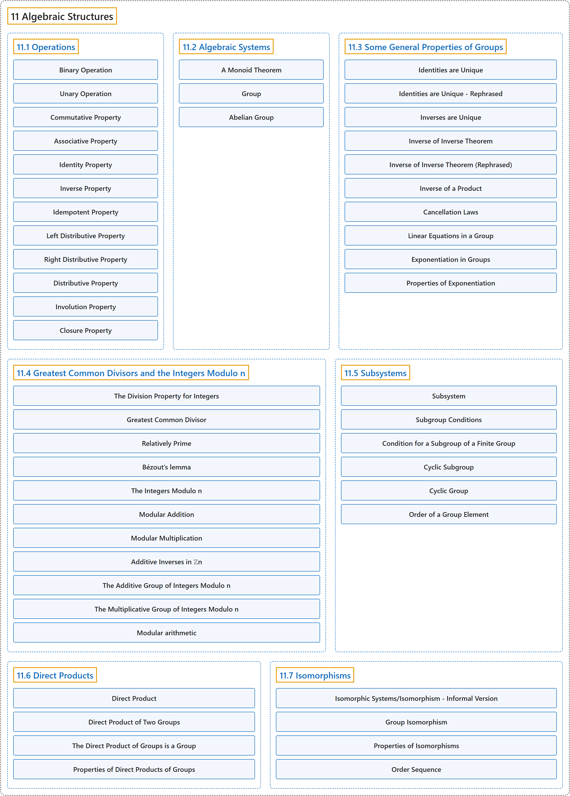

# 11 Algebraic Structures

## Classification

## Glossary

| Term | Definition | 中文翻译 | Source |
|---|---|---|---|
| **11 Algebraic Structures** 代数结构 | (No definition) | （无定义） | [Doerr & Levasseur, n.d., chapter 11](https://discretemath.org/ads/chapter_11.html) |
| **[11.1 Operations](11-1-operations.md)** 运算 | (No definition) | （无定义） | [Doerr & Levasseur, n.d., section 11.1](https://discretemath.org/ads/s-Operations.html) |
| **[11.2 Algebraic Systems](11-2-algebraic-systems.md)** 代数系统 | (No definition) | （无定义） | [Doerr & Levasseur, n.d., section 11.2](https://discretemath.org/ads/s-algebraic-systems.html) |
| **[11.3 Some General Properties of Groups](11-3-some-general-properties-of-groups.md)** 群的一些一般性质 | (No definition) | （无定义） | [Doerr & Levasseur, n.d., section 11.3](https://discretemath.org/ads/s-general-properties-of-groups.html) |
| **[11.4 Greatest Common Divisors and the Integers Modulo n](11-4-greatest-common-divisors-and-the-integers-modulo-n.md)** 最大公约数与模 n 整数 | (No definition) | （无定义） | [Doerr & Levasseur, n.d., section 11.4](https://discretemath.org/ads/s-gcds-and-zsubn.html) |
| **[11.5 Subsystems](11-5-subsystems.md)** 子系统 | (No definition) | （无定义） | [Doerr & Levasseur, n.d., section 11.5](https://discretemath.org/ads/s-Subsystems.html) |
| **[11.6 Direct Products](11-6-direct-products.md)** 直积 | (No definition) | （无定义） | [Doerr & Levasseur, n.d., section 11.6](https://discretemath.org/ads/s-direct-products.html) |
| **[11.7 Isomorphisms](11-7-isomorphisms.md)** 同构 | (No definition) | （无定义） | [Doerr & Levasseur, n.d., section 11.7](https://discretemath.org/ads/s-isomorphisms.html) |

## References

Doerr, A., & Levasseur, K. (n.d.). *Applied discrete structures*. Retrieved October 28, 2026, from <https://discretemath.org/ads/index-ads.html>
