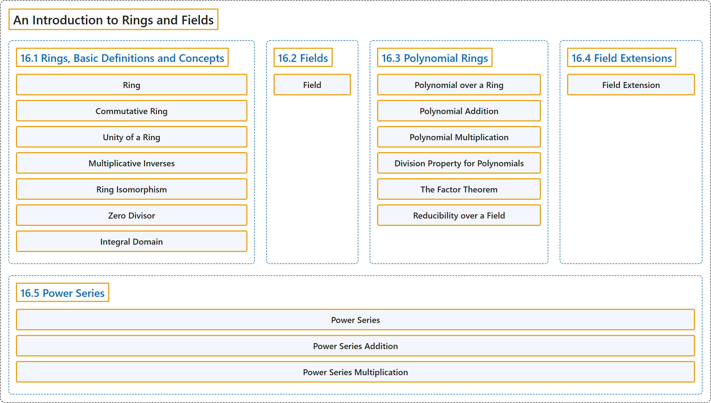

# 16 An Introduction to Rings and Fields

## Classification

## Glossary

| Term | Definition | 中文翻译 | Source |
|---|---|---|---|
| **16 An Introduction to Rings and Fields** 环与域导论 | (No definition) | （无定义） | [Doerr & Levasseur, n.d., chapter 16](https://discretemath.org/ads/chapter_16.html) |
| **16.1 Rings, Basic Definitions and Concepts** 环：基本定义与概念 | (No definition) | （无定义） | [Doerr & Levasseur, n.d., section 16.1](https://discretemath.org/ads/s-rings-basic.html) |
| **Ring** 环 | "**A ring** is a set $R$ together with **two binary operations**, addition and multiplication, denoted by the symbols $+$ and $\cdot$ such that the following axioms are satisfied:" | **环**是带有两个**二元运算**（加法与乘法，分别记作符号 $+$ 和 $\cdot$）的集合 $R$，使得下列公理成立： | [Doerr & Levasseur, n.d., Definition 16.1.1](https://discretemath.org/ads/s-rings-basic.html#def-ring) |
| **Commutative Ring** 交换环 | "A ring in which multiplication is **a commutative operation** is called **a commutative ring**." | 乘法为**交换运算**的环称为**交换环**。 | [Doerr & Levasseur, n.d., Definition 16.1.5](https://discretemath.org/ads/s-rings-basic.html#def-commutative-ring) |
| **Unity of a Ring** 环的单位元 | "A ring $[R; +, \cdot ]$ that has **a multiplicative identity** is called **a ring with unity**. The multiplicative identity itself is called **the unity of the ring**. More formally, if there exists an element $1 \in R\text{,}$ such that for all $x \in R\text{,}$ $x\cdot 1 = 1\cdot x = x\text{,}$ then $R$ is called a ring with unity." | 具有**乘法单位元**的环 $[R; +, \cdot ]$ 称为**含幺环**。该乘法单位元本身称为环的**幺元**。更正式地说，若存在元素 $1 \in R$， 使得对所有 $x \in R$， 有 $x\cdot 1 = 1\cdot x = x$， 则称 $R$ 为含幺环。 | [Doerr & Levasseur, n.d., Definition 16.1.6](https://discretemath.org/ads/s-rings-basic.html#def-unity) |
| **Multiplicative Inverses** 乘法逆元 | "Let $[R; +, \cdot ]$ be a ring with unity, 1. If $u \in R$ and there exists an element $v \in R$ such that $u\cdot v = v\cdot u = 1\text{,}$ then $u$ is said to have **a multiplicative inverse**, $v\text{.}$ A ring element that possesses a multiplicative inverse is **a unit of the ring**. The set of all units of a ring $R$ is denoted by $U(R)\text{.}$" | 设 $[R; +, \cdot ]$ 为含幺（幺元为 1）的环。若 $u \in R$ 且存在元素 $v \in R$ 使得 $u\cdot v = v\cdot u = 1$， 则称 $u$ 有**乘法逆元** $v$。 具有乘法逆元的环元素是环的**单位**。环 $R$ 的所有单位的集合记作 $U(R)$。 | [Doerr & Levasseur, n.d., Definition 16.1.10](https://discretemath.org/ads/s-rings-basic.html#def-multiplicative-inverses) |
| **Ring Isomorphism** 环同构 | "Let $[R; +, \cdot ]$ and $[R'; +', \cdot']$ be rings. Then $R$ is **isomorphic** to $R'$ if and only if there exists a function, $f:R \to R'\text{,}$ called **a ring isomorphism**, such that" | 设 $[R; +, \cdot ]$ 和 $[R'; +', \cdot']$ 为环。则 $R$ **同构**于 $R'$，当且仅当存在函数 $f:R \to R'$， 称为**环同构**，使得 | [Doerr & Levasseur, n.d., Definition 16.1.13](https://discretemath.org/ads/s-rings-basic.html#def-ring-isomorphism) |
| **Zero Divisor** 零因子 | "Let $[R; +, \cdot ]$ be a ring. If $a$ and $b$ are **two nonzero elements** of $R$ such that $a \cdot b = 0\text{,}$ then $a$ and $b$ are called **zero divisors**." | 设 $[R; +, \cdot ]$ 为环。若 $a$ 和 $b$ 是 $R$ 的两个满足 $a \cdot b = 0$， 的**非零元素**，则称 $a$ 和 $b$ 为**零因子**。 | [Doerr & Levasseur, n.d., Definition 16.1.20](https://discretemath.org/ads/s-rings-basic.html#def-zero-divisor) |
| **Integral Domain** 整环 | "**A commutative ring with unity** containing **no zero divisors** is called **an integral domain**." | **不含零因子**的**含幺交换环**称为**整环**。 | [Doerr & Levasseur, n.d., Definition 16.1.23](https://discretemath.org/ads/s-rings-basic.html#def-integral-domain) |
| **16.2 Fields** 域 | (No definition) | （无定义） | [Doerr & Levasseur, n.d., section 16.2](https://discretemath.org/ads/s-fields.html) |
| **Field** 域 | "**A field** is a **commutative ring with unity** such that each nonzero element has a **multiplicative inverse**." | **域**是**含幺交换环**，且其每个非零元素都有**乘法逆元**。 | [Doerr & Levasseur, n.d., Definition 16.2.1](https://discretemath.org/ads/s-fields.html#def-field) |
| **16.3 Polynomial Rings** 多项式环 | (No definition) | （无定义） | [Doerr & Levasseur, n.d., section 16.3](https://discretemath.org/ads/s-polynomial-rings.html) |
| **Polynomial over a Ring** 环上的多项式 | "Let $[R; +, \cdot ]$ be a ring. **A polynomial**, $f(x)\text{,}$ over $R$ is an expression of the form" | 设 $[R; +, \cdot ]$ 为环。$R$ 上的**多项式** $f(x)$， 是形如下式的表达式 | [Doerr & Levasseur, n.d., Definition 16.3.1](https://discretemath.org/ads/s-polynomial-rings.html#def-polynomial-over-r) |
| **Polynomial Addition** 多项式加法 | "Let $f(x) =a_0 + a_1 x+a_2 x^2+ \cdots +a_m x^m$ and $g(x) =b_0 + b_1 x+b_2 x^2+ \cdots +b_n x^n$ be elements in $R[x]$ so that $a_i \in R$ and $b_i\in R$ for all i. Let $k$ be **the maximum of $m$ and $n\text{.}$** Then $f(x) + g(x) =c_0 + c_1 x+c_2 x^2+ \cdots +c_k x^k\text{,}$ where $c_i=a_i+b_i$ for $i = 0, 1, 2, \ldots, k\text{.}$" | 设 $f(x) =a_0 + a_1 x+a_2 x^2+ \cdots +a_m x^m$ 与 $g(x) =b_0 + b_1 x+b_2 x^2+ \cdots +b_n x^n$ 为 $R[x]$ 的元素，即对所有 i 有 $a_i \in R$ 且 $b_i\in R$。设 $k$ 为 **$m$ 与 $n$。 的最大值**。则 $f(x) + g(x) =c_0 + c_1 x+c_2 x^2+ \cdots +c_k x^k$， 其中对 $i = 0, 1, 2, \ldots, k$。 有 $c_i=a_i+b_i$。 | [Doerr & Levasseur, n.d., Definition 16.3.3](https://discretemath.org/ads/s-polynomial-rings.html#def-polynomial-addition) |
| **Polynomial Multiplication** 多项式乘法 | "Let $f(x) =a_0 + a_1 x+a_2 x^2+ \cdots +a_m x^m$ and $g(x) =b_0 + b_1 x+b_2 x^2+ \cdots +b_n x^n\text{.}$ Then" | 设 $f(x) =a_0 + a_1 x+a_2 x^2+ \cdots +a_m x^m$ 与 $g(x) =b_0 + b_1 x+b_2 x^2+ \cdots +b_n x^n$。 则 | [Doerr & Levasseur, n.d., Definition 16.3.4](https://discretemath.org/ads/s-polynomial-rings.html#def-polynomial-multiplication) |
| **Division Property for Polynomials** 多项式的带余除法性质 | "Let $[F; +, \cdot ]$ be **a field** and let $f(x)$ and $g(x)$ be two elements of $F[x]$ with $g(x) \neq 0\text{.}$ Then there exist **unique polynomials** $q(x)$ and $r(x)$ in $F[x]$ such that $f(x) = g(x) q(x) + r(x)\text{,}$ where $\deg r(x) < \deg g(x)\text{.}$" | 设 $[F; +, \cdot ]$ 为**域**，$f(x)$ 与 $g(x)$ 为 $F[x]$ 的两个元素且 $g(x) \neq 0$。 则存在 $F[x]$ 中**唯一的多项式** $q(x)$ 与 $r(x)$，使得 $f(x) = g(x) q(x) + r(x)$， 其中 $\deg r(x) < \deg g(x)$。 | [Doerr & Levasseur, n.d., Theorem 16.3.13](https://discretemath.org/ads/s-polynomial-rings.html#theorem-poly-divison-property) |
| **The Factor Theorem** 因式定理 | "Let $[F; +, \cdot ]$ be a field. An element $a \in F$ is **a zero of** $f(x) \in F[x]$ if and only if $x - a$ is **a factor of** $f(x)$ in $F[x]\text{.}$" | 设 $[F; +, \cdot ]$ 为域。元素 $a \in F$ 是 $f(x) \in F[x]$ 的**零点**，当且仅当 $x - a$ 是 $F[x]$。 中 $f(x)$ 的**因子**。 | [Doerr & Levasseur, n.d., Theorem 16.3.14](https://discretemath.org/ads/s-polynomial-rings.html#theorem-polynomial-factor) |
| **Reducibility over a Field** 域上的可约性 | "Let $[F; +, \cdot]$ be a field and let $f(x) \in F[x]$ be a nonconstant polynomial. $f(x)$ is **reducible over $F$** if and only if it can be factored as **a product of two nonconstant polynomials** in $F[x]\text{.}$ A polynomial is **irreducible over $F$** if it is not reducible over $F\text{.}$" | 设 $[F; +, \cdot]$ 为域，$f(x) \in F[x]$ 为非常数多项式。$f(x)$ 在 $F$ 上**可约**，当且仅当它可分解为 $F[x]$。 中**两个非常数多项式之积**。若多项式在 $F$ 上不是可约的，则它在 $F$ 上**不可约**。 | [Doerr & Levasseur, n.d., Definition 16.3.17](https://discretemath.org/ads/s-polynomial-rings.html#def-reducible-over-field) |
| **16.4 Field Extensions** 域扩张 | (No definition) | （无定义） | [Doerr & Levasseur, n.d., section 16.4](https://discretemath.org/ads/s-field-extensions.html) |
| **Field Extension** 域扩张 | (context) "Hence, to solve a polynomial really involves two steps: first, find the zeros, and second, find the **field in which the zeros lie**." | （语境）因此，求解一个多项式实际上包含两步：先求出零点，再找出这些零点所在的**域**。 | [Doerr & Levasseur, n.d., section 16.4](https://discretemath.org/ads/s-field-extensions.html#s-field-extensions-2) |
| **16.5 Power Series** 幂级数 | (No definition) | （无定义） | [Doerr & Levasseur, n.d., section 16.5](https://discretemath.org/ads/s-power-series.html) |
| **Power Series** 幂级数 | "Let $[R; +,\cdot ]$ be a ring. **A power series** over $R$ is an expression of the form" | 设 $[R; +,\cdot ]$ 为环。$R$ 上的**幂级数**是形如下式的表达式 | [Doerr & Levasseur, n.d., Definition 16.5.1](https://discretemath.org/ads/s-power-series.html#def-power-series) |
| **Power Series Addition** 幂级数加法 | "Given **power series**" | 给定**幂级数** | [Doerr & Levasseur, n.d., Definition 16.5.2](https://discretemath.org/ads/s-power-series.html#def-power-series-addition) |
| **Power Series Multiplication** 幂级数乘法 | "Given **power series**" | 给定**幂级数** | [Doerr & Levasseur, n.d., Definition 16.5.3](https://discretemath.org/ads/s-power-series.html#def-power-series-multiplication) |

## References

Doerr, A., & Levasseur, K. (n.d.). *Applied discrete structures*. Retrieved October 28, 2026, from <https://discretemath.org/ads/index-ads.html>
