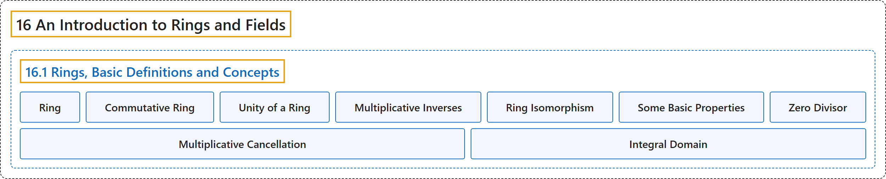

# 16.1 Rings, Basic Definitions and Concepts

## Classification

## Glossary

| Term | Definition | 中文翻译 | Source |
|---|---|---|---|
| **16.1 Rings, Basic Definitions and Concepts** 环：基本定义与概念 | (No definition) | （无定义） | [Doerr & Levasseur, n.d., section 16.1](https://discretemath.org/ads/s-rings-basic.html) |
| **Ring** 环 | "**A ring** is a set $R$ together with **two binary operations**, addition and multiplication, denoted by the symbols $+$ and $\cdot$ such that the following axioms are satisfied:" | **环**是带有两个**二元运算**（加法与乘法，分别记作符号 $+$ 和 $\cdot$）的集合 $R$，使得下列公理成立： | [Doerr & Levasseur, n.d., Definition 16.1.1](https://discretemath.org/ads/s-rings-basic.html#def-ring) |
| **Commutative Ring** 交换环 | "A ring in which multiplication is **a commutative operation** is called **a commutative ring**." | 乘法为**交换运算**的环称为**交换环**。 | [Doerr & Levasseur, n.d., Definition 16.1.5](https://discretemath.org/ads/s-rings-basic.html#def-commutative-ring) |
| **Unity of a Ring** 环的单位元 | "A ring $[R; +, \cdot ]$ that has **a multiplicative identity** is called **a ring with unity**. The multiplicative identity itself is called **the unity of the ring**. More formally, if there exists an element $1 \in R\text{,}$ such that for all $x \in R\text{,}$ $x\cdot 1 = 1\cdot x = x\text{,}$ then $R$ is called a ring with unity." | 具有**乘法单位元**的环 $[R; +, \cdot ]$ 称为**含幺环**。该乘法单位元本身称为环的**幺元**。更正式地说，若存在元素 $1 \in R$， 使得对所有 $x \in R$， 有 $x\cdot 1 = 1\cdot x = x$， 则称 $R$ 为含幺环。 | [Doerr & Levasseur, n.d., Definition 16.1.6](https://discretemath.org/ads/s-rings-basic.html#def-unity) |
| **Multiplicative Inverses** 乘法逆元 | "Let $[R; +, \cdot ]$ be a ring with unity, 1. If $u \in R$ and there exists an element $v \in R$ such that $u\cdot v = v\cdot u = 1\text{,}$ then $u$ is said to have **a multiplicative inverse**, $v\text{.}$ A ring element that possesses a multiplicative inverse is **a unit of the ring**. The set of all units of a ring $R$ is denoted by $U(R)\text{.}$" | 设 $[R; +, \cdot ]$ 为含幺（幺元为 1）的环。若 $u \in R$ 且存在元素 $v \in R$ 使得 $u\cdot v = v\cdot u = 1$， 则称 $u$ 有**乘法逆元** $v$。 具有乘法逆元的环元素是环的**单位**。环 $R$ 的所有单位的集合记作 $U(R)$。 | [Doerr & Levasseur, n.d., Definition 16.1.10](https://discretemath.org/ads/s-rings-basic.html#def-multiplicative-inverses) |
| **Ring Isomorphism** 环同构 | "Let $[R; +, \cdot ]$ and $[R'; +', \cdot']$ be rings. Then $R$ is **isomorphic** to $R'$ if and only if there exists a function, $f:R \to R'\text{,}$ called **a ring isomorphism**, such that" | 设 $[R; +, \cdot ]$ 和 $[R'; +', \cdot']$ 为环。则 $R$ **同构**于 $R'$，当且仅当存在函数 $f:R \to R'$， 称为**环同构**，使得 | [Doerr & Levasseur, n.d., Definition 16.1.13](https://discretemath.org/ads/s-rings-basic.html#def-ring-isomorphism) |
| **Some Basic Properties** 一些基本性质 | "Let $[R; +, \cdot]$ be a ring, with $a, b \in R$. Then $\displaystyle a \cdot 0 = 0 \cdot a = 0$ $\displaystyle a\cdot (-b) = (-a) \cdot b = -(a\cdot b)$ $\displaystyle (-a) \cdot (-b) = a\cdot b$" | 设 $[R; +, \cdot]$ 是环，$a, b \in R$。则 $\displaystyle a \cdot 0 = 0 \cdot a = 0$ $\displaystyle a\cdot (-b) = (-a) \cdot b = -(a\cdot b)$ $\displaystyle (-a) \cdot (-b) = a\cdot b$ | [Doerr & Levasseur, n.d., Theorem 16.1.18](https://discretemath.org/ads/s-rings-basic.html#theorem-basic-group-properties) |
| **Zero Divisor** 零因子 | "Let $[R; +, \cdot ]$ be a ring. If $a$ and $b$ are **two nonzero elements** of $R$ such that $a \cdot b = 0\text{,}$ then $a$ and $b$ are called **zero divisors**." | 设 $[R; +, \cdot ]$ 为环。若 $a$ 和 $b$ 是 $R$ 的两个满足 $a \cdot b = 0$， 的**非零元素**，则称 $a$ 和 $b$ 为**零因子**。 | [Doerr & Levasseur, n.d., Definition 16.1.20](https://discretemath.org/ads/s-rings-basic.html#def-zero-divisor) |
| **Multiplicative Cancellation** 乘法消去律 | "The multiplicative cancellation laws hold in a ring $[R; +, \cdot ]$ if and only if $R$ **has no zero divisors**." | 环 $[R; +, \cdot ]$ 中乘法消去律成立，当且仅当 $R$ **没有零因子**。 | [Doerr & Levasseur, n.d., Theorem 16.1.22](https://discretemath.org/ads/s-rings-basic.html#theorem-zero-divisors-cancellation) |
| **Integral Domain** 整环 | "**A commutative ring with unity** containing **no zero divisors** is called **an integral domain**." | **不含零因子**的**含幺交换环**称为**整环**。 | [Doerr & Levasseur, n.d., Definition 16.1.23](https://discretemath.org/ads/s-rings-basic.html#def-integral-domain) |

## References

Doerr, A., & Levasseur, K. (n.d.). *Applied discrete structures*. Retrieved October 28, 2026, from <https://discretemath.org/ads/index-ads.html>
