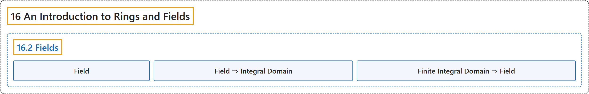

# 16.2 Fields

## Classification

## Glossary

| Term | Definition | 中文翻译 | Source |
|---|---|---|---|
| **16.2 Fields** 域 | (No definition) | （无定义） | [Doerr & Levasseur, n.d., section 16.2](https://discretemath.org/ads/s-fields.html) |
| **Field** 域 | "**A field** is a **commutative ring with unity** such that each nonzero element has a **multiplicative inverse**." | **域**是**含幺交换环**，且其每个非零元素都有**乘法逆元**。 | [Doerr & Levasseur, n.d., Definition 16.2.1](https://discretemath.org/ads/s-fields.html#def-field) |
| **Field ⇒ Integral Domain** 域必为整环 | "Every field **is an integral domain**." | 每个域**都是整环**。 | [Doerr & Levasseur, n.d., Theorem 16.2.4](https://discretemath.org/ads/s-fields.html#theorem-field-implies-integral-domain) |
| **Finite Integral Domain ⇒ Field** 有限整环必为域 | "Every finite integral domain **is a field**." | 每个有限整环**都是域**。 | [Doerr & Levasseur, n.d., Theorem 16.2.5](https://discretemath.org/ads/s-fields.html#theorem-finite-id-is-field) |

## References

Doerr, A., & Levasseur, K. (n.d.). *Applied discrete structures*. Retrieved October 28, 2026, from <https://discretemath.org/ads/index-ads.html>
