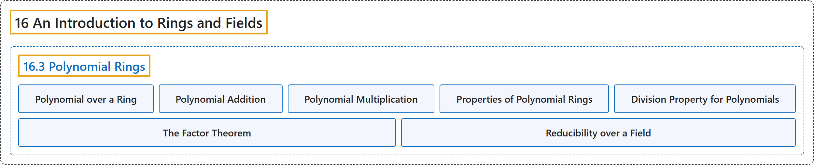

# 16.3 Polynomial Rings

## Classification

## Glossary

| Term | Definition | 中文翻译 | Source |
|---|---|---|---|
| **16.3 Polynomial Rings** 多项式环 | (No definition) | （无定义） | [Doerr & Levasseur, n.d., section 16.3](https://discretemath.org/ads/s-polynomial-rings.html) |
| **Polynomial over a Ring** 环上的多项式 | "Let $[R; +, \cdot ]$ be a ring. **A polynomial**, $f(x)\text{,}$ over $R$ is an expression of the form" | 设 $[R; +, \cdot ]$ 为环。$R$ 上的**多项式** $f(x)$， 是形如下式的表达式 | [Doerr & Levasseur, n.d., Definition 16.3.1](https://discretemath.org/ads/s-polynomial-rings.html#def-polynomial-over-r) |
| **Polynomial Addition** 多项式加法 | "Let $f(x) =a_0 + a_1 x+a_2 x^2+ \cdots +a_m x^m$ and $g(x) =b_0 + b_1 x+b_2 x^2+ \cdots +b_n x^n$ be elements in $R[x]$ so that $a_i \in R$ and $b_i\in R$ for all i. Let $k$ be **the maximum of $m$ and $n\text{.}$** Then $f(x) + g(x) =c_0 + c_1 x+c_2 x^2+ \cdots +c_k x^k\text{,}$ where $c_i=a_i+b_i$ for $i = 0, 1, 2, \ldots, k\text{.}$" | 设 $f(x) =a_0 + a_1 x+a_2 x^2+ \cdots +a_m x^m$ 与 $g(x) =b_0 + b_1 x+b_2 x^2+ \cdots +b_n x^n$ 为 $R[x]$ 的元素，即对所有 i 有 $a_i \in R$ 且 $b_i\in R$。设 $k$ 为 **$m$ 与 $n$。 的最大值**。则 $f(x) + g(x) =c_0 + c_1 x+c_2 x^2+ \cdots +c_k x^k$， 其中对 $i = 0, 1, 2, \ldots, k$。 有 $c_i=a_i+b_i$。 | [Doerr & Levasseur, n.d., Definition 16.3.3](https://discretemath.org/ads/s-polynomial-rings.html#def-polynomial-addition) |
| **Polynomial Multiplication** 多项式乘法 | "Let $f(x) =a_0 + a_1 x+a_2 x^2+ \cdots +a_m x^m$ and $g(x) =b_0 + b_1 x+b_2 x^2+ \cdots +b_n x^n\text{.}$ Then" | 设 $f(x) =a_0 + a_1 x+a_2 x^2+ \cdots +a_m x^m$ 与 $g(x) =b_0 + b_1 x+b_2 x^2+ \cdots +b_n x^n$。 则 | [Doerr & Levasseur, n.d., Definition 16.3.4](https://discretemath.org/ads/s-polynomial-rings.html#def-polynomial-multiplication) |
| **Properties of Polynomial Rings** 多项式环的性质 | "Let $[R; +, \cdot]$ be a ring. Then: $R[x]$ is a ring under the operations of polynomial addition and multiplication. If $R$ is a commutative ring, then $R[x]$ is a commutative ring. If $R$ is a ring with unity, $\textup{ 1}$, then $R[x]$ is a ring with unity (the unity in $R[x]$ is $1 + 0x + 0 x^2 + \cdots$). If $R$ is an integral domain, then $R[x]$ is an integral domain. If $F$ is a field, then $F[x]$ is not a field. However, $F[x]$ is an integral domain." | 设 $[R; +, \cdot]$ 是环。则：在多项式加法和乘法运算下，$R[x]$ 是环。若 $R$ 是交换环，则 $R[x]$ 是交换环。若 $R$ 是有单位元 $\textup{ 1}$ 的环，则 $R[x]$ 是有单位元的环（$R[x]$ 中的单位元是 $1 + 0x + 0 x^2 + \cdots$）。若 $R$ 是整环，则 $R[x]$ 是整环。若 $F$ 是域，则 $F[x]$ 不是域。但 $F[x]$ 是整环。 | [Doerr & Levasseur, n.d., Theorem 16.3.8](https://discretemath.org/ads/s-polynomial-rings.html#theorem-polynomial-ring-properties) |
| **Division Property for Polynomials** 多项式的带余除法性质 | "Let $[F; +, \cdot ]$ be **a field** and let $f(x)$ and $g(x)$ be two elements of $F[x]$ with $g(x) \neq 0\text{.}$ Then there exist **unique polynomials** $q(x)$ and $r(x)$ in $F[x]$ such that $f(x) = g(x) q(x) + r(x)\text{,}$ where $\deg r(x) < \deg g(x)\text{.}$" | 设 $[F; +, \cdot ]$ 为**域**，$f(x)$ 与 $g(x)$ 为 $F[x]$ 的两个元素且 $g(x) \neq 0$。 则存在 $F[x]$ 中**唯一的多项式** $q(x)$ 与 $r(x)$，使得 $f(x) = g(x) q(x) + r(x)$， 其中 $\deg r(x) < \deg g(x)$。 | [Doerr & Levasseur, n.d., Theorem 16.3.13](https://discretemath.org/ads/s-polynomial-rings.html#theorem-poly-divison-property) |
| **The Factor Theorem** 因式定理 | "Let $[F; +, \cdot ]$ be a field. An element $a \in F$ is **a zero of** $f(x) \in F[x]$ if and only if $x - a$ is **a factor of** $f(x)$ in $F[x]\text{.}$" | 设 $[F; +, \cdot ]$ 为域。元素 $a \in F$ 是 $f(x) \in F[x]$ 的**零点**，当且仅当 $x - a$ 是 $F[x]$。 中 $f(x)$ 的**因子**。 | [Doerr & Levasseur, n.d., Theorem 16.3.14](https://discretemath.org/ads/s-polynomial-rings.html#theorem-polynomial-factor) |
| **Reducibility over a Field** 域上的可约性 | "Let $[F; +, \cdot]$ be a field and let $f(x) \in F[x]$ be a nonconstant polynomial. $f(x)$ is **reducible over $F$** if and only if it can be factored as **a product of two nonconstant polynomials** in $F[x]\text{.}$ A polynomial is **irreducible over $F$** if it is not reducible over $F\text{.}$" | 设 $[F; +, \cdot]$ 为域，$f(x) \in F[x]$ 为非常数多项式。$f(x)$ 在 $F$ 上**可约**，当且仅当它可分解为 $F[x]$。 中**两个非常数多项式之积**。若多项式在 $F$ 上不是可约的，则它在 $F$ 上**不可约**。 | [Doerr & Levasseur, n.d., Definition 16.3.17](https://discretemath.org/ads/s-polynomial-rings.html#def-reducible-over-field) |

## References

Doerr, A., & Levasseur, K. (n.d.). *Applied discrete structures*. Retrieved October 28, 2026, from <https://discretemath.org/ads/index-ads.html>
