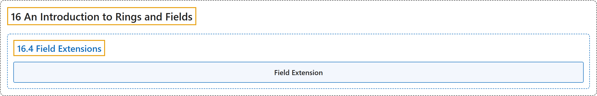

# 16.4 Field Extensions

## Classification

## Glossary

| Term | Definition | 中文翻译 | Source |
|---|---|---|---|
| **16.4 Field Extensions** 域扩张 | (No definition) | （无定义） | [Doerr & Levasseur, n.d., section 16.4](https://discretemath.org/ads/s-field-extensions.html) |
| **Field Extension** 域扩张 | (context) "Hence, to solve a polynomial really involves two steps: first, find the zeros, and second, find the **field in which the zeros lie**." | （语境）因此，求解一个多项式实际上包含两步：先求出零点，再找出这些零点所在的**域**。 | [Doerr & Levasseur, n.d., section 16.4](https://discretemath.org/ads/s-field-extensions.html#s-field-extensions-2) |

## References

Doerr, A., & Levasseur, K. (n.d.). *Applied discrete structures*. Retrieved October 28, 2026, from <https://discretemath.org/ads/index-ads.html>
