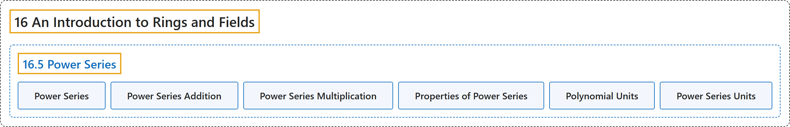

# 16.5 Power Series

## Classification

## Glossary

| Term | Definition | 中文翻译 | Source |
|---|---|---|---|
| **16.5 Power Series** 幂级数 | (No definition) | （无定义） | [Doerr & Levasseur, n.d., section 16.5](https://discretemath.org/ads/s-power-series.html) |
| **Power Series** 幂级数 | "Let $[R; +,\cdot ]$ be a ring. **A power series** over $R$ is an expression of the form" | 设 $[R; +,\cdot ]$ 为环。$R$ 上的**幂级数**是形如下式的表达式 | [Doerr & Levasseur, n.d., Definition 16.5.1](https://discretemath.org/ads/s-power-series.html#def-power-series) |
| **Power Series Addition** 幂级数加法 | "Given **power series**" | 给定**幂级数** | [Doerr & Levasseur, n.d., Definition 16.5.2](https://discretemath.org/ads/s-power-series.html#def-power-series-addition) |
| **Power Series Multiplication** 幂级数乘法 | "Given **power series**" | 给定**幂级数** | [Doerr & Levasseur, n.d., Definition 16.5.3](https://discretemath.org/ads/s-power-series.html#def-power-series-multiplication) |
| **Properties of Power Series** 幂级数的性质 | "Let $[R; +, \cdot ]$ be a ring. Then: $R[[x]]$ is a ring under the operations of power series addition and multiplication, which depend on the operations in R. If R is a commutative ring, then $R[[x]]$ is a commutative ring. If R is a ring with unity, $1$, then $R[[x]]$ is a ring with unity (the unity in R[x] is $1 + 0x + 0 x^2 + \cdots$). If R is an integral domain, then $R[[x]]$ is an integral domain. If F is a field, then $F[[x]]$ is not a field. However, $F[[x]]$ is an integral domain." | 设 $[R; +, \cdot ]$ 是环。则：在幂级数加法和乘法运算（依赖于 R 中的运算）下，$R[[x]]$ 是环。若 R 是交换环，则 $R[[x]]$ 是交换环。若 R 是有单位元 $1$ 的环，则 $R[[x]]$ 是有单位元的环（R[x] 中的单位元是 $1 + 0x + 0 x^2 + \cdots$）。若 R 是整环，则 $R[[x]]$ 是整环。若 F 是域，则 $F[[x]]$ 不是域。但 $F[[x]]$ 是整环。 | [Doerr & Levasseur, n.d., Theorem 16.5.5](https://discretemath.org/ads/s-power-series.html#theorem-power-series-properties) |
| **Polynomial Units** 多项式单位 | "Let $[F; +, \cdot ]$ be a field. Polynomial $f(x)$ is a unit in $F[x]$ if and only if **it is a nonzero constant polynomial**." | 设 $[F; +, \cdot ]$ 是域。多项式 $f(x)$ 是 $F[x]$ 中的单位（可逆元），当且仅当**它是非零常数多项式**。 | [Doerr & Levasseur, n.d., Theorem 16.5.6](https://discretemath.org/ads/s-power-series.html#theorem-polynomial-units) |
| **Power Series Units** 幂级数单位 | "Let $[F; +, \cdot ]$ be a field. Then $f(x)=\sum_{i=0}^{\infty } a_i x^i$ is a unit of $F[[x]]$ **if and only if $a_0\neq 0$**." | 设 $[F; +, \cdot ]$ 是域。则 $f(x)=\sum_{i=0}^{\infty } a_i x^i$ 是 $F[[x]]$ 的单位（可逆元），**当且仅当 $a_0\neq 0$**。 | [Doerr & Levasseur, n.d., Theorem 16.5.7](https://discretemath.org/ads/s-power-series.html#theorem-power-series-units) |

## References

Doerr, A., & Levasseur, K. (n.d.). *Applied discrete structures*. Retrieved October 28, 2026, from <https://discretemath.org/ads/index-ads.html>
