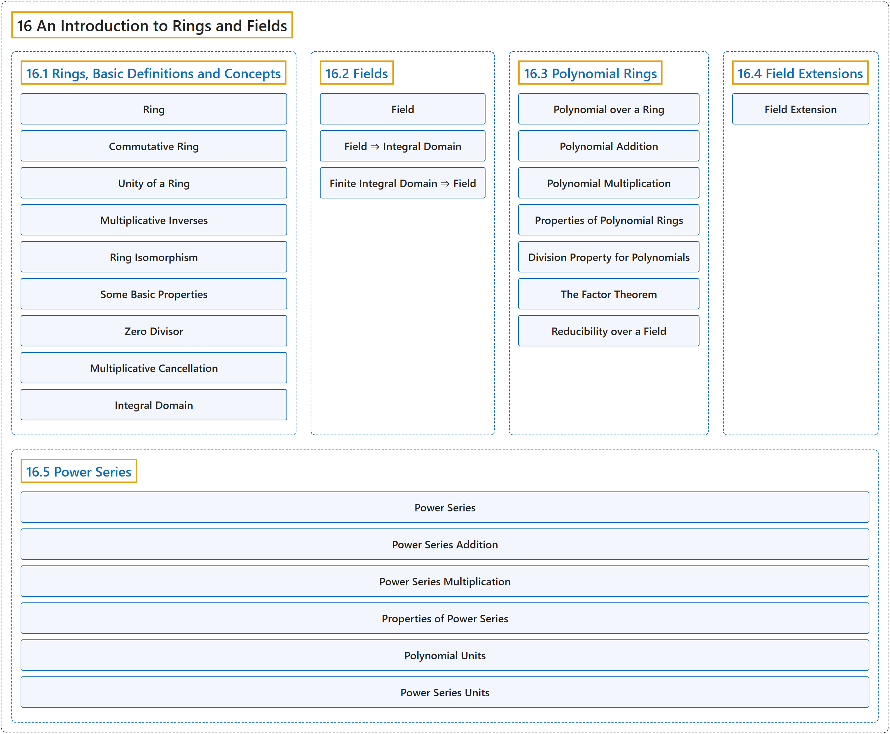

# 16 An Introduction to Rings and Fields

## Classification

## Glossary

| Term | Definition | 中文翻译 | Source |
|---|---|---|---|
| **16 An Introduction to Rings and Fields** 环与域介绍 | (No definition) | （无定义） | [Doerr & Levasseur, n.d., chapter 16](https://discretemath.org/ads/chapter_16.html) |
| **[16.1 Rings, Basic Definitions and Concepts](16-1-rings-basic-definitions-and-concepts.md)** 环：基本定义与概念 | (No definition) | （无定义） | [Doerr & Levasseur, n.d., section 16.1](https://discretemath.org/ads/s-rings-basic.html) |
| **[16.2 Fields](16-2-fields.md)** 域 | (No definition) | （无定义） | [Doerr & Levasseur, n.d., section 16.2](https://discretemath.org/ads/s-fields.html) |
| **[16.3 Polynomial Rings](16-3-polynomial-rings.md)** 多项式环 | (No definition) | （无定义） | [Doerr & Levasseur, n.d., section 16.3](https://discretemath.org/ads/s-polynomial-rings.html) |
| **[16.4 Field Extensions](16-4-field-extensions.md)** 域扩张 | (No definition) | （无定义） | [Doerr & Levasseur, n.d., section 16.4](https://discretemath.org/ads/s-field-extensions.html) |
| **[16.5 Power Series](16-5-power-series.md)** 幂级数 | (No definition) | （无定义） | [Doerr & Levasseur, n.d., section 16.5](https://discretemath.org/ads/s-power-series.html) |

## References

Doerr, A., & Levasseur, K. (n.d.). *Applied discrete structures*. Retrieved October 28, 2026, from <https://discretemath.org/ads/index-ads.html>
