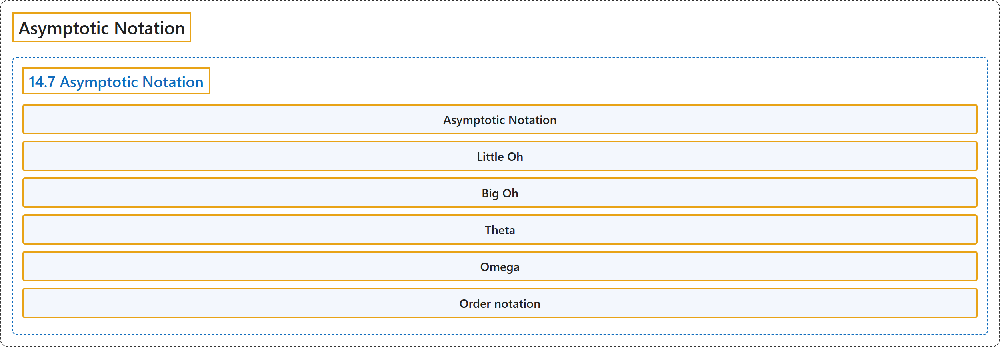

# 17 Asymptotic Notation

## Classification

## Glossary

| Term | Definition | 中文翻译 | Source |
|---|---|---|---|
| **17 Asymptotic Notation** 渐近记号 | "Asymptotic notation is a **shorthand** used to give a **quick measure of the behavior of a function** $f(n)$ as $n$ grows large." | 渐近记号是一种**简写**，用来在 $n$ 变大时**快速衡量函数** $f(n)$ 的行为。 | [Lehman et al., 2018, section 14.7, para. 1](https://courses.csail.mit.edu/6.042/spring18/mcs.pdf) |
| **Asymptotic Notation** 渐近记号 | "Asymptotic notation is a **shorthand** used to give a **quick measure of the behavior of a function** $f(n)$ as $n$ grows large." | 渐近记号是一种**简写**，用来在 $n$ 变大时**快速衡量函数** $f(n)$ 的行为。 | [Lehman et al., 2018, section 14.7, para. 1](https://courses.csail.mit.edu/6.042/spring18/mcs.pdf) |
| **Little Oh** 小 o 记号 | "For functions $f, g : \mathbb{R} \to \mathbb{R}$, with $g$ nonnegative, we say $f$ is **asymptotically smaller than** $g$, in symbols, $f(x) = o(g(x))$, iff $\lim_{x \to \infty} f(x)/g(x) = 0$." | 对于函数 $f, g : \mathbb{R} \to \mathbb{R}$，其中 $g$ 非负，若 $\lim_{x \to \infty} f(x)/g(x) = 0$，则称 $f$ **渐近小于** $g$，记作 $f(x) = o(g(x))$。 | [Lehman et al., 2018, Definition 14.7.1](https://courses.csail.mit.edu/6.042/spring18/mcs.pdf) |
| **Big Oh** 大 O 记号 | "Given functions $f, g : \mathbb{R} \to \mathbb{R}$ with $g$ nonnegative, we say $f = O(g)$ iff **there exists a constant** $c \ge 0$ and an $x_0$ such that **for all** $x \ge x_0$, $\lvert f(x)\rvert \le c\,g(x)$." | 给定函数 $f, g : \mathbb{R} \to \mathbb{R}$，其中 $g$ 非负，若**存在常数** $c \ge 0$ 和 $x_0$，使得**对所有** $x \ge x_0$，有 $\lvert f(x)\rvert \le c\,g(x)$，则称 $f = O(g)$。 | [Lehman et al., 2018, Definition 14.7.9](https://courses.csail.mit.edu/6.042/spring18/mcs.pdf) |
| **Theta** Θ 记号 | "$f = \Theta(g)$ iff $f = O(g)$ **and** $g = O(f)$." | $f = \Theta(g)$ 当且仅当 $f = O(g)$ **且** $g = O(f)$。 | [Lehman et al., 2018, Definition 14.7.13](https://courses.csail.mit.edu/6.042/spring18/mcs.pdf) |
| **Omega** Ω 记号 | "Given functions $f, g : \mathbb{R} \to \mathbb{R}$ with $f$ nonnegative, define $f = \Omega(g)$ to **mean** $g = O(f)$." | 给定函数 $f, g : \mathbb{R} \to \mathbb{R}$，其中 $f$ 非负，定义 $f = \Omega(g)$ **表示** $g = O(f)$。 | [Lehman et al., 2018, Definition 14.7.15](https://courses.csail.mit.edu/6.042/spring18/mcs.pdf) |
| **Order notation** 阶的记号 | (context) "... the symbols **O(x)** (sometimes called 'big-O') and o(x) (sometimes called 'little-o') are known as the **Landau symbols** ..." | （语境）……符号 **O(x)**（有时称为“大 O”）和 o(x)（有时称为“小 o”）称为**朗道符号**…… | [Weisstein, n.d., "Landau symbols" entry, para. 1](https://mathworld.wolfram.com/LandauSymbols.html#:~:text=are%20known%20as%20the%20Landau%20symbols) |

## References

Lehman, E., Leighton, F. T., & Meyer, A. R. (2018). *Mathematics for computer science*. Massachusetts Institute of Technology. <https://courses.csail.mit.edu/6.042/spring18/mcs.pdf>

Weisstein, E. W. (n.d.). *Landau symbols*. MathWorld: A Wolfram Resource. Retrieved October 27, 2026, from <https://mathworld.wolfram.com/LandauSymbols.html>
